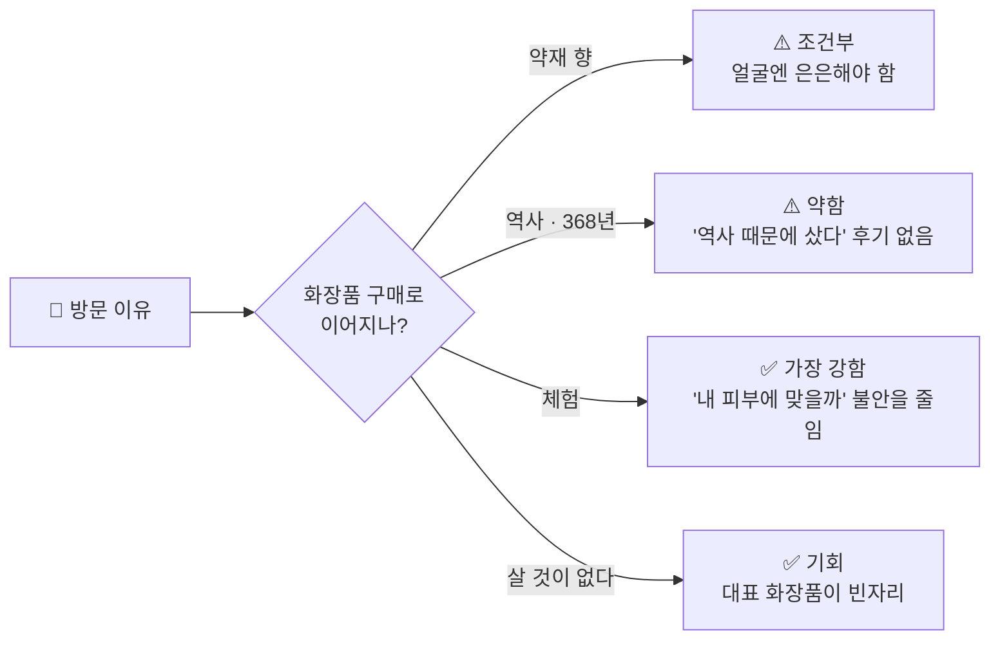
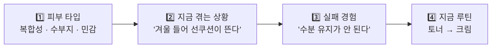

# 🌿 고객 인사이트 종합 · 대구 약전골목 × 한방 뷰티

> **2026-10-30 중간보고용 종합본** · 고객 인사이트 파트 (MEJ)
> 04 자료조사(리뷰·커뮤니티·여행 후기)와 유튜브 댓글 현장 반응을 한 문서로 합쳤다.
> 함께 볼 팀 자료: 01 산업·시장 · 02 역사·공간 · [03 사람·원료](03_사람원료_자료조사.md)

---

## 📌 한 장 요약

| | |
|---|---|
| **핵심 질문** | 고객은 왜 한방화장품을 고르거나 망설이고, 약전골목의 무엇이 선택 이유가 될까? |
| **가장 큰 쟁점** | 사람들이 약전골목에 **가고 싶은 이유**가 **얼굴에 바를 화장품을 살 이유**로 이어지는가? |
| **지금까지 답** | 역사만으로는 약하다. **향과 체험**이 가장 강한 연결고리다. 그런데 그 향마저 **옅어지고 있다**는 현장 반응이 나왔다. |
| **구매 결정 요인** | 후기에서 칭찬받는 이유는 '한방'이 아니라 **사용감·향의 세기·가격**이다. |
| **추천의 조건** | 고객은 피부 타입뿐 아니라 **지금 겪는 상황과 실패 경험**을 말하고, **나와 비슷한 사람의 경험**을 믿는다. |
| **다음 할 일** | 인스타그램·X 반응 수집 (로그인 필요), 현장에서 향과 판매 품목 확인 |

### 팀 조사 현황

| 파트 | 문서 | 핵심 결과 | 상태 |
|---|---|---|---|
| 🏭 산업·시장 | 01 | 광고 금지 표현, 경쟁 브랜드 4곳(설화수·수려한·한율·조선미녀), 로컬 IP 사례(대전 꿈돌이·제주 감귤), 대구·경북 인프라 | ✅ 1차 완료 |
| 🏛️ 역사·공간 | 02 | 1658년 개설, 368년 동안 끊기지 않은 유일한 약령시, 심약관·령바람 이야기, **약령시 대표 제품은 빈자리** | ✅ 1차 완료 |
| 🌱 사람·원료 | 03 | 사상체질 4종, 약재 8종(효능·산지·향), 인물 5명 조사 예정 | 🔄 진행 중 |
| 💬 고객 인사이트 | 05 (이 문서) | 구매 장벽, 골목의 실제 가치, 추천의 조건, Agent 선택질문, 유튜브 댓글 반응 | 🔄 SNS 수집 남음 |

### 조사 범위와 한계

| 채널 | 수집 결과 | 비고 |
|---|---|---|
| 리뷰 사이트 (언니의파우치, 글로우픽, 쇼핑몰 리뷰) | ✅ | 제품 후기, Q&A 원문 확인 |
| 커뮤니티 (더쿠, 글로우픽 Q&A) | ✅ 일부 | 검색 결과 위주 |
| 여행 후기 (트립어드바이저, Wanderlog, 여행 가이드) | ✅ 요약 | 트립어드바이저 원문은 접속이 막혀 검색 요약만 사용 |
| **유튜브 영상·댓글** | ✅ | KBS뉴스(댓글 211개), 대구TV(댓글 498개) 상위 댓글 확인 |
| 기사·칼럼 | ✅ | 소비자 인식의 배경 자료 |
| **인스타그램, X** | ❌ | 로그인이 필요해 미수집 → [6장](#6--다음-수집-계획) 양식으로 팀원이 직접 수집 |
| 구글 지도 리뷰, 레딧 | ❌ | 자동 수집이 막힘 |

> [!WARNING]
> 표본이 작다. 아래 인사이트는 "이런 말이 실제로 나온다"는 **가설**이고, "대부분이 이렇게 생각한다"는 결론이 아니다.

---

## 1. 한방화장품의 구매 장벽

### 1-1. 한방이라서 샀나, 다른 장점 때문에 샀나?

| 발견 | 근거 | 출처 |
|---|---|---|
| **한방이 정체성인 제품도 후기에서는 사용감으로 칭찬받는다.** 설화수 윤조에센스는 은은한 향과 편안함, 자음생크림은 끈적임 없음과 광채를 말한다. | 언니의파우치·글로우픽 리뷰 | [윤조에센스](https://unpa.me/reviews/372193) · [자음생크림](https://www.glowpick.com/casts/1313) |
| 한율 어린쑥 토너의 재구매 이유도 '향이 은은함', '활용도'였다. | 언니의파우치·글로우픽 리뷰 | [언파](https://unpa.me/community/toner/115796649) · [글로우픽](https://www.glowpick.com/products/72370) |
| 소비자는 '한방'이라는 말에 **순하다, 한국인에게 맞는다, 근본부터 좋아진다**는 기대를 건다. 하지만 한방 성분을 0.001%만 넣어도 '한방화장품'이라고 할 수 있어 신뢰가 흔들린다. | 매거진 칼럼 | [얼루어코리아](https://www.allurekorea.com/2016/03/24/%ED%95%9C%EB%B0%A9-%ED%99%94%EC%9E%A5%ED%92%88%EC%9D%98-%EC%A7%84%EC%8B%A4/) |
| (간접 근거) 화장품 전반에서 MZ세대의 구매 기준은 기능 30.2%, 가성비 29.4%이고 브랜드 이미지는 3.4%였다. '한방'을 따로 물은 조사는 아니다. 어피티 구독자 351명이라 표본도 작다. | 설문 기사 | [다음뉴스](https://v.daum.net/v/WLl609Dxj6) |

> [!NOTE]
> **인사이트** · '한방이라서 샀다'는 후기는 찾지 못했다. 실제 구매는 **사용감·피부 반응·가격**에서 결정된다.
> 한방이 **관심을 끄는지**는 아직 근거가 없다. 인스타그램·X 조사로 확인해야 한다.

### 1-2. 관심은 있지만 사지 않은 이유

| 장벽 | 실제로 나온 말 (요약) | 출처 |
|---|---|---|
| 👃 **향** | 한방 오일 후기: 보습은 좋지만 한방 냄새를 싫어하면 비추. 금방 날아간다고 해서 샀는데 꽤 셌다. | [방방곳곳](https://bangot.kr/article/review/4/2775/) |
| 👃 **향 (국가별 차이)** | 설화수 윤조에센스: 국내는 좋은 향으로 보지만, 중국 소비자는 '한약 냄새가 심하다'고 지적한 사례가 있다. | [뷰티경제](https://www.thebk.co.kr/news/articleView.html?idxno=202390) |
| 🧴 **무게감** | 자음생크림 클래식은 지성 피부에게 무겁고 유분이 많을 수 있다 → 소프트 버전을 권한다. | [블로그](https://kimsunsam.com/entry/%EC%84%A4%ED%99%94%EC%88%98-%EC%9E%90%EC%9D%8C%EC%83%9D%ED%81%AC%EB%A6%BC-%ED%81%B4%EB%9E%98%EC%8B%9D-%EB%82%B4%EB%8F%88%EB%82%B4%EC%82%B0-%ED%9B%84%EA%B8%B0-%ED%9A%A8%EA%B3%BC-%EA%B0%80%EA%B2%A9-%EB%B9%84%EA%B5%90-%EC%95%8C%EC%95%84%EB%B3%B4%EA%B8%B0) |
| 💸 **가격** | 자음생크림 50ml 27만 원. 만족해서 재구매한다는 사람도 '비싸다'는 말을 먼저 한다. | [글로우픽](https://www.glowpick.com/casts/1313) |
| 🕵️ **진품 불안** | 가품이 많으니 조심하라는 말, 방판에서 본품 하나에 나머지는 샘플이었다는 말. | [블로그](https://tipmad.com/%EC%84%A4%ED%99%94%EC%88%98-%EC%9E%90%EC%9D%8C%EC%83%9D%ED%81%AC%EB%A6%BC/) · [블로소득](https://dawnfac.blosodeuk.com/137/) |
| 👵 **이미지** | 한방 브랜드는 '엄마 화장품'이라는 올드한 이미지를 벗으려고 리브랜딩했다(설화수는 캘리그라피 로고를 산세리프로 바꿈). | [매일일보](http://www.m-i.kr/news/articleView.html?idxno=1232268) · [아시아타임즈](https://www.asiatime.co.kr/article/20230314500301) |
| 🌿 **'천연 = 순함' 오해** | 천연 성분 중에도 민감 피부에 트러블을 일으키는 것이 많다. 복합 식물 추출물·에센셜 오일은 접촉 알레르기 원인이 될 수 있다. | [허프포스트](https://www.huffingtonpost.kr/article/39490) · [하니서울](https://www.haniseoul.com/ko/travels/korea/kbeauty-guide-sensitive-skin-warnings) |
| 🇨🇳 **원산지 불신** 🆕 | 한약재 전반에 대해 "중국산 가짜 약재를 조심해야 한다", "성분·함량 설명이 없다"는 반응. | [KBS뉴스 댓글](https://www.youtube.com/watch?v=bfrRqZDBN9U) |

### 1-3. 쓰다가 그만두거나 다시 산 이유

| 구분 | 이유 | 출처 |
|---|---|---|
| 🔁 재구매 | 향이 강하지 않고 깔끔함, 활용도가 높음 (한율 어린쑥 토너) | [언파](https://unpa.me/reviews/423519) |
| 🔁 재구매 | 한방 향이 은은하고 마음을 편하게 해 줌 (윤조에센스) | [언파](https://unpa.me/reviews/372193) |
| 🔁 선물 | 한약방 냄새를 아버지는 오히려 건강한 느낌이라며 좋아함 | [멜릭서 후기](https://kr.melixirskincare.com/article/%EC%83%81%ED%92%88-%EC%82%AC%EC%9A%A9%ED%9B%84%EA%B8%B0/4/13089/page/8/) |
| ⛔ 중단·불만 | 건조함, 따가움, 붉어짐, 비싼 가격 (글로우픽 부정 리뷰 요약) | [글로우픽](https://www.glowpick.com/products/72370) |
| ⛔ 중단 위험 | 리뉴얼 뒤 용기와 향이 달라졌다 (5통 넘게 쓴 사용자) | [더쿠](https://theqoo.net/beauty/1414610668) |

> [!IMPORTANT]
> **인사이트** · 향은 **같은 이유로 재구매도 하고 포기도 한다.** '은은하다'는 확신을 주면 장점, '셀 수 있다'는 불안을 남기면 장벽이다.
> → **향의 세기를 미리 고르게 하는 장치**(시향, 강도 표시, Agent 질문)가 필요하다.

---

## 2. 약전골목에서 고객이 실제로 느끼는 가치

### 2-1. 사람들이 기억하는 요소

| 요소 | 언급 | 실제로 나온 말 (요약) | 출처 |
|---|---|---|---|
| 👃 **약재 향** | ★★★ | 거리 공기에 약 냄새가 밴다, 인삼 향이 좋다, 흙내 나지만 불쾌하지 않다. 도착하자마자 향긋한 한약 냄새에 힐링. | [트립어드바이저](https://www.tripadvisor.com/Attraction_Review-g297886-d3161599-Reviews-Daegu_Oriental_Medicine_Market-Daegu.html) · [Wanderlog](https://wanderlog.com/place/details/2457016/daegu-herbal-medicine-wholesale-market) · [대구TV 댓글](https://www.youtube.com/watch?v=Er52uxMUbXo) |
| 🏮 **골목 분위기·역사** | ★★ | 역사적인 분위기, 걷기 좋다. 근대골목 투어(계산성당, 이상화 고택)와 묶어서 간다. | [트립어드바이저(국문)](https://www.tripadvisor.co.kr/ShowUserReviews-g297886-d3161599-r540078454-Daegu_Oriental_Medicine_Market-Daegu.html) · [이번여행](https://www.ibtravel.co.kr/place/24366/) |
| 🦶 **체험** | ★★ | 족욕(5,000원, 현금), 향주머니·비누 만들기, 약재 직접 맡아 보기. 체질 분석기 결과가 예상과 반대로 나와 재밌었다. | [대구시 예약](https://yeyak.daegu.go.kr/index.do?menu_id=00007887) · [트립닷컴](https://kr.trip.com/moments/theme/poi-daegu-yangnyeongsi-museum-of-oriental-medicine-29947108-guides-993135/) · [대구TV 댓글](https://www.youtube.com/watch?v=Er52uxMUbXo) |
| 🙇 **상인과의 만남** 🆕 | ★ | 한약방 선생님께 모자를 벗고 인사하는 장면이 인상 깊었다. | [대구TV 댓글](https://www.youtube.com/watch?v=Er52uxMUbXo) |
| 🏛️ **박물관** | ★ | 잠깐 들르기 좋다. 4개 국어 애니메이션. (입장료 무료/1,000원 정보가 엇갈림) | [트립인포](https://m.tripinfo.co.kr/info.html?content_id=2470057&content_type_id=12) · [South Korea Guide](https://www.thesouthkoreaguide.com/city/daegu/things-to-do/) |
| 🛍️ **살 것** | ☆ | 한약재·건강식품 위주라 일반 쇼핑을 기대하면 실망하기 쉽다. 기념품은 동성로 관광안내소의 약령시 한방 방향제(8,000~10,000원) 정도. | [이번여행](https://www.ibtravel.co.kr/place/24366/) · [대구관광](https://tour.daegu.go.kr/index.do?menu_id=00004130) |

트립어드바이저 평점은 **3.9점(리뷰 53건)**이다. 향과 분위기는 좋다고 하지만 '꼭 가야 할 곳'이라는 평은 약하다.

### 2-2. 🔥 쟁점: '가고 싶은 이유'는 '얼굴에 바를 이유'가 되는가

| 방문 이유 | 화장품 구매로 이어지나? | 판단 |
|---|---|---|
| **약재 향이 좋다** | 거리 향은 좋지만, 얼굴에 바르는 향은 은은해야 한다는 요구와 부딪친다. | 🟠 조건부 |
| **역사 · 368년** | 신뢰의 배경은 되지만, '역사 때문에 샀다'는 화장품 후기는 없다. | 🟠 약함 |
| **체험** | 직접 맡고 만들어 본 경험이 '내 피부에 맞을까'라는 불안을 줄인다. | 🟢 가장 강함 |
| **살 것이 없다** | 약령시를 대표하는 화장품이 아직 없다(02 문서). | 🟢 기회 |

> [!IMPORTANT]
> **인사이트** · 골목의 가치는 역사보다 **오감과 체험**에서 나온다.
> → "골목에서 맡은 그 향을, **내 피부에 맞는 세기로** 가져간다."

### 2-3. 🆕 유튜브 현장 반응

#### KBS뉴스 「130억 들였는데 '텅텅'…대구 약령시 현재 상황」

📺 [영상 링크](https://www.youtube.com/watch?v=bfrRqZDBN9U) · 조회수 3.8만 · **댓글 211개** · 2024.01

| 반응 유형 | 대표 댓글 (요약) | 👍 |
|---|---|---|
| 🧓 **세대 단절** | 젊은 사람들은 한방에 관심이 없다, 세대가 바뀌는 자연스러운 현상 | **94** |
| 🧓 세대 단절 | 젊은 사람이 약령골목을 찾지 않으면 사라진다 | 41 |
| 💸 **가격** | 한약이 너무 비싸다, 보약 한 재에 60만~120만 원 | 23 |
| 🇨🇳 **원산지 불신** | 요즘 중국산 가짜 약재를 조심해야 한다 | 22 |
| 🇨🇳 원산지 불신 | 레토르트 파우치로 비싸게 팔면서 성분·함량 설명이 없다 | 3 |
| 👃 **향이 사라짐** | 90년대엔 골목에 약 냄새가 진동했는데, 요즘엔 거의 나지 않는다 | 1 |
| 👃 향이 사라짐 | 예전엔 한약 냄새라도 나서 다녔는데, 이젠 그냥 시내 가는 길 | 1 |
| 📍 **장소 성격** | 데이트 장소로도, 가족끼리 가기에도 애매하다 | 2 |
| ☕ **반론** | 몇 년 전보다 핫플 식당·카페·술집이 많이 생겨서 유동인구는 늘었다 | 2 |

#### 대구TV 「대구 약령시 투어 | 대구싸람 제이슨 EP.03」

📺 [영상 링크](https://www.youtube.com/watch?v=Er52uxMUbXo) · 조회수 4.2만 · 댓글 498개 · 대구시 공식 채널

> [!WARNING]
> 댓글 이벤트를 했던 영상이라 칭찬 댓글이 많다. **분위기보다 '어떤 장면을 기억하는지'만** 참고한다.

| 기억하는 장면 | 댓글 요약 | 우리에게 주는 힌트 |
|---|---|---|
| 🧪 **체질 분석기** | 결과가 예상과 정반대로 나와서 당황하는 장면이 재밌었다 | 체질 테스트는 **재미 콘텐츠**로 통한다 |
| 👃 **도착하자마자 맡은 향** | 향긋한 한약 냄새에 힐링 | 향 = 골목의 첫인상 |
| 🙇 **한약방 선생님께 인사** | 모자를 벗고 인사하는 장면이 인상 깊었다 | **상인과의 만남**이 기억에 남는다 |
| 🎁 **부모님께 한약 선물** | 부모님께 한약을 사 드리는 장면 | **선물 수요** |
| 🌑 **이미지 반전** | 약 냄새 나고 어두운 곳인 줄 알았는데 활기차고 재밌다 | 선입견을 깨는 콘텐츠가 효과 있다 |
| 🚶 **스쳐 지나가던 곳** | 평소엔 그냥 지나가기만 했지 제대로 둘러볼 생각은 못 했다 | 대구 사람에게도 **목적지가 아니다** |

#### 그 밖에 눈에 띈 점

| 관찰 | 근거 |
|---|---|
| 조회수 124만의 대구 여행 브이로그도 떡볶이 골목, 미도다방, 곱창 골목은 다루지만 **약전골목은 제목에 없다.** | [유튜브 검색 결과](https://www.youtube.com/results?search_query=%EC%95%BD%EC%A0%84%EA%B3%A8%EB%AA%A9+%EB%B8%8C%EC%9D%B4%EB%A1%9C%EA%B7%B8) |
| '약령시' 영상은 대부분 지자체·방송국 채널이 올렸다. 개인이 올린 영상은 칼국수 맛집 브이로그 정도다. | [유튜브 검색 결과](https://www.youtube.com/results?search_query=%EB%8C%80%EA%B5%AC+%EC%95%BD%EB%A0%B9%EC%8B%9C) |
| KBS대구의 축제 브이로그(2026년 5월)는 조회수 224회, **댓글 0개**다. | [영상](https://www.youtube.com/watch?v=FU5ibrw_zYs) |

#### 비교: 서울 약령시는 '케데헌' 효과를 보고 있다

- 애니메이션 『케이팝 데몬 헌터스』에 한약방 장면이 나온 뒤, **서울약령시(경동시장) 서울한방진흥센터**가 주목받았다. ([서울신문](https://m.go.seoul.co.kr/news/2025/10/20/20251020033001))
- 외국인 사이에서 한의원 체험이 '서울 필수코스'로 떠올랐다는 보도도 있다. ([한국경제 사설](https://www.hankyung.com/article/2025090436081))
- 대구 약령시는 **'가장 오래된 약령시'라는 이야기는 있지만, 이런 화제의 연결고리가 없다.** 대구TV 댓글에도 "케데헌 한약방 투어처럼 붐비면 좋겠다"는 바람이 있었다.

> [!IMPORTANT]
> **유튜브에서 나온 새 인사이트 3가지**
> 1. **향은 우리의 핵심 자산인데, 그 향이 옅어지고 있다.** 골목만 믿을 게 아니라, 향을 **제품과 체험으로 다시 만들어야** 한다.
> 2. **'중국산·가짜·성분 표시 없음' 불신은 화장품에도 그대로 옮겨 온다.** 원료 이력(어느 점포, 어느 산지)을 보여 주는 것이 차별점이 된다.
> 3. **젊은 층에게 약전골목은 목적지가 아니다.** 체질 테스트처럼 **재미있는 입구**와, 부모님 선물처럼 **사야 할 이유**가 필요하다.

---

## 3. 추천받을 때 필요한 정보와 불안

### 3-1. 추천 질문글에서 고객이 주는 정보

| 질문글 | 피부 타입 | 사용 상황 | 과거 실패 경험 | 지금 루틴 | 계절 |
|---|---|---|---|---|---|
| [글로우픽 Q&A 903](https://www.glowpick.com/qna/903) (23세) | 복합성(수부지), 트러블 잦음 | — | 수분크림이 수분 유지가 안 됨, 수분 위주 제품은 트러블이 날까 걱정 | 토너 → 크림 | 겨울 |
| [글로우픽 Q&A 2655](https://www.glowpick.com/qna/2655) (26세) | 복합성(T존 유분, U존 건조) | **선쿠션이 뜬다** | 가벼운 루틴이 겨울에 안 맞음 | 토너 + 에센스 | 겨울 |
| [언니의파우치](https://unpa.me/community/moisturizer/119536836) | 매우 민감 | — | 아무거나 바르면 따갑고 빨개짐 | — | — |

**→ 고객은 피부 타입만 말하지 않는다.** 지금 겪는 상황, 실패 경험, 지금 쓰는 루틴까지 말한다. **예산은 거의 말하지 않는다.**

### 3-2. 고객이 믿는 추천 이유

| 답변에서 쓰인 근거 | 예 | 설득력 |
|---|---|---|
| **나와 비슷한 사람의 경험** | "지성일 때부터 사계절 썼고, 수부지가 된 지금도 산다" | 🟢 높음. 답변자가 나이·피부 타입을 함께 밝힌다. |
| **제형·사용감** | "꾸덕하거나 기름지지 않다", "번들거리지 않고 수분만 채운다" | 🟢 높음 |
| **루틴·사용 순서** | 토너 → 앰플 → 크림, T존과 U존을 나눠 바르기, 한 번에 바꾸지 말고 하나씩 | 🟢 높음 (Q&A 2655 답변 8개 중 5개가 루틴 제안) |
| 원리 설명 | "수분 제형만 쓰면 증발해서 더 건조해진다. 유수분 균형이 중요하다" | 🟠 중간 |
| 성분 | 세라마이드·시카·마데카소사이드 | 🟠 중간 |
| 근거 없는 추천 | "많이들 쓴다" | 🔴 낮음 |

질문자가 원한 정보 중 **전성분과 가격은 답변에 거의 나오지 않았다.** 대신 '나와 비슷한 사람의 경험'과 '사용법'이 오갔다.

### 3-3. 추천을 받아도 결정하지 못하는 이유

| 이유 | 근거 | 출처 |
|---|---|---|
| 답변마다 추천 제품이 다 다르다 | Q&A 903 답변 8개 → 제품 8개 이상 | [글로우픽](https://www.glowpick.com/qna/903) |
| 내 피부에서 실패할까 봐 | "실패하긴 하지만 그나마 괜찮았다" 같은 말이 반복된다 | [언파](https://unpa.me/community/question/123410269) |
| 써 보기 전에는 모른다 | 샘플·패치 테스트(귀 뒤·팔 안쪽 24~48시간)를 먼저 권한다 | [한경](https://magazine.hankyung.com/job-joy/article/202103110888d) · [화해](https://blog.hwahae.co.kr/all/hwahae/talk/2106) |
| 성분을 읽을 줄 모른다 | 원하는 기능을 먼저 정하고 앞쪽 성분과 자극 성분을 보라는 가이드가 따로 있다 | [라미셰](https://lamichebeautylab.com/free/19) |

> [!IMPORTANT]
> **인사이트** · 고객에게 필요한 건 제품 목록이 아니라 **"왜 나한테 맞는지"를 내 상황 말로 설명해 주는 것**, 그리고 **작게 먼저 써 볼 수 있는 길**이다.

---

## 4. 지역 자산과 고객의 연결

| 고객의 망설임 | 연결할 약전골목 자산 | 활용 아이디어 |
|---|---|---|
| 👃 향이 셀까 봐 | 거리의 약재 향, 약재를 직접 맡아 보는 체험 | 현장 **시향 바** + Agent에서 향 세기 고르기 (무향 / 은은하게 / 약재 향 그대로) |
| 🤔 내 피부에 맞을까 | 한방의료체험타운의 체험 프로그램, 사상체질 테스트 | 재미로 하는 체질 테스트 → **사용감·향 취향 추천** (체질 '진단'·'개선' 표현 금지) |
| 🇨🇳 진짜 원료일까 | 368년 국가 공인 시장, 심약관의 약재 검수 이야기 | 원료를 산 **점포·산지 이력** 공개 (심약관은 '검수한다'는 이야기로만, 인증 암시 금지) |
| 👵 엄마 화장품 같다 | 힙전골목 1658, 근대골목 | 패키지·굿즈는 힙트래디션으로, 제형은 가볍게 |
| 💸 비싸다, 실패하면 아깝다 | 축제, 체험형 소품 만들기 | 소용량·샘플 키트, 직접 만드는 체험 |
| 🛍️ 살 게 없다 (방문객) | 약령시 대표 상품이 빈자리 | '골목에서 맡은 향'을 담은 핸드크림·향주머니 → 얼굴 제품으로 넘어가는 입구 |
| 🎁 부모님께 사 드리고 싶다 🆕 | 한약방에서 부모님 선물을 사는 문화 | 부모님용·나용을 함께 고르는 **선물 세트** |
| 🚶 일부러 갈 이유가 없다 🆕 | 체질 분석기, 한약방 상인 | 체질 테스트 + 상인 이야기를 묶은 **짧은 체험 코스** |

---

## 5. 🤖 Agent 선택질문

리뷰와 댓글에서 나온 실제 고민을 고객이 고를 수 있는 질문으로 바꿨다. 광고 규제(01 문서 1단계)에 걸리지 않게 질병명, 치료·개선 표현을 빼고 썼다.

| # | 고객이 실제로 한 말 | Agent 질문 | 선택지 | 근거 |
|---|---|---|---|---|
| 1 | 보습은 필요한데 아침 화장이 뜬다 | **아침 화장 전에 쓸 제품인가요?** | 아침 화장 전 · 밤에만 · 둘 다 | [Q&A 2655](https://www.glowpick.com/qna/2655) |
| 2 | 한방 냄새를 싫어한다, 생각보다 셌다 | **약재 향은 어느 정도가 좋으세요?** | 거의 없게 · 은은하게 · 약재 향 그대로 | [방방곳곳](https://bangot.kr/article/review/4/2775/) |
| 3 | 수분은 유지가 안 되고, 유분은 무겁다 | **바르고 난 느낌은 어떤 쪽이 좋으세요?** | 산뜻하게 · 촉촉하게 · 쫀쫀하게 | [Q&A 903](https://www.glowpick.com/qna/903) |
| 4 | T존은 번들, U존은 건조 | **얼굴에서 부위마다 느낌이 다른가요?** | 전체가 비슷 · T존만 번들 · 볼만 건조 | [Q&A 2655](https://www.glowpick.com/qna/2655) |
| 5 | 아무거나 바르면 따갑고 빨개진다 | **새 제품을 쓰고 따갑거나 붉어진 적이 있나요?** | 자주 · 가끔 · 거의 없음 | [언파](https://unpa.me/community/moisturizer/119536836) |
| 6 | 써 봤는데 실패한 제품이 있다 | **안 맞았던 제품은 어떤 점이 별로였나요?** | 무거움 · 건조함 · 향 · 따가움 · 직접 입력 | [Q&A 903](https://www.glowpick.com/qna/903) |
| 7 | 계절이 바뀌니 루틴이 안 맞는다 | **요즘 가장 신경 쓰이는 때는요?** | 환절기 · 겨울 건조 · 여름 번들 | [Q&A 2655](https://www.glowpick.com/qna/2655) |
| 8 | 루틴을 한 번에 바꾸면 피부가 힘들다 | **지금 루틴에 추가할까요, 바꿀까요?** | 하나만 추가 · 단계 바꾸기 | [Q&A 2655](https://www.glowpick.com/qna/2655) |
| 9 | 비싸면 실패가 무섭다 | **처음엔 어떻게 써 보고 싶으세요?** | 샘플 먼저 · 소용량 · 본품 | [한경](https://magazine.hankyung.com/job-joy/article/202103110888d) |
| 10 | 추천 이유를 모르겠다 | (답변 형식) **"나와 비슷한 사람" + 사용법으로 설명** | — | 3-2 표 |
| 11 | 약전골목에서 맡은 향이 좋았다 | **약전골목에서 기억에 남은 향이 있나요?** | 인삼 · 당귀 · 쑥 · 잘 모르겠어요 | [트립어드바이저](https://www.tripadvisor.com/Attraction_Review-g297886-d3161599-Reviews-Daegu_Oriental_Medicine_Market-Daegu.html) |
| 12 | 부모님께 한약을 사 드린다 | **누가 쓸 건가요?** | 나 · 부모님 · 친구 선물 | [대구TV 댓글](https://www.youtube.com/watch?v=Er52uxMUbXo) · [멜릭서 후기](https://kr.melixirskincare.com/article/%EC%83%81%ED%92%88-%EC%82%AC%EC%9A%A9%ED%9B%84%EA%B8%B0/4/13089/page/8/) |
| 13 🆕 | 중국산·가짜 약재가 걱정된다 | **원료에서 가장 궁금한 건 무엇인가요?** | 산지 · 사용한 점포 · 전성분 | [KBS뉴스 댓글](https://www.youtube.com/watch?v=bfrRqZDBN9U) |
| 14 🆕 | 체질 분석 결과가 재밌었다 | **재미로 보는 체질 테스트로 향을 골라 볼까요?** | 해 볼래요 · 바로 고를래요 | [대구TV 댓글](https://www.youtube.com/watch?v=Er52uxMUbXo) |

> [!CAUTION]
> **쓰면 안 되는 질문:** "아토피가 있나요?", "여드름을 치료하고 싶나요?", "체질을 진단해 드릴까요?"
> 질병명·치료·진단 표현은 의약품 오인 광고가 된다. 체질 테스트는 **사용감·향 추천**에만 쓴다.

---

## 6. 📋 다음 수집 계획

인스타그램과 X는 로그인을 해야 볼 수 있다. 팀원이 직접 보고 **아래 양식 그대로** 채우면 이 문서에 합칠 수 있다.

| 채널 | 검색어 | 볼 것 |
|---|---|---|
| 📸 인스타그램 | `#약전골목` `#대구약령시` `#약령시` `#한방화장품` `#한방스킨케어` | 사진에 무엇을 찍었나 (간판·약재·족욕·카페), 캡션의 감정 단어 |
| 🐦 X | `약전골목`, `약령시`, `한방 화장품 냄새`, `한약 냄새 화장품`, `설화수 엄마` | 짧은 불만·농담 (향·이미지·가격) |
| 🗺️ 구글 지도 | 대구약령시 · 한의약박물관 · 한방의료체험타운 | 별점이 낮은 리뷰의 이유, 상인 응대 |
| 🌐 레딧 | r/AsianBeauty `hanbang`, `ginseng smell`, `Beauty of Joseon` | 해외 고객이 '한방'을 이유로 샀는지 |

**수집 양식 (복사해서 쓰기)**

| 채널 | 링크 | 원문 요약 (한 줄) | 반응 유형 | 좋아요·조회 |
|---|---|---|---|---|
| 인스타 | | | 향 / 체험 / 가격 / 이미지 / 불신 / 선물 / 기타 | |
| X | | | | |

### ✅ 확인 필요 목록

- [ ] 지금 골목에서 약재 향이 실제로 얼마나 나는지 (현장 방문)
- [ ] 상인과 나눈 대화를 기억하는 후기 (유튜브에서 1건 찾음, 더 필요)
- [ ] 골목 안에서 파는 한방 화장품·비누가 있는지 (현장)
- [ ] 한방의료체험타운이 1년 넘게 방치됐다는 보도의 현재 상태 (KBS 2024.01)
- [ ] 박물관 입장료 무료 / 1,000원 (자료가 엇갈림)
- [ ] 족욕 요금·운영 시간 최신 정보
- [ ] 동성로 관광안내소 한방 방향제 판매 여부
- [ ] 2030의 한방화장품 인식 정량 조사

---

유튜브 댓글은 2026-10-29에 공개된 댓글 상위 40개(KBS뉴스)와 20개(대구TV)를 확인했다. 좋아요 수는 확인 시점 기준이다. 표본이 작으므로 결론이 아니라 가설로 본다.
