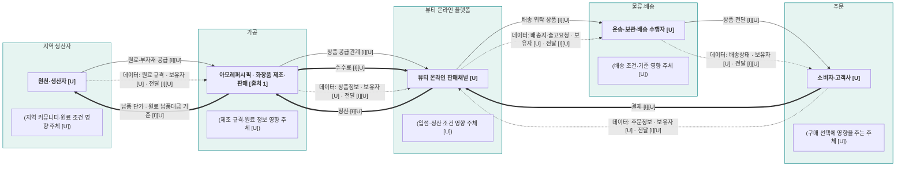

# 뷰티 산업 밸류체인 v0 — 5단계 초안

## 📌 한 줄 요약

[해석][I] 아모레퍼시픽이 속한 뷰티 산업의 공급·판매 구조를, 사용자가 지정한 ‘지역 생산자 → 가공 → 뷰티 온라인 플랫폼 → 주문 → 물류·배송’의 다섯 subgraph로 그렸다. 원페이지에서 제조·판매와 온라인 경로는 확인되지만, 지역 공급처·플랫폼 거래 방식·배송·정산·데이터 전달의 실제 연결은 미확인인 구조 가설이다. [원페이지][출처 1][팀 입력]

## 🔑 핵심 내용

- [사실] 이번 요청에서 지정한 `Lifestyle실습/company/아모레퍼시픽/onepager.md`의 1~8칸을 읽고 단계별 근거를 아래 표에 연결했다. [원페이지]
- [사실] 이번 단계명은 현재 사용자가 지정했다. 앞서 확정했던 인바운드·운영·제작·아웃바운드·마케팅·판매·서비스의 단계명과 다르므로, 기존 활동·이해관계자 파일의 단계명은 이 파일 작성만으로 변경하지 않았다. [팀 입력][기존 단계]
- [해석][I] 실제 지역 공급자, 특정 뷰티 온라인 플랫폼, 주문 처리·배송 담당, 거래별 정산·데이터 보유자는 원페이지에서 확인되지 않는다. 확인되지 않은 실명 대신 유형명과 `[U]`를 사용하고, 모든 미확인 연결에 `[I][U]`를 붙였다. 올리브영 선출시 발표만으로 해당 거래의 온라인 주문·결제·배송 구조를 확정하지 않는다. [원페이지] 2·4·7·8칸
- [해석][I] 수수료율·거래 금액은 표기하지 않는다. 회사 전체 매출·원가 수치는 거래별 결제·정산·납품 단가를 의미하지 않으므로 화살표에 전용하지 않았다. [원페이지] 2·5칸, [출처 9]

## 📚 상세 조사

### Mermaid — 요청한 다섯 단계

범례: **굵은 노드**는 수행자, `(괄호 노드)`는 영향 주체 후보다. `-->`는 상품 공급관계, `==>`는 돈 흐름, `-.->`는 데이터 흐름이다. `[I]`는 구조 가설, `[U]`는 실제 주체·거래·전달 여부 미확인이다. 영향 주체도 모두 미확인 후보이며, 괄호만으로 실제 관여가 확인됐다는 뜻은 아니다.

### 단계별 근거 — 원페이지의 어느 칸인가?

| 요청 단계 | 원페이지 근거 칸·내용 | 직접 확인 가능한 범위 | 도식의 해석·미확인 |
|---|---|---|---|
| 지역 생산자 | 3칸: 한율의 자연 원료·루틴, 7칸: 원료는 지역 제한 없이 검토한다는 우리 팀 방향 | 원료 이야기를 제품·콘텐츠와 연결하는 비교는 가능. 7칸은 기업 공급 사실이 아닌 팀 접점 해석. [출처 13][출처 16] | 특정 지역 생산자·실제 공급·원산지·계약은 [U]. 지역 생산자로부터 아모레퍼시픽으로 향하는 연결은 [I][U]. |
| 가공 | 1칸: 화장품·생활용품 제조·판매, 2칸 ‘무엇으로’: 자체 생산·연구개발·상품 매입 | 아모레퍼시픽의 화장품 제조·판매 활동을 확인. [출처 1] | ‘가공’을 화장품 제조에 대응시킨 배치는 [I]. 특정 지역 원료의 제조 투입·수탁 가공 계약은 [U]. |
| 뷰티 온라인 플랫폼 | 2칸 ‘어떻게 전달’: 온라인 등 복수 경로, 4칸: 올리브영 선출시·이커머스 확대 계획 | 화장품의 온라인 판매경로와 이커머스 확대 계획을 확인. [출처 1][출처 5] | 플랫폼 유형을 온라인 판매경로에 대응시킨 배치는 [I]. 특정 플랫폼 거래·입점 계약·중개 방식과 결제·정산·배송 주체는 [U]. |
| 주문 | 2칸 ‘누구에게’: 소비자에 대한 해석, ‘어떻게 돈’: 제품·상품 판매 중심 | 판매 수익원이 기재됨. 개별 소비자 주문·결제·중개 정산 구조는 확인 불가. [출처 1][출처 9][출처 13] | 고객사명·주문 시스템·결제 수취 주체·데이터 보유자·결제 방식은 [U]. |
| 물류·배송 | 2칸 ‘어떻게 전달’, 6칸: 해외법인·수출·플랫폼, 5칸 산업 이슈3: 운반비 | 판매·수출 경로와 운반비 항목의 존재를 확인. [출처 1][출처 2][출처 3][출처 9] | 해외 판매법인을 배송사로 보지 않음. 실제 배송 수행자·위탁·출고·데이터 전달은 [U]. |

### 화살표 해석과 검증 한계

- [해석][I] 상품 화살표는 검토할 공급관계를 나타낸다. 온라인 플랫폼이 물리적으로 상품을 보관한다거나 모든 주문이 같은 경로를 거친다고 확정하지 않는다. 직배송·플랫폼 재고 판매 등 실제 구조는 [U]. [원페이지] 2·6칸
- [해석][I] 결제→플랫폼, 플랫폼→제조사 정산, 제조사→플랫폼 수수료는 **중개 판매 가설**이다. 직접 판매·매입 판매·정산 공제 방식은 미확인이다. 실제로 정산에서 수수료를 공제한다면 별도 수수료 송금과 중복 계산하지 않아야 하며, 그림은 실제 송금 내역을 뜻하지 않는다. [원페이지] 2·5칸
- [해석][I] ‘납품 단가’ 라벨은 금액이 아니라 원료 납품대금의 결정 기준을 뜻한다. 돈의 방향은 구매자 후보인 제조사에서 공급자 후보인 생산자로 표시했으며 실제 구매·대금 지급 관계는 [U]. [원페이지] 2·7칸
- [해석][I] 데이터 이름은 흐름을 검토하기 위한 항목 제안이다. 데이터 보유자는 생성자·업무 수행자와 같다고 단정하지 않으며 전부 `[U]`로 표시했다. 피드백 연동·접근 권한도 미확인이다. [원페이지] 8칸
- [해석][I] 이 파일의 구조 가설은 실제 지연·데이터 단절·차감 중첩의 증거가 아니다. [signals.md](signals.md)의 S01은 한율 리뷰의 고객 체감 후보이며 제조 불량 미입증 상태를 유지한다. 이번 도식만으로 그 후보의 근거 수준을 높이지 않는다.

## 🤖 우리 에이전트에 어떻게 쓸까?

- [아이디어] 이 도식은 기업 산업 구조와 우리 팀이 조사해야 할 거래·데이터 항목을 구분하는 초안으로 사용한다. BM용 제품기획 에이전트가 실제 발주·배송·정산을 수행한다는 뜻으로 사용하지 않는다.
- [해석][I] 지역 문화와 원료 이야기를 활용한다는 기획만으로 독점적인 권리 확보·실제 지역 협업·IP 계약 완료를 뜻하지 않는다. 원페이지도 우리 팀의 지역 협업을 미확정으로 남긴다. [원페이지] 7·8칸

## ⚠️ 광고 표현 체크

- 효능·제품 광고 문구를 제안하지 않았다. 원료 이야기와 제품의 효능 입증을 구분한다.

## 📌 다른 팀원에게

- 이번 요청에 따라 세 번째 단계를 ‘뷰티 온라인 플랫폼’으로 수정했다. 단계 순서는 사용자 지정 순서이며, 상품이 반드시 온라인 플랫폼의 물리적 창고를 거친다는 뜻은 아니다.
- `[U]`를 원문·계약·실제 운영 기록으로 검증하고 화살표를 수정한 다음 `Lifestyle실습/valuechain/valuechain_v1.md`로 검증 후 버전을 만든다. 이번에는 v0를 수정하고 기존 [analysis.md](analysis.md)에 근거·수정 이력을 추가했다. 거래 검증 전이므로 v1은 만들지 않았다.

## ❓ 아직 모르는 것

- 특정 온라인 플랫폼의 실제 판매·입점·정산 방식과 제조사 직배송 여부.
- 실제 지역 공급자·가공 계약·플랫폼 거래 방식·납품 단가·수수료율·배송 수행자.
- 단계별 데이터 보유자·전달·피드백·접근권.
- 팀 IP의 최종 형태·브랜드명·이야기·캐릭터 사용 여부.

## 🔗 출처

### 📄 자료 출처

원페이지의 출처 번호를 그대로 유지했다. 아래 기업 자료 링크는 기존에 수집한 저장본이다. 원문 URL·자료 날짜는 [출처 목록](../company/아모레퍼시픽/sources.md)을 따른다. 원페이지는 2026-11-06 로컬 파일로 열람했고, 기존 기업 원문 확인일은 2026-11-05다. 이번 작업에서 기업 웹 원문을 재검증하지 않았다. 보고서 쪽수는 확인 필요이며, 기업 작성 공시는 보수적으로 🟡 B로 분류했다.

| 번호 | 등급·구분 | 자료·사용 위치 | 검증 한계 |
|---|---|---|---|
| [출처 1] | 🟡 B, 기업 공시 | 사업보고서 II. 사업의 내용 / 제조·판매·자원·채널 | 제품별 거래와 배송 구조까지 확인하지 않음 |
| [출처 2] | 🟡 B, 기업 공시 | 같은 사업보고서 계열회사 / 해외 제조·판매 기반 | 출처 1과 동일 보고서, 독립 교차확인 아님 |
| [출처 3] | 🟡 B, 기업 IR | 분기 실적 / 해외 유통·플랫폼 | 회사 설명이며 개별 데이터 권한 근거 아님 |
| [출처 5] | 🟡 B, 기업 발표 | 에스트라 신제품 / 올리브영 선출시·이커머스 확대 계획 | 특정 온라인 플랫폼의 주문·정산·배송 계약 구조 근거는 아님 |
| [출처 9] | 🟡 B, 기업 공시 | 같은 사업보고서 재무 / 수익원·비용 | 개별 수수료율·정산액·납품 단가 미확인 |
| [출처 13] | 🟡 B, 기업 소개 | 한율 / 자연 원료·브랜드 이야기 | 실제 원료 공급처·지역 계약 근거 아님 |
| [출처 16] | 팀 내부 기획 | 우리 자산·방향 | 기업의 실제 거래를 입증하는 외부 자료 아님 |
| [팀 입력] | 사용자 요청 | 이 채팅의 2026-11-06 지정 5단계·화살표·저장 형식 | 기업 거래의 실증 출처가 아닌 작성 조건 |

### 저장 위치와 점검

- 저장 파일: `C:/Users/Green/Desktop/AxO/Lifestyle실습/valuechain/valuechain_v0.md`.
- Markdown 안의 `mermaid` 블록, `flowchart LR`, subgraph 5개로 작성.
- 수행자는 `font-weight:bold`, 영향 주체는 괄호로 표시.
- 상품 `-->`, 돈 `==>`, 데이터 `-.->`를 구분하고 돈·데이터 라벨을 작성.
- 숫자 수수료율·거래 금액을 넣지 않음. 미확인 관계는 `[I][U]` 표시.
- 단계별 원페이지 근거 칸과 실제 거래·데이터의 검증 한계를 함께 기록.
- `Lifestyle실습/valuechain/valuechain_v0.md`: 요청한 도식·단계별 근거를 담은 초안.
- `Lifestyle실습/valuechain/valuechain_v1.md`: 실제 관계 검증 후 작성할 버전. 이번 작업에서는 미생성.
- `Lifestyle실습/valuechain/analysis.md`: 기존 리뷰 한계를 보존하고 이번 도식의 근거·수정 이력·미확인 항목을 추가 기록.

[원페이지]: ../company/아모레퍼시픽/onepager.md
[기존 단계]: stakeholders.md
[출처 1]: ../company/아모레퍼시픽/sources/01_dart_사업의내용.md
[출처 2]: ../company/아모레퍼시픽/sources/02_dart_계열회사.md
[출처 3]: ../company/아모레퍼시픽/sources/03_ir_실적자료.md
[출처 5]: ../company/아모레퍼시픽/sources/05_pr_2026-11-04-2.md
[출처 9]: ../company/아모레퍼시픽/sources/09_dart_재무.md
[출처 13]: ../company/아모레퍼시픽/sources/13_brand_한율.md
[출처 16]: ../company/아모레퍼시픽/sources/16_local_context.md
