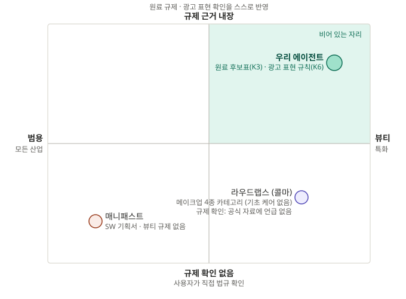
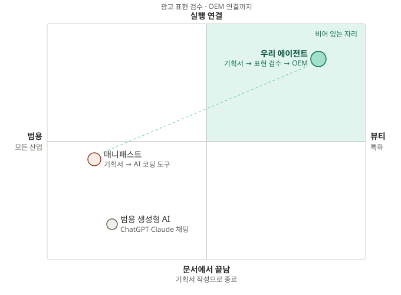

# 뷰티 상품 기획 에이전트 포지셔닝 맵

## 📌 한 줄 요약
범용 기획 도구 매니패스트와 뷰티 기획 플랫폼 라우드랩스(콜마)를 경쟁으로 두면, 우리 에이전트의 빈자리는 "누구나 쓸 수 있으면서 원료 규제·광고 표현 근거를 내장한 자리"다. 규제 근거를 가진 대기업 사내 AI(아모레퍼시픽 LEMON)는 외부에 제공되지 않고, 제조사 연결은 라우드랩스가 이미 앞서 있다.

## 🔑 핵심 내용
- [사실] 매니패스트는 아이디어 한 줄이나 자료로 PRD, 기능명세서, 유저플로우, 와이어프레임 초안을 만드는 AI 기획 워크스페이스다 [1]
- [사실] 매니패스트 홈페이지의 예시는 "휴가 관리 솔루션" 하나이고, 산출물은 소프트웨어 개발용 문서다 [1]
- [사실] 매니패스트는 기획서를 Claude Code, Cursor 같은 AI 코딩 도구가 MCP로 읽고 구현하도록 연결한다 [1]
- [해석] 매니패스트는 범용 소프트웨어 기획 쪽에 있고, 뷰티 상품 기획(원료·광고 표현·OEM)은 다루지 않는다 [1]
- [사실] 라우드랩스(LoudLabs)는 콜마홀딩스 계열의 AI 화장품 상품기획 플랫폼이고, 키워드를 넣으면 콘셉트·제형·컬러가 담긴 기획안을 준다 [5][6]
- [사실] 라우드랩스 요금제는 Basic 월 ₩0(정가 ₩49,000, 설계서 월 30회)과 Pro 월 ₩300,000(VAT 포함)이고, 요금표 기능 목록에 원료 규제·광고 표현 확인은 없다 [5]
- [사실] 라우드랩스 상품기획 화면의 기획 키워드 카테고리는 립·베이스·페이스·아이 메이크업 4종이고, 기초 스킨케어 카테고리는 없다 [9]
- [사실] 라우드랩스 운영사는 크몽에서 ODM 제조 프로세스 기준 상품기획 컨설팅(90분, ₩300,000)을 팔고, 기획 툴 1개월 이용권을 함께 준다 [7]
- [해석] 뷰티 특화만으로는 라우드랩스와 구분되지 않는다. 우리만의 자리는 원료 후보표(K3)·광고 표현 규칙(K6) 같은 규제 근거다
- [해석] 카테고리도 겹치지 않는다. 라우드랩스는 메이크업 기획, 우리는 한방 원료 기초 케어(토너·세럼·크림 등) 라인 기획이다 [9]
- [아이디어] 맵 1은 이용 가능성 × 규제 근거(11/18 6단계 재점검으로 교체), 맵 2는 산업 특화도 × 실행 연결도로 그린다

## 📚 상세 조사

### 1. 맵을 만든 과정

1. **경쟁 상대 확인.** 팀이 정한 경쟁 상대 매니패스트의 홈페이지와 요금제 페이지를 읽고 대상 사용자, 산출물, 입력 자료, 산업 범위를 정리했다 [1][2]
2. **우리 강점 정리.** 팀이 생각하는 강점은 "뷰티 브랜드에 특화된 기획서"다. 이것을 그대로 가로축으로 쓴다
3. **세로축 후보 고르기.** 가로축과 뜻이 겹치지 않으면서 경쟁사와 차이가 나는 축을 찾았다

   | 후보 | 판단 |
   |---|---|
   | 기획 근거 (입력 의존 ↔ 근거 내장) | ❌ 11/18 교체. 라우드랩스도 트렌드·제형 데이터를 내장해서 차이가 안 남 |
   | 규제 근거 (확인 없음 ↔ 원료 규제·광고 표현 내장) | ✅ 채택 (맵 1). 라우드랩스와 갈리는 축 |
   | 실행 연결도 (문서에서 끝남 ↔ 광고 표현 검수·OEM 연결) | ✅ 채택 (맵 2). 기획 이후 단계까지 이어 주는 기능 방향을 보여 줌 |
   | 산출물 형태 (디지털 서비스 ↔ 실물 상품) | ❌ 제외. 가로축과 거의 같은 뜻이라 점이 대각선 위에만 놓임 |

4. **비교 대상 정하기.** 11/18 팀 결정으로 경쟁 상대를 매니패스트와 라우드랩스 두 곳으로 정했다. 이전 판의 "범용 생성형 AI"는 뺐다. 맵 1에는 6단계 재점검에 따라 아모레퍼시픽 LEMON을 더했다
5. **위치 찍기.** 매니패스트는 공식 홈페이지 [1], 라우드랩스는 공식 요금제·크몽 서비스 설명 [5][7]으로 위치를 정했다. 우리 에이전트의 위치는 팀 자료(K3·K6)를 기준으로 한 가설이다 ([해석])

### 2. 맵 1: 이용 가능성 × 규제 근거 (11/18 교체)

- **가로축 (이용 가능성):** 왼쪽은 회사 안에서만 쓰는 사내 전용, 오른쪽은 누구나 가입해 쓸 수 있음
- **세로축 (규제 근거):** 아래는 사용자가 직접 법규 확인, 위는 원료 규제·광고 표현 확인을 스스로 반영
- [사실] 아모레퍼시픽 LEMON은 연구자료·규제 검토를 돕는 사내 AI 플랫폼이고 외부에 제공되지 않는다 [10]
- [해석] LEMON은 왼쪽 위, 매니패스트(뷰티 규제 다루지 않음 [1])와 라우드랩스(규제 확인 공식 자료에 언급 없음 [5][6])는 오른쪽 아래에 둔다
- [해석] 우리 에이전트는 외부 판매(11/18 결정)이고 원료 후보표(K3)·광고 표현 규칙(K6)을 쓰므로 오른쪽 위에 둔다. 신생 브랜드는 사내 AI를 쓸 수 없으므로 이 자리는 수요와 이어진다
- [해석] 이전 판의 가로축(산업 특화도)은 우리 점을 지우면 세로축에서 경쟁자가 갈리지 않아 6단계 점검을 통과하지 못해 바꿨다 (6장 참고)
- [해석] 라우드랩스와의 카테고리 차이(메이크업 4종 vs 한방 기초 케어 [9])는 맵 축이 아니라 설명 문장으로 쓴다

### 3. 맵 2: 산업 특화도 × 실행 연결도

- **가로축 (산업 특화도):** 맵 1과 같다
- **세로축 (실행 연결도):** 아래는 기획서 작성으로 끝남, 위는 광고 표현 검수와 제조사(ODM/OEM) 연결까지 이어짐
- [사실] 매니패스트는 확정한 기획서를 AI 코딩 도구와 Linear·Jira·GitHub 이슈로 보낸다 [1]
- [해석] 매니패스트의 연결은 개발 쪽이지 제조가 아니므로 범용·중간 아래에 둔다
- [사실] 라우드랩스는 완성된 기획안으로 ODM 기업과 바로 협업할 수 있다고 밝혔고, 트렌드 예측 관련 국내 특허를 등록했다 [8]
- [해석] 라우드랩스는 콜마 계열이고 ODM 제조 기준 상담으로 이어 주므로 오른쪽 위에 둔다 [7][8]
- [해석] 우리 에이전트는 지금은 라인 후보·기획서까지라 아래쪽, 목표는 표현 검수 → OEM 문의까지인 위쪽이다. 목표 위치는 아직 만들지 않은 기능이라 발표에서 "목표"라고 밝힌다
- [해석] 제조사 연결은 라우드랩스가 앞서 있어 이 맵에는 빈자리가 없다. 발표의 차별점은 맵 1(규제 근거)로 세운다

### 4. "왜 굳이 뷰티 특화인가"에 대한 답 (발표용 3줄)

- [사실] 2025년 국내 화장품 생산액은 17조 9,382억 원으로 사상 최대이고, 수출은 114억 달러, 수출국은 202개국이다 [3]
- [사실] 화장품 책임판매업체는 2024년 말 27,932곳으로 2019년의 약 2배다. 기획서가 필요한 작은 브랜드가 많다 [4]
- [해석] 화장품 기획에는 원료, 광고 표현 규제, OEM이 함께 들어가서, 기능명세서·와이어프레임을 만드는 범용 소프트웨어 기획 도구로는 채울 수 없다

### 5. 참고: 매니패스트 요금제 (2026-11-16 확인)

| 플랜 | 가격 | 주요 내용 |
|---|---|---|
| Starter | 무료 | 가입 시 5,000 크레딧, 매일 3,000 크레딧, 프로젝트 3개 |
| Pro | 월 $20 (5배 사용량 $100) | 월 100,000 크레딧, 최대 3좌석, 고급 AI 모델, 내보내기 무제한 |
| Team | 월 $60 (5배 사용량 $140) | 기본 5좌석, 1명 추가마다 월 $10 |

- [사실] 연간 결제 시 최대 25% 할인이다 [2]
- [해석] 구독에 크레딧을 붙이고, 많이 쓰면 더 높은 사용량 단계를 사는 구조다 [2]

### 6. playbook 6단계 점검 (11/18 재점검)

**① 축 후보 채점 (각 1~5점, 합계가 가장 높은 쌍 선택)**

| 축 쌍 (가로 × 세로) | 고객이 실제로 보는 기준인가 | 두 축이 독립인가 | 근거로 위치를 정할 수 있나 | 합계 | 경쟁자끼리 갈리나 (우리 점 지우고) | 빈자리 |
|---|:---:|:---:|:---:|:---:|---|---|
| A. 산업 특화도 × 규제 근거 (지금 맵 1) | 5 | 4 | 4 | 13 | 가로 ○ · **세로 ✕** (매니패스트·라우드랩스 둘 다 아래) | 있음 |
| B. 산업 특화도 × 실행 연결도 (지금 맵 2) | 4 | 4 | 4 | 12 | 가로 ○ · 세로 ○ | **없음** (라우드랩스가 우상단) |
| C. 기획 카테고리 (메이크업 ↔ 기초 케어) × 규제 근거 | 4 | 3 | 2 | 9 | 가로 판단 불가 (매니패스트는 화장품 카테고리가 없음) · 세로 ✕ | 있음 |
| D. 이용 가능성 (사내 전용 ↔ 누구나 가입) × 규제 근거 *(아모레퍼시픽 LEMON 추가)* | 5 | 4 | 4 | 13 | 가로 ○ · 세로 ○ | 있음 |

- [해석] 점수 이유
  - 고객 기준: 규제 근거는 공개 VOC(광고 표현 질문 반복, 행정처분 427건 중 표시·광고 324건)가 받쳐 줘서 5점이다. 이용 가능성은 신생 브랜드가 사내 AI를 쓸 수 없다는 사실이 바로 기준이라 5점이다 [10]. 실행 연결은 제조사 찾기가 어렵다는 VOC가 있어 4점, 카테고리는 "자기 제품군을 다루는 도구를 고른다"는 해석이라 4점이다
  - 독립성: 라우드랩스가 뷰티 특화인데 규제 확인은 언급이 없어 A는 4점이다. C는 기초 케어일수록 효능 표현 규제 부담이 커서 두 축이 같이 움직일 수 있어 3점이다
  - 근거: 라우드랩스 규제 칸이 '언급 없음'([U])이라 A·D는 4점이다. C는 매니패스트의 카테고리 위치를 정할 수 없어 2점이다
- [해석] 카테고리 축(C)은 라우드랩스와 우리를 가르는 좋은 **설명**이지만, 경쟁자 두 곳을 같은 축에 놓을 수 없어 맵 축으로는 약하다. 맵 밖의 근거 문장으로 쓰는 것이 맞다 [9]

**② 축 D 위치 (1~5점)**

| 대안 | 이용 가능성 | 규제 근거 | 근거 |
|---|:---:|:---:|---|
| 매니패스트 | 5 [F] 누구나 가입 | 1 [F] 뷰티 다루지 않음 | [1][2] |
| 라우드랩스(LoudLabs) | 5 [F] 무료 가입 | 2 [U] 공식 자료에 언급 없음 | [5][6][9] |
| 아모레퍼시픽 LEMON | 1 [F] 사내 연구원 전용 | 5 [F] 연구자료·규제 검토 | [10] |
| 우리 에이전트 | 5 [I] 외부 판매로 결정, 아직 서비스 전 | 4 [F] K3 원료 후보표·K6 광고 표현 규칙 (효과 검증 전) | 팀 문서 |

**③ 타당성 점검 결과**

| 점검 | 축 A (지금 맵 1) | 축 D |
|---|---|---|
| 우리 점을 지워도 경쟁자가 두 축에서 갈리나 | 미통과 (세로축에서 안 갈림) | 통과 (LEMON이 두 축 모두에서 다른 둘과 갈림) |
| 빈자리가 수요와 연결되나 | 통과 (공개 VOC·행정처분 통계) | 통과 (같은 근거 + 신생 브랜드는 사내 AI를 못 씀) |
| `[I]`가 많으면 "해석 단계"라고 적었나 | 통과 | 통과 (우리 위치는 [I]가 섞여 해석 단계로 표시) |

- [해석] 지금 맵 1(축 A)로는 6단계를 통과하지 못한다. 축 D는 점수가 A와 같고(13점) 점검을 모두 통과한다
- [사실] 11/18 HSJ 결정으로 맵 1을 축 D(이용 가능성 × 규제 근거)로 바꾸고 아모레퍼시픽 LEMON을 세 번째 비교 대상으로 넣었다 → 6단계 점검 통과

## 🤖 우리 에이전트에 어떻게 쓸까?
- [ ] 세계관 / 키비주얼 / 캐릭터 소품 :
- [ ] 페르소나 / 체질 캐릭터 / 제품 라인업 :
- [x] 캠페인 / 기획전 / 홍보 문구 : 발표·소개 자료에서 "뷰티 특화 + 근거 + 실행 연결"을 차별점으로 쓴다
- [ ] 피부타입 → 기초라인 추천 에이전트 :
- [ ] 약재 → 추천 라인·홍보 문구 에이전트 :
- [ ] 팝업 위치 추천 에이전트 :

## ⚠️ 광고 표현 체크
- [x] 금지어 확인 완료 (이 문서에는 제품 효능 문구가 없음)

## 📌 다른 팀원에게
- To LJH: 맵 2의 "광고 표현 검수"는 `research/LJH_K6_광고표현규칙.md`를 기반으로 만든다고 가정했어요
- To MEJ: 맵 2의 "OEM 연결"은 `research/MEJ_OEM_업체정보표.md`, `research/MEJ_OEM_견적_문의준비.md`와 이어질 수 있어요

## ❓ 아직 모르는 것
- 매니패스트 고객 로고에 AMOREPACIFIC이 있다 [1]. 실제로 뷰티 기획에 쓰는지, 계약 범위는 확인 못 함
- 우리 에이전트의 위치는 가설. 실제 사용자(신생 한방뷰티 브랜드 기획자) 의견으로 검증 필요
- 라우드랩스의 규제·광고 표현 확인 기능 유무 → 직접 가입해 설계서 1건을 만들어 확인 필요
- ~~라우드랩스 기획 툴이 기초 스킨케어를 다루는지~~ → 11/18 확인: 메이크업 4종만 있음 [9]. 이후 카테고리가 늘어나는지는 계속 지켜봐야 함
- 책임판매업체 수(27,932곳)의 원출처 확인 필요 [4]
- 다른 경쟁 후보(뷰티 트렌드 데이터 서비스 등)는 아직 조사하지 않음

## 🔗 출처

| 번호 | 등급 | 종류 | 내용 | 비고 |
|---|---|---|---|---|
| [1] | 🟡 | 웹페이지 | 매니패스트 \| 매니패스트 홈페이지 "AI와 개발하는 팀을 위한 기획 워크스페이스" \| 날짜 없음 \| https://manyfast.io/ko \| 2026-11-16 확인 | 기업 공식 자료. 고객 로고·후기 수치는 자체 주장 |
| [2] | 🟡 | 웹페이지 | 매니패스트 \| 요금제 \| 날짜 없음 \| https://manyfast.io/pricing \| 2026-11-16 확인 | `/ko/pricing`은 404, `/pricing`에서 확인 |
| [3] | 🟢 | 보고서 | 식품의약품안전처 \| '25년 화장품 무역수지 흑자 첫 100억 달러 돌파 보도자료 \| 2026.5.22 \| 쪽수 확인 필요 \| https://kcia.or.kr/inc/down.php?dir=BOARD&file_name=202605_177978900248248_2.pdf \| 2026-11-16 팀 문서에서 확인 | 원자료는 팀 문서 `research/한방화장품 시장조사_산업규모 및 약령시의 현재.md`. 이번에 원문은 다시 열지 않음 |
| [4] | 팀 내부 (원자료 확인 필요) | 조사 문서 | HSJ \| 한방화장품 시장조사 산업규모·약령시의 현재 \| `research/한방화장품 시장조사_산업규모 및 약령시의 현재.md` \| 2026-11-16 확인 | 업체 수의 원출처 확인 필요 |
| [5] | 🟡 | 웹페이지 | 라우드랩스 \| 홈페이지 "플랜 알아보기" 요금제 \| 날짜 없음 \| https://loudlabs.ai/ \| 2026-11-18 확인 | 기업 공식 자료 |
| [6] | 🔴 | 블로그 | 콜로세움 블로그 \| 한국콜마가 만든 AI, 화장품 기획을 30초로 줄이다 : 라우드랩스 테스트 후기 \| 이송이 \| 2026-02-23 \| https://blog.colosseum.global/loudlabs-cosmetic-manufacturing \| 2026-11-18 확인 | 사용 후기 참고용 (핵심 근거 아님). 본문에 "라운드랩스" 오기 있음 |
| [7] | 🟡 | 웹페이지 | 크몽 \| 화장품 브랜드 창업 ODM 상품 기획/개발 방향 컨설팅 (판매자: 라우드랩스) \| 날짜 없음 \| https://kmong.com/gig/752496 \| 2026-11-18 확인 | 판매자 자체 설명 |
| [8] | 🟡 | 뉴스 기사 | 문화일보 \| 콜마홀딩스 라우드랩스, "수개월 걸리던 화장품 개발 기획 AI로 30초 만 완성" \| 최준영 \| 2026-02-02 \| https://www.munhwa.com/article/11565365 \| 2026-11-18 확인 | 회사 발표 기사. 이데일리·장업신문(`idea/MEJ_기획자페르소나_근거.md` [8][22])과 내용 일치 |
| [9] | 🟡 | 웹페이지 | 라우드랩스 \| 상품기획 "기획 키워드 선택" 카테고리 목록 \| 날짜 없음 \| https://loudlabs.ai/product-planning \| 2026-11-18 확인 | 기업 공식 화면. 크몽 설명 [7]과 일치 |
| [10] | 🟡 | 기업 보도자료 | 아모레퍼시픽 \| 아모레퍼시픽, 70년 연구 자산 기반 AI 특화 플랫폼 구축 \| 2026-07-28 \| https://www.apgroup.com/int/ko/news/2026-07-28-1.html \| 2026-11-11 확인 (`idea/MEJ_기획자페르소나_근거.md` [6]) | 한국경제 같은 날 기사와 수치 일치 |

### 이미지

| 파일 | 내용 | 사용 가능 |
|---|---|---|
| `beautyagent/positioning/positioning_map_evidence.svg` | 맵 1 (이용 가능성 × 규제 근거) | ✅ 팀 자체 제작 |
| `beautyagent/positioning/positioning_map_execution.svg` | 맵 2 (산업 특화도 × 실행 연결도) | ✅ 팀 자체 제작 |
