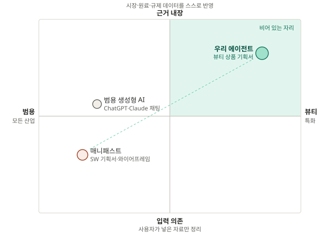
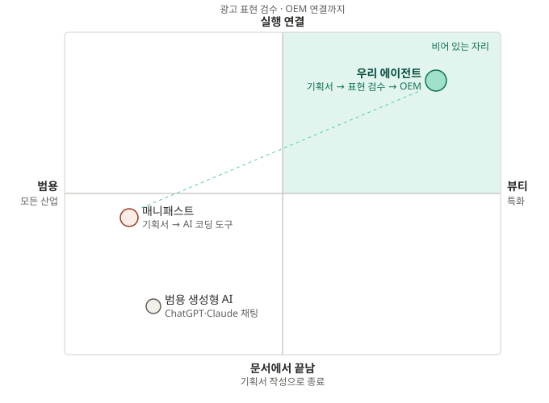

# 뷰티 상품 기획 에이전트 포지셔닝 맵

## 📌 한 줄 요약
범용 소프트웨어 기획 도구인 매니패스트와 비교하면, 우리 에이전트는 "뷰티 특화 + 근거 내장 + 실행 연결" 쪽의 비어 있는 자리를 노린다.

## 🔑 핵심 내용
- [사실] 매니패스트는 아이디어 한 줄이나 자료로 PRD, 기능명세서, 유저플로우, 와이어프레임 초안을 만드는 AI 기획 워크스페이스다 [1]
- [사실] 매니패스트 홈페이지의 예시는 "휴가 관리 솔루션" 하나이고, 산출물은 소프트웨어 개발용 문서다 [1]
- [사실] 매니패스트는 기획서를 Claude Code, Cursor 같은 AI 코딩 도구가 MCP로 읽고 구현하도록 연결한다 [1]
- [해석] 매니패스트는 범용 소프트웨어 기획 쪽에 있고, 뷰티 상품 기획(원료·광고 표현·OEM)은 다루지 않는다 [1]
- [아이디어] 우리 에이전트의 강점인 "뷰티 브랜드에 특화된 기획서"를 가로축에 두고, 세로축 두 가지로 맵을 두 장 그린다

## 📚 상세 조사

### 1. 맵을 만든 과정

1. **경쟁 상대 확인.** 팀이 정한 경쟁 상대 매니패스트의 홈페이지와 요금제 페이지를 읽고 대상 사용자, 산출물, 입력 자료, 산업 범위를 정리했다 [1][2]
2. **우리 강점 정리.** 팀이 생각하는 강점은 "뷰티 브랜드에 특화된 기획서"다. 이것을 그대로 가로축으로 쓴다
3. **세로축 후보 고르기.** 가로축과 뜻이 겹치지 않으면서 경쟁사와 차이가 나는 축을 찾았다

   | 후보 | 판단 |
   |---|---|
   | 기획 근거 (입력 의존 ↔ 근거 내장) | ✅ 채택 (맵 1). 출처 있는 조사 파일이 쌓이는 우리 저장소의 강점이 드러남 |
   | 실행 연결도 (문서에서 끝남 ↔ 광고 표현 검수·OEM 연결) | ✅ 채택 (맵 2). 기획 이후 단계까지 이어 주는 기능 방향을 보여 줌 |
   | 산출물 형태 (디지털 서비스 ↔ 실물 상품) | ❌ 제외. 가로축과 거의 같은 뜻이라 점이 대각선 위에만 놓임 |

4. **비교 대상 정하기.** 매니패스트 외에 사람들이 실제로 대신 쓸 만한 것으로 "범용 생성형 AI(ChatGPT·Claude 채팅)"를 함께 두었다. 근거 없이 다른 회사를 넣지 않으려고 비교 대상은 두 개로 줄였다
5. **위치 찍기.** 매니패스트는 공식 홈페이지 내용으로 위치를 정했다 [1]. 범용 생성형 AI와 우리 에이전트의 위치는 팀의 가설이다 ([해석])

### 2. 맵 1: 산업 특화도 × 기획 근거

- **가로축 (산업 특화도):** 왼쪽은 모든 산업에 쓰는 범용, 오른쪽은 뷰티 특화
- **세로축 (기획 근거):** 아래는 사용자가 넣은 자료만 정리, 위는 시장·원료·규제 데이터를 스스로 반영
- [사실] 매니패스트의 입력은 한 줄 아이디어, 업로드 파일, Notion·Figma·Slack 같은 MCP 연결이다 [1]
- [해석] 매니패스트는 넣은 자료가 결과를 좌우하므로 범용·입력 의존 쪽에 둔다 [1]
- [해석] 범용 생성형 AI는 웹 검색으로 자료를 찾을 수 있지만 뷰티 규제·원료 근거가 정리돼 있지 않아 중간 높이에 둔다
- [해석] "뷰티 특화"만으로는 범용 도구가 뷰티 템플릿을 추가하면 따라잡을 수 있다. 출처를 단 조사 지식 파일이 쉽게 따라 하기 어려운 차이다

### 3. 맵 2: 산업 특화도 × 실행 연결도

- **가로축 (산업 특화도):** 맵 1과 같다
- **세로축 (실행 연결도):** 아래는 기획서 작성으로 끝남, 위는 광고 표현 검수와 OEM 연결까지 이어짐
- [사실] 매니패스트는 확정한 기획서를 AI 코딩 도구와 Linear·Jira·GitHub 이슈로 보낸다 [1]
- [해석] 매니패스트는 개발 쪽 실행으로 이어지므로 범용 쪽 중간 높이에 둔다 [1]
- [해석] 범용 생성형 AI는 문서를 만들고 끝나므로 아래쪽에 둔다
- [아이디어] 우리 에이전트는 기획서 → 광고 표현 검수 → OEM 문의까지 이어 주는 것을 목표로 우상단에 둔다. 아직 만들지 않은 기능이므로 발표에서는 "목표 위치"라고 밝힌다

### 4. "왜 굳이 뷰티 특화인가"에 대한 답 (발표용 3줄)

- [사실] 2025년 국내 화장품 생산액은 17조 9,382억 원으로 사상 최대이고, 수출은 114억 달러, 수출국은 202개국이다 [3]
- [사실] 화장품 책임판매업체는 2024년 말 27,932곳으로 2019년의 약 2배다. 기획서가 필요한 작은 브랜드가 많다 [4]
- [해석] 화장품 기획에는 원료, 광고 표현 규제, OEM이 함께 들어가서, 기능명세서·와이어프레임을 만드는 범용 소프트웨어 기획 도구로는 채울 수 없다

### 5. 참고: 매니패스트 요금제 (2026-11-16 확인)

| 플랜 | 가격 | 주요 내용 |
|---|---|---|
| Starter | 무료 | 가입 시 5,000 크레딧, 매일 3,000 크레딧, 프로젝트 3개 |
| Pro | 월 $20 (5배 사용량 $100) | 월 100,000 크레딧, 최대 3좌석, 고급 AI 모델, 내보내기 무제한 |
| Team | 월 $60 (5배 사용량 $140) | 기본 5좌석, 1명 추가마다 월 $10 |

- [사실] 연간 결제 시 최대 25% 할인이다 [2]
- [해석] 구독에 크레딧을 붙이고, 많이 쓰면 더 높은 사용량 단계를 사는 구조다 [2]

## 🤖 우리 에이전트에 어떻게 쓸까?
- [ ] 세계관 / 키비주얼 / 캐릭터 소품 :
- [ ] 페르소나 / 체질 캐릭터 / 제품 라인업 :
- [x] 캠페인 / 기획전 / 홍보 문구 : 발표·소개 자료에서 "뷰티 특화 + 근거 + 실행 연결"을 차별점으로 쓴다
- [ ] 피부타입 → 기초라인 추천 에이전트 :
- [ ] 약재 → 추천 라인·홍보 문구 에이전트 :
- [ ] 팝업 위치 추천 에이전트 :

## ⚠️ 광고 표현 체크
- [x] 금지어 확인 완료 (이 문서에는 제품 효능 문구가 없음)

## 📌 다른 팀원에게
- To LJH: 맵 2의 "광고 표현 검수"는 `research/LJH_K6_광고표현규칙.md`를 기반으로 만든다고 가정했어요
- To MEJ: 맵 2의 "OEM 연결"은 `research/MEJ_OEM_업체정보표.md`, `research/MEJ_OEM_견적_문의준비.md`와 이어질 수 있어요

## ❓ 아직 모르는 것
- 매니패스트 고객 로고에 AMOREPACIFIC이 있다 [1]. 실제로 뷰티 기획에 쓰는지, 계약 범위는 확인 못 함
- 범용 생성형 AI와 우리 에이전트의 위치는 가설. 실제 사용자(뷰티 브랜드 담당자) 의견으로 검증 필요
- 책임판매업체 수(27,932곳)의 원출처 확인 필요 [4]
- 다른 경쟁 후보(뷰티 트렌드 데이터 서비스, ODM 기획 컨설팅 등)는 아직 조사하지 않음

## 🔗 출처

| 번호 | 등급 | 종류 | 내용 | 비고 |
|---|---|---|---|---|
| [1] | 🟡 | 웹페이지 | 매니패스트 \| 매니패스트 홈페이지 "AI와 개발하는 팀을 위한 기획 워크스페이스" \| 날짜 없음 \| https://manyfast.io/ko \| 2026-11-16 확인 | 기업 공식 자료. 고객 로고·후기 수치는 자체 주장 |
| [2] | 🟡 | 웹페이지 | 매니패스트 \| 요금제 \| 날짜 없음 \| https://manyfast.io/pricing \| 2026-11-16 확인 | `/ko/pricing`은 404, `/pricing`에서 확인 |
| [3] | 🟢 | 보고서 | 식품의약품안전처 \| '25년 화장품 무역수지 흑자 첫 100억 달러 돌파 보도자료 \| 2026.5.22 \| 쪽수 확인 필요 \| https://kcia.or.kr/inc/down.php?dir=BOARD&file_name=202605_177978900248248_2.pdf \| 2026-11-16 팀 문서에서 확인 | 원자료는 팀 문서 `research/한방화장품 시장조사_산업규모 및 약령시의 현재.md`. 이번에 원문은 다시 열지 않음 |
| [4] | 팀 내부 (원자료 확인 필요) | 조사 문서 | HSJ \| 한방화장품 시장조사 산업규모·약령시의 현재 \| `research/한방화장품 시장조사_산업규모 및 약령시의 현재.md` \| 2026-11-16 확인 | 업체 수의 원출처 확인 필요 |

### 이미지

| 파일 | 내용 | 사용 가능 |
|---|---|---|
| `beautyagent/positioning_map_evidence.svg` | 맵 1 (산업 특화도 × 기획 근거) | ✅ 팀 자체 제작 |
| `beautyagent/positioning_map_execution.svg` | 맵 2 (산업 특화도 × 실행 연결도) | ✅ 팀 자체 제작 |
