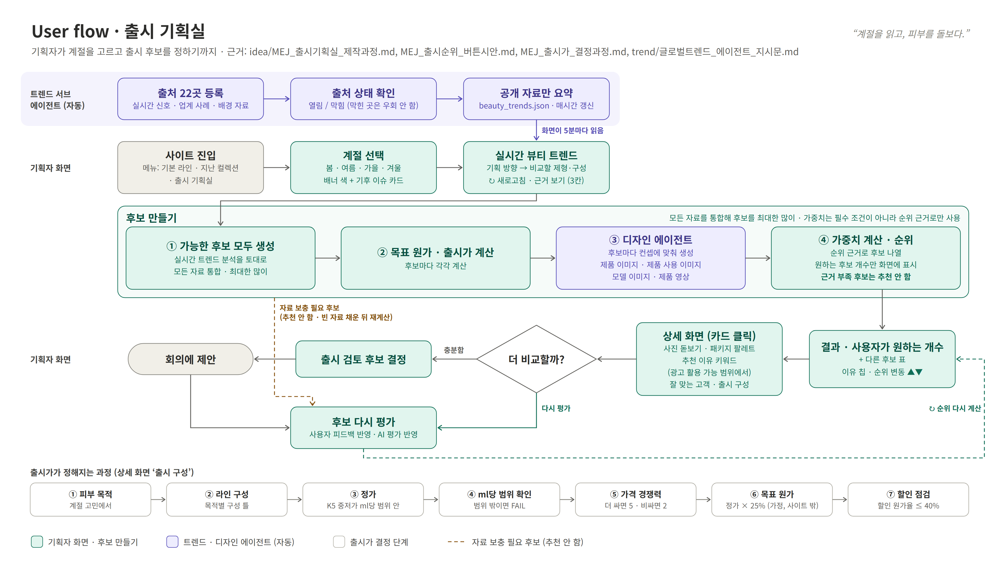
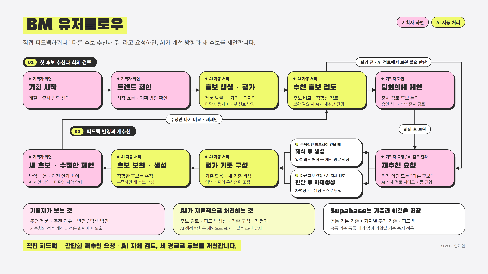

# 유저 플로우

> HSJ가 AI(Claude Code)에게 준 **지시문**과 그에 따라 만든 **유저 플로우 이미지**를 기록한 문서예요.
> 지시문은 실제로 입력한 문장을 그대로 옮겼어요 (띄어쓰기·오타 포함).

## 📌 한 줄 요약
MEJ의 출시 기획실 문서를 바탕으로 유저 플로우를 그린 뒤, v1에서 **기준 고르기 → 후보 만들기(4단계)**로 바꾸고 필수 통과 조건을 없앴어요. 대신 **근거가 부족한 후보는 추천하지 않고 후보 다시 평가로 보내요.**

## 🗂️ 결과물

| 파일 | 내용 | 비율 |
|---|---|---|
| [유저플로우_v1.png](유저플로우_v1.png) / [.html](유저플로우_v1.html) | **출시 기획실 유저 플로우 v1 (최신)** | 16:9 (3840×2160) |
| [BM_user_flow_v2.png](BM_user_flow_v2.png) / [.html](BM_user_flow_v2.html) | **BM 유저플로우 v2 (최신)** · 발표 자료 디자인 · `피칭데이/1119_발표_v2.html` 13쪽에 HTML로 직접 그려 넣음 | 16:9 (3840×2160) |
| [BM_user_flow.png](BM_user_flow.png) / [.svg](BM_user_flow.svg) | BM 유저플로우 (v2 이전판) | 16:9 (1920×1080) |
| [user_flow_launch_studio.png](user_flow_launch_studio.png) / [.svg](user_flow_launch_studio.svg) | 출시 기획실 유저 플로우 (v1 이전판) | 16:9 (3840×2160) |
| [brand/spec/user_flow.png](../../brand/spec/user_flow.png) / [.svg](../../brand/spec/user_flow.svg) | 시나리오 명세 유저 플로우 (세로) | 960×1300 (PNG는 2배) |
| [brand/spec/user_flow_landscape.png](../../brand/spec/user_flow_landscape.png) / [.svg](../../brand/spec/user_flow_landscape.svg) | 시나리오 명세 유저 플로우 (발표용 가로) | 16:9 (3840×2160) |
| `presentation/2026-11-13_발표/…_유저플로우 추가.pptx` | 발표용 가로판을 17번 슬라이드에 넣은 발표 파일 | 16:9 |

---

## 1. 출시 기획실 유저 플로우 (v1 이전판)

### 1-1. 근거 문서

| 문서 | 유저 플로우에서 쓴 곳 |
|---|---|
| `idea/MEJ_출시기획실_제작과정.md` | 사이트 구성(메뉴, 계절 선택, 트렌드, 기준 고르기, 결과, 상세 화면, 기본 라인) |
| `idea/MEJ_출시순위_버튼시안.md` | 필수 통과 조건 7개, 후보 순위 근거 버튼(★/★★), 프리셋, 트렌드 갱신 규칙 |
| `idea/MEJ_출시가_결정과정.md` | 아래 띠의 "출시가가 정해지는 과정" ①~⑦ |
| `idea/trend/글로벌트렌드_에이전트_지시문.md` | 트렌드 서브 에이전트 줄 (출처 22곳 → 상태 확인 → 공개 자료만 요약) |
| `idea/브랜드명_CHAHAR(가칭).md` | 제목의 CHAHAR(가칭) (v1에서 삭제), 슬로건 "계절을 읽고, 피부를 돌보다." |

### 1-2. 흐름

**트렌드 서브 에이전트 (자동)**
1. 출처 22곳 등록 (실시간 신호 · 업계 사례 · 배경 자료)
2. 출처 상태 확인 (열림 / 막힘 — 막힌 곳은 우회하지 않음)
3. 공개 자료만 요약해 `beauty_trends.json`에 매시간 갱신
4. 화면이 5분마다 읽어 "실시간 뷰티 트렌드"에 보여 줌

**기획자 화면**
1. 사이트 진입 (메뉴: 기본 라인 · 지난 컬렉션 · 출시 기획실) → 갈래: 기본 라인 한눈에 보기 (5개 제품군 · 용기 7종 같은 배율)
2. 계절 선택 (봄·여름·가을·겨울, 배너 색 + 기후 이슈 카드)
3. 실시간 뷰티 트렌드 (기획 방향 → 비교할 제형·구성, ↻ 새로고침, 근거 보기 3칸)
4. 기준 고르기 (프리셋 5종 또는 직접 고르기, 후보 순위 근거 ★ / ★★)
5. 필수 통과 조건 7개 → **PASS**는 결과로, **FAIL**은 순위에서 제외 (예: 길경, 클렌저용)
6. 결과 · Top 3 카드 (+ 다른 후보 표 · 추가 검증, 이유 칩, 순위 변동 ▲▼)
7. 상세 화면 (사진 돋보기 · 패키지 팔레트, 추천 이유 키워드 · 잘 맞는 고객, 출시 구성 · 필수 조건 · 순위 근거)
8. 더 비교할까?
   - **기준 바꾸기** → 프리셋·★ 다시 고르기 → ↻ 순위 다시 계산 (결과로 돌아감)
   - **충분함** → 출시 검토 후보 결정 → 회의에 제안

**출시가가 정해지는 과정 (상세 화면 '출시 구성')**
① 피부 목적 → ② 라인 구성 → ③ 정가 (K5 중저가 ml당 범위 안) → ④ ml당 범위 확인 (범위 밖이면 FAIL) → ⑤ 가격 경쟁력 (더 싸면 5 · 비싸면 2) → ⑥ 목표 원가 (정가 × 25%, 가정, 사이트 밖) → ⑦ 할인 점검 (할인 원가율 ≤ 40%)

### 1-3. 확인 필요

- "회의에 제안"은 근거 문서 5개에는 없고, 기존 유저스토리(`presentation/LJH_상품기획자_유저스토리_16x9.html`)에서 가져왔어요.
- 메뉴의 "지난 컬렉션"은 문서에 설명이 없어 메뉴 이름으로만 넣었어요.

---

## 2. v1 수정 내용 (11/18)

### 2-1. 이전판과 달라진 점

| 부분 | 이전판 | v1 |
|---|---|---|
| 제목 | User flow · 출시 기획실 (CHAHAR 가칭) | User flow · 출시 기획실 (에이전트 이름은 새로 정할 예정) |
| 사이트 진입 갈래 | 기본 라인 한눈에 보기 | 삭제 |
| 기준 고르기 | 프리셋 5종 · ★ 고르기 | **후보 만들기** 4단계: ① 실시간 트렌드를 토대로 모든 자료를 통합해 가능한 후보 모두 생성 → ② 후보마다 목표 원가·출시가 계산 → ③ **디자인 에이전트**가 후보 컨셉에 맞춰 제품 이미지·제품 사용 이미지·모델 이미지·제품 영상 생성 → ④ 가중치 계산·순위, 원하는 개수만 화면에 표시 |
| 가중치 | 필수 통과 조건 + 순위 근거 | **순위 근거로만** 사용 (필수 조건 아님) |
| 필수 통과 조건 · 순위에서 제외 | 마름모 + FAIL 상자 | 삭제 |
| 결과 | 결과 · Top 3 카드 (+ 다른 후보 표 · 추가 검증) | **결과 · 사용자가 원하는 개수** (+ 다른 후보 표) |
| 상세 화면 | … 추천 이유 키워드 · 필수 조건 · 순위 근거 | 필수 조건·순위 근거 숨김. **추천 이유 키워드 (광고 활용 가능 범위에서)** |
| 추가 검증 | 결과 화면에 따로 보여 주는 목록 | **자료 보충 필요 후보 → 후보 다시 평가**로 보냄 (갈색 점선) |
| 기준 바꾸기 | 프리셋 · ★ 다시 고르기 | **후보 다시 평가** (사용자 피드백 반영 · AI 평가 반영). 더 비교할까? **와 회의에 제안** 둘 다에서 들어옴 |

**규칙:** 근거가 부족한 후보는 가중치 점수가 아무리 높아도 **사용자에게 추천하지 않아요.** 후보 다시 평가에서 빈 자료를 채우고 순위를 다시 계산한 뒤에야 추천 대상이 돼요.

### 2-2. 지시문

| 지시문 | 반영 |
|---|---|
| "txt 파일에 유저플로우 수정 사항을 정리했어. 텍스트 파일 내용 외에 것은 생각하지 말고 유저플로우 이미지 수정해서 beautyagent/유저플로우_v1.html 만들어줘. 그리고 수정 과정은 beautyagent/유저 플로우.md 에 기록해줘." | 첨부 txt의 6가지 반영 (아래 표) |
| "top3 글자 지우고 사용자가 원하는 개수 로 수정" | 결과 상자 이름 |
| "우리는 이 에이전트 이름을 새로 만들거고 출시 기획실 뒤의 차하르 가칭 글자는 지워줘. 차하르나 청향, 우리가 적어둔 브랜드명 후보들은 앞으로 샘플 이미지를 만들기 위한 것으로 사용할거야." | 제목에서 CHAHAR(가칭) 삭제 |
| "c로 하고, 자료 보충이 필요한 후보는 아무리 가중치를 많이 받더라도 사용자에게 추천하면 안될 것 같아. 근거가 불충분한 후보는 추천할 수 없어." | 추가 검증 → 후보 다시 평가로 연결, ④에 "근거 부족 후보는 추천 안 함" |
| "후보 다시 평가 로 수정. 아래줄에는 사용자 피드백 반영 · ai 평가 반영" | 기준 바꾸기 상자 이름·아래 줄 |
| "결과물 + 이미지 : 유저플로우 수정하면 이 내용도 새로운 결과물 추가하고 이미지를 알아서 수정해. …" | v1 PNG를 뽑아 결과물·대표 이미지 교체, 이 문서 정리 |

**첨부 txt (`##유저플로우 수정 필요.txt`) 6가지**

| # | 원문 |
|---|---|
| 1 | 회의에 제안 상자에서 기준 바꾸기 상자로 화살표 방향 추가 |
| 2 | 기준 고르기 상자 이름 후보 만들기로 바꾸고 세분화 — 실시간 트렌드 분석으로 모든 후보 생성 / 각 후보 목표원가·출시가 계산 / 디자인 에이전트: 제품이미지·제품사용이미지·모델이미지·제품영상 생성 / 가중치 계산해 원하는 후보 개수 보여주기 |
| 3 | 가중치 조건을 필수조건에서 빼고 순위 근거로만 사용. 후보는 모든 자료를 통합해 최대한 많이 |
| 4 | 필수통과조건 상자, 순위에서 제외 상자 지우기 |
| 5 | 상세화면: 필수조건·순위 근거는 안 보이게 / 추천 이유 키워드 → 광고 활용 가능 범위에서 / 보여 주면 좋을 정보 제안 |
| 6 | 기본 라인 한눈에 보기 상자 삭제 |

### 2-3. 상세 화면에 보여 주면 좋을 정보 (제안 · 아직 이미지에 안 넣음)

| 제안 | 이유 |
|---|---|
| 디자인 에이전트 결과물 (이미지 3종 · 제품 영상) | 후보 만들기 ③의 결과를 카드에서 바로 확인 |
| 목표 원가 · 출시가 | 후보 만들기 ②의 숫자를 따로 보여 주면 비교가 빠름 |
| 후보 컨셉 한 줄 요약 | 이미지·영상의 컨셉을 한눈에 |
| 주요 원료 · 제형 | 트렌드에서 나온 원료·제형 확인 |
| 트렌드 근거 (출처 · 수집 날짜) | 점수는 숨겨도 믿을 근거는 보여 줌 |
| 비슷한 시중 제품 · 가격대 | 출시가의 시장 위치 비교 |

### 2-4. 확인 필요

- "추천 이유 키워드 → 광고 활용 가능 범위에서"는 **광고에 쓸 수 있는 표현 안에서만 보여 준다**는 뜻으로 읽었어요.
- 오른쪽 위 슬로건 "계절을 읽고, 피부를 돌보다."는 브랜드명 문서에서 온 문구예요. 제목의 브랜드명처럼 뺄지 정해 주세요.

---

## 2A. BM 유저플로우 v2 (11/19)

| 부분 | 이전판 | v2 |
|---|---|---|
| 내용 | 상자·문구·화살표 | 그대로 (바꾸지 않음) |
| 색 | 초록(기획자 화면) · 보라(AI 자동 처리) | 발표 자료 팔레트: 분홍 `#FFC6E6`(기획자 화면) · 라임 `#F0FA6E`(AI 자동 처리) · 먹색 `#2B2B2B` 테두리·화살표, 회색 `#F4F4F6` 배경 |
| 글씨체 | 맑은 고딕 | 제목 Black Han Sans · 본문 Noto Sans KR · 숫자 Archivo Black |
| 발표 자료 | 13쪽에 PNG를 통째로 넣음 | 13쪽에 같은 흐름을 HTML·SVG로 직접 그림 (이미지 안 씀), 제목 옆에 범례 추가 |

| 지시문 | 반영 |
|---|---|
| "이 유저 플로우 이미지를 내용은 그대로 두고 디자인을 바꾸고 싶어. 컬러팔레트와 글씨체를 발표자료 html 파일 디자인에 맞춰서 변경하고 만든 이미지 하나와 생성된 유저플로우를 발표자료 템플릿 활용해서 html 자체에 디자인해서 넣어줘. 이미지를 그냥 넣지 말고." | `BM_user_flow_v2.html`·`.png`, 발표 13쪽 |

---

## 3. 제작 과정 (v1 이전)

| 날짜 | 지시문 | 결과 |
|---|---|---|
| 11/13 | "user flow 그려줘." | 시나리오 12장 흐름을 `시나리오.md` 13장에 Mermaid로 저장 |
| 11/13 | "시나리오.md 의 유저 플로우 머메이드 맵을 좀 더 보기 쉬운 이미지로 만들어줘." | `user_flow.svg`·`.png` (세로) |
| 11/13 | "커밋해줘" / "HSJ 브랜치 brand 폴더에 푸쉬해줘" | `brand/spec/`으로 옮겨 HSJ에 push |
| 11/13 | "AxO/brand/spec/user_flow.png 가로 이미지로 변경해서 pptx 마지막 슬라이드에 넣어줘. …" | `user_flow_landscape.*` (가로), 발표 파일 17번 슬라이드에 삽입 |
| 11/13 | "research 브랜치 presentation 폴더에 푸쉬해줘" / "research브랜치에 직접올려줘" | HSJ에 push 후 research에 fast-forward로 반영 |
| 11/13 | "깃 풀 해줘" | research 최신본을 HSJ에 받음 |
| 11/13 | "…브랜드명_CHAHAR(가칭).md …MEJ_출시기획실_제작과정.md …MEJ_출시가_결정과정.md …MEJ_출시순위_버튼시안.md …글로벌트렌드_에이전트_지시문.md 을 보고 유저 플로우 만들어줘." | `user_flow_launch_studio.*` (출시 기획실 유저 플로우) |
| 11/13 | "유저플로우 더 비교할까? > 다른 계절 보기 화살표 삭제해" / "다른 계절 보기 상자도 삭제해" | 다른 계절 보기 갈래 삭제 |
| 11/13 | "따로 보여주는 목록, 정보없음, 오늘 없음 상자 >> 유저플로우 이미지에서 삭제해. …" | 예외 처리·목록 상자를 이미지에서 빼고 이 문서에 정리 |

| 만드는 방법 | |
|---|---|
| 그리기 | SVG를 직접 작성 (v1은 HTML 안에 SVG) |
| 이미지 뽑기 | Microsoft Edge(헤드리스)로 2배 해상도 PNG |
| 검사 | 렌더링한 이미지에서 상자·글자·화살표가 겹치지 않는지 매번 확인 |

---

## 4. 이미지에서 뺀 상자

| 상자 | 종류 | 원래 위치 | 지금 |
|---|---|---|---|
| 다른 계절 보기 | 기획자 화면 갈래 | 더 비교할까? 위 | 삭제 (계절 탭을 다시 눌러 바꾸는 동작은 사이트에 있음) |
| 추가 검증 후보 | 따로 보여 주는 목록 | 필수 통과 조건 UNKNOWN 갈래 | v1에서 **후보 다시 평가**로 대체 (2-1 규칙) |
| 오늘 안 나옴 | 예외 처리 | 실시간 뷰티 트렌드 아래 | 아래 표 |
| 정보 없음 (점수 · 가격·원가) | 예외 처리 | 결과 · 상세 화면 아래 | 아래 표 |

### 예외 처리

| 유형 | 어디서 | 상황 | 화면 표시 |
|---|---|---|---|
| 오늘 안 나옴 | 실시간 뷰티 트렌드 | 자료 수집 전이거나 30일보다 오래됨 | '예시 인사이트 · 수집 전' |
| 오늘 안 나옴 | 실시간 뷰티 트렌드 | 150분 이상 갱신 없음 | '갱신 확인 필요' |
| 오늘 안 나옴 | 트렌드 서브 에이전트 | 출처가 자동 접근 차단 (Google Trends, @cosme, 올리브영 랭킹, McKinsey) | 우회하지 않고 '확인 못 함' → 팀원이 직접 확인 |
| 정보 없음 | 결과 카드 | 근거가 확인 안 된 칸 | 0점 대신 점수 범위 + '확인 필요' |
| 정보 없음 | 상세 화면 · 출시 구성 | 클렌저는 가격 기준(K5) 범위 밖 | '가격 기준 준비 중' |
| 정보 없음 | 순위 근거 | 원가 · 완제품 시험 · 채널 자료 없음 | 💰 수익성 · ✨ 핵심 효능 · 📣 채널 버튼 "자료 준비 중" |
| 정보 없음 | 순위 근거 · 📈 뜨는 원료 | `trend.json` 수집 전 | 빈칸 |

- 근거: `MEJ_출시순위_버튼시안.md`, `MEJ_출시기획실_제작과정.md`, `MEJ_출시가_결정과정.md`, `글로벌트렌드_에이전트_지시문.md`
- v1 규칙에 따라, 위 "정보 없음" 후보는 **추천하지 않고 후보 다시 평가로 보내요.**
