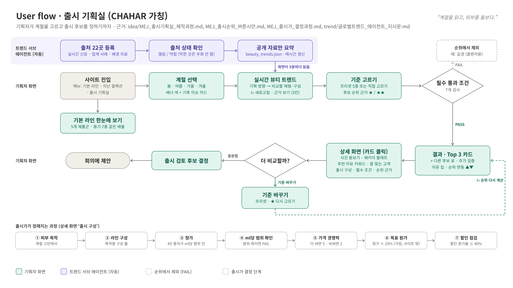

# 유저 플로우

> 이 문서는 HSJ가 AI(Claude Code)에게 준 **지시문**과 그에 따라 만든 **유저 플로우 이미지**를 순서대로 기록한 거예요.
> 지시문은 실제로 입력한 문장을 그대로 옮겼어요 (띄어쓰기·오타 포함, `@` 파일 첨부 표시는 파일 경로로 적음).
> 이미지에서 지운 **예외 처리 상자**와 **따로 보여 주는 목록 상자**의 내용은 [아래 4·5장](#4-예외-처리-이미지에서-뺀-상자)에 정리했어요.

## 📌 한 줄 요약
시나리오 명세의 유저 플로우(Mermaid)를 보기 쉬운 이미지로 바꾸고, 발표용 가로판을 만든 뒤, MEJ의 출시 기획실 문서 5개를 바탕으로 **출시 기획실 유저 플로우**를 새로 그렸어요. 마지막에 예외 처리·목록 상자를 이미지에서 빼고 이 문서로 옮겼어요.

## 🗂️ 결과물

| 파일 | 내용 | 비율 |
|---|---|---|
| [유저플로우_v1.html](유저플로우_v1.html) | **출시 기획실 유저 플로우 v1 (최신)** · 11/18 수정 사항 반영 ([6장](#6-v1-수정-1118)) | 16:9 (1920×1080) |
| [user_flow_launch_studio.png](user_flow_launch_studio.png) / [.svg](user_flow_launch_studio.svg) | 출시 기획실 유저 플로우 (v1 이전판) | 16:9 (3840×2160) |
| [brand/spec/user_flow.png](../brand/spec/user_flow.png) / [.svg](../brand/spec/user_flow.svg) | 시나리오 명세 유저 플로우 (세로) | 960×1300 (PNG는 2배) |
| [brand/spec/user_flow_landscape.png](../brand/spec/user_flow_landscape.png) / [.svg](../brand/spec/user_flow_landscape.svg) | 시나리오 명세 유저 플로우 (발표용 가로) | 16:9 (3840×2160) |
| [brand/spec/시나리오.md](../brand/spec/시나리오.md) 13장 | 같은 흐름의 Mermaid 텍스트판 | — |
| `presentation/2026-11-13_발표/2026-11-13_차하르·청향_발표자료_문구수정_유저플로우 추가.pptx` | 가로판을 17번 슬라이드에 넣은 발표 파일 | 16:9 |

---

## 1. 출시 기획실 유저 플로우 (v1 이전판)

> 11/18에 바뀐 흐름은 [6장](#6-v1-수정-1118)에 있어요. 이 장은 v1 이전판 기준이에요.

### 1-1. 근거 문서

| 문서 | 유저 플로우에서 쓴 곳 |
|---|---|
| `idea/MEJ_출시기획실_제작과정.md` | 사이트 구성(메뉴, 계절 선택, 트렌드, 기준 고르기, 결과, 상세 화면, 기본 라인) |
| `idea/MEJ_출시순위_버튼시안.md` | 필수 통과 조건 7개, 후보 순위 근거 버튼(★/★★), 프리셋, 트렌드 갱신 규칙 |
| `idea/MEJ_출시가_결정과정.md` | 아래 띠의 "출시가가 정해지는 과정" ①~⑦ |
| `idea/trend/글로벌트렌드_에이전트_지시문.md` | 트렌드 서브 에이전트 줄 (출처 22곳 → 상태 확인 → 공개 자료만 요약) |
| `idea/브랜드명_CHAHAR(가칭).md` | 제목의 CHAHAR(가칭), 슬로건 "계절을 읽고, 피부를 돌보다." |

### 1-2. 흐름

**트렌드 서브 에이전트 (자동)**
1. 출처 22곳 등록 (실시간 신호 · 업계 사례 · 배경 자료)
2. 출처 상태 확인 (열림 / 막힘 — 막힌 곳은 우회하지 않음)
3. 공개 자료만 요약해 `beauty_trends.json`에 매시간 갱신
4. 화면이 5분마다 읽어 "실시간 뷰티 트렌드"에 보여 줌

**기획자 화면**
1. 사이트 진입 (메뉴: 기본 라인 · 지난 컬렉션 · 출시 기획실) → 갈래: 기본 라인 한눈에 보기 (5개 제품군 · 용기 7종 같은 배율)
2. 계절 선택 (봄·여름·가을·겨울, 배너 색 + 기후 이슈 카드)
3. 실시간 뷰티 트렌드 (기획 방향 → 비교할 제형·구성, ↻ 새로고침, 근거 보기 3칸)
4. 기준 고르기 (프리셋 5종 또는 직접 고르기, 후보 순위 근거 ★ / ★★)
5. 필수 통과 조건 7개 → **PASS**는 결과로, **FAIL**은 순위에서 제외 (예: 길경, 클렌저용)
6. 결과 · Top 3 카드 (+ 다른 후보 표 · 추가 검증, 이유 칩, 순위 변동 ▲▼)
7. 상세 화면 (사진 돋보기 · 패키지 팔레트, 추천 이유 키워드 · 잘 맞는 고객, 출시 구성 · 필수 조건 · 순위 근거)
8. 더 비교할까?
   - **기준 바꾸기** → 프리셋·★ 다시 고르기 → ↻ 순위 다시 계산 (결과로 돌아감)
   - **충분함** → 출시 검토 후보 결정 → 회의에 제안

**출시가가 정해지는 과정 (상세 화면 '출시 구성')**
① 피부 목적 → ② 라인 구성 → ③ 정가 (K5 중저가 ml당 범위 안) → ④ ml당 범위 확인 (범위 밖이면 FAIL) → ⑤ 가격 경쟁력 (더 싸면 5 · 비싸면 2) → ⑥ 목표 원가 (정가 × 25%, 가정, 사이트 밖) → ⑦ 할인 점검 (할인 원가율 ≤ 40%)

### 1-3. 확인 필요

- "회의에 제안"은 근거 문서 5개에는 없고, 기존 유저스토리("회의에 제안할 후보를 고르기 위해", `presentation/LJH_상품기획자_유저스토리_16x9.html`)에서 가져왔어요.
- 메뉴의 "지난 컬렉션"은 문서에 설명이 없어 메뉴 이름으로만 넣었어요.
- "다른 계절 보기" 갈래는 지시에 따라 이미지에서 지웠어요. 사이트에서 계절 탭을 다시 눌러 바꾸는 동작 자체는 `MEJ_출시순위_버튼시안.md`에 있어요.

---

## 2. 제작 과정 (지시문 → 결과)

### 1단계. 시나리오 명세의 유저 플로우 그리기 (11/13)

| 지시문 | 결과 |
|---|---|
| "user flow 그려줘." | 시나리오 12장 장면 1~9 흐름을 대화 화면용 그림으로 그리고, `시나리오.md` 13장에 Mermaid로 저장 |
| "시나리오.md 의 유저 플로우 머메이드 맵을 좀 더 보기 쉬운 이미지로 만들어줘." | `user_flow.svg`·`user_flow.png` (세로). 메인 흐름 / 예외 처리 두 칸, 장면 번호, 필수·나중 색 구분. `시나리오.md` 13장에 이미지 연결 |
| "커밋해줘" | `[HSJ] user flow 이미지(SVG·PNG) 추가하고 시나리오 13장에 연결` |
| "HSJ 브랜치 brand 폴더에 푸쉬해줘" → (선택) brand/spec 하위로 옮겨 푸시 | `spec/` → `brand/spec/`으로 이동, 이미지 부제의 경로 수정 후 HSJ에 push |

### 2단계. 발표용 가로판 (11/13)

| 지시문 | 결과 |
|---|---|
| "AxO/brand/spec/user_flow.png 가로 이미지로 변경해서 pptx 마지막 슬라이드에 넣어줘. 사이즈는 pptx 파일 사이즈에 맞게 만들어. 이미지 내용은 수정없이 그대로 유지해." (첨부: `2026-11-13_차하르·청향_발표자료_문구수정.pptx`) | 내용은 그대로 두고 배치만 가로(위 줄 →, 아래 줄 ←)로 바꾼 `user_flow_landscape.*` (3840×2160). 발표 파일 끝에 17번 슬라이드로 전체 크기 삽입 |
| "(첨부: …_유저플로우 추가.pptx) research 브랜치 presentation 폴더에 푸쉬해줘" → (선택) HSJ에 올리고 PR | `presentation/2026-11-13_발표/`에 넣어 HSJ에 push. GitHub 로그인이 안 되어 PR은 못 만듦 |
| "research브랜치에 직접올려줘" | HSJ 커밋을 research에 fast-forward로 push (리뷰 없이 반영) |

### 3단계. 출시 기획실 유저 플로우 (11/13)

| 지시문 | 결과 |
|---|---|
| "깃 풀 해줘" | research 최신본(팀원 커밋 23개)을 HSJ에 받음 |
| "AxO/idea/브랜드명_CHAHAR(가칭).md AxO/idea/MEJ_출시기획실_제작과정.md AxO/idea/MEJ_출시가_결정과정.md AxO/idea/MEJ_출시순위_버튼시안.md AxO/idea/trend/글로벌트렌드_에이전트_지시문.md 을 보고 유저 플로우 만들어줘." | `user_flow_launch_studio.*` (16:9). 트렌드 서브 에이전트 줄 + 기획자 화면 두 줄 + 예외 처리 줄 + 출시가 결정 과정 띠 |
| "유저플로우 더 비교할까? > 다른 계절 보기 화살표 삭제해" | "더 비교할까?" → "다른 계절 보기" 화살표와 "다른 계절" 라벨 삭제 |
| "다른 계절 보기 상자도 삭제해" | "다른 계절 보기" 상자와 계절 선택으로 돌아가던 점선 삭제 |
| "따로 보여주는 목록, 정보없음, 오늘 없음 상자 >> 유저플로우 이미지에서 삭제해. 유저플로우 제작 과정과 내 지시문을 정리해서 유저 플로우.md 파일을 만들고 예외처리 상자 내용과 따로 보여주는 목록 상자는 md 파일에 정리해놔" | 이미지에서 추가 검증 후보(목록)·정보 없음 2개·오늘 안 나옴 상자와 연결선, 아래 "예외 처리" 띠를 삭제. 범례도 정리. 이 문서 작성 |

### 만드는 방법

- 이미지는 SVG로 직접 그리고, Microsoft Edge(헤드리스)로 2배 해상도 PNG를 뽑았어요.
- 렌더링한 PNG를 열어 상자·글자·화살표가 겹치지 않는지 매번 확인했어요.
- 발표 파일은 원본 슬라이드를 건드리지 않고 마지막에 그림 슬라이드 1장만 추가했어요.

---

## 3. 이미지에서 뺀 것 한눈에 보기

| 상자 | 종류 | 원래 위치 (출시 기획실 유저 플로우) |
|---|---|---|
| 추가 검증 후보 | 따로 보여 주는 목록 | 필수 통과 조건 위, UNKNOWN 갈래 |
| 오늘 안 나옴 (트렌드) | 예외 처리 | 실시간 뷰티 트렌드 아래 |
| 정보 없음 (점수) | 예외 처리 | 결과 · Top 3 카드 아래 |
| 정보 없음 (가격·원가) | 예외 처리 | 상세 화면 아래 |
| 다른 계절 보기 | 기획자 화면 갈래 | 더 비교할까? 위 (앞 단계에서 삭제) |

- **남겨 둔 것:** "순위에서 제외 (FAIL)" 상자는 지우라는 목록에 없어서 이미지에 남겼어요.

---

## 4. 예외 처리 (이미지에서 뺀 상자)

| 유형 | 어디서 | 상황 | 화면 동작 | 근거 |
|---|---|---|---|---|
| 오늘 안 나옴 | 실시간 뷰티 트렌드 | 근거 자료가 아직 수집되지 않았거나 30일보다 오래됨 | **'예시 인사이트 · 수집 전'**으로 표시하고 실제 트렌드로 단정하지 않음 | MEJ_출시순위_버튼시안.md "실시간 뷰티 트렌드는?" |
| 오늘 안 나옴 | 실시간 뷰티 트렌드 | 150분 이상 갱신이 없음 | **'갱신 확인 필요'** 표시 | 같은 문서 |
| 오늘 안 나옴 | 트렌드 서브 에이전트 | 출처가 자동 접근 차단 (Google Trends, @cosme, 올리브영 판매 랭킹, McKinsey) | 다시 시도·우회하지 않고 **'확인 못 함'**으로 남김. 팀원이 브라우저로 직접 확인해 추가 | 글로벌트렌드_에이전트_지시문.md |
| 정보 없음 | 결과 · Top 3 카드 | 근거가 확인되지 않은 칸 (예: 오가피의 빈자리 공략 칸) | 0점이 아니라 **점수 범위(하한~상한)**와 **'확인 필요'**로 표시 | MEJ_출시순위_버튼시안.md 4장, MEJ_출시기획실_제작과정.md "지켜 온 규칙" |
| 정보 없음 | 상세 화면 · 출시 구성 | 클렌저는 가격 기준(K5) 조사 범위 밖 | 정가 없이 **'가격 기준 준비 중'** 표시 | MEJ_출시가_결정과정.md 3장 |
| 정보 없음 | 기준 고르기 | 원가 자료가 없음 | **💰 수익성** 버튼을 꺼 둠 (누를 수 없음). 목표 원가는 정가 × 25% 가정으로 사이트 밖에서만 계산 | MEJ_출시가_결정과정.md 1·3장 |
| 정보 없음 | 기준 고르기 | 완제품 시험·채널 자료가 없음 | **✨ 핵심 효능 · 📣 채널·고객 확보** 버튼 "자료 준비 중" (누를 수 없음) | MEJ_출시순위_버튼시안.md 4장 |
| 정보 없음 | 기준 고르기 · 📈 뜨는 원료 | 트렌드 파일(`trend.json`) 수집 전 (네이버 데이터랩 API 키 발급 전) | 해당 칸을 빈칸으로 둠 | MEJ_출시순위_버튼시안.md 4장 |

- 마지막 세 줄(✨·📣 버튼, 📈 뜨는 원료)은 원래 이미지 상자에는 없었고, 같은 문서에 있는 예외라서 함께 정리했어요.

---

## 5. 따로 보여 주는 목록 (이미지에서 뺀 상자)

### 추가 검증 후보

| 항목 | 내용 |
|---|---|
| 들어가는 후보 | 필수 통과 조건 중 하나라도 **UNKNOWN**(판단할 자료 부족)인 후보 |
| 화면 위치 | 결과 화면에서 Top 3 카드·다른 후보 표와 **따로** 표시. 순위에는 올리지 않음 |
| 예 | 병풀 — 공정서 약재가 아니라 "한방 원료 근거"가 UNKNOWN |
| 계절별 수 (시안 기준) | 봄 1 (병풀) · 여름 2 (병풀, 길경) · 가을 1 · 겨울 1 |
| 참고 | 길경은 클렌저용이라 "기초라인 적합"이 FAIL → 순위에서 제외 (여름 표에서는 추가 검증 수에 함께 셈) |
| 근거 | MEJ_출시순위_버튼시안.md 2·3장 |

### 이 문서에 정리한 이유

- 지시에 따라 유저 플로우 이미지는 **기획자가 실제로 지나가는 흐름**만 보이게 단순화했어요.
- 예외 처리와 따로 보여 주는 목록은 화면 규칙이라 이 문서에서 표로 관리해요.

---

## 6. v1 수정 (11/18)

### 6-1. 지시문

| 지시문 | 결과 |
|---|---|
| "txt 파일에 유저플로우 수정 사항을 정리했어. 텍스트 파일 내용 외에 것은 생각하지 말고 유저플로우 이미지 수정해서 beautyagent/유저플로우_v1.html 만들어줘. 그리고 수정 과정은 beautyagent/유저 플로우.md 에 기록해줘." (첨부: `##유저플로우 수정 필요.txt`) | `user_flow_launch_studio.svg`를 바탕으로 아래 6가지를 반영한 [유저플로우_v1.html](유저플로우_v1.html) 생성. 원래 SVG·PNG는 그대로 둠 |

### 6-2. 수정 사항 원문 (첨부 txt)

1. 회의에 제안 상자에서 기준 바꾸기 상자로 화살표 방향 추가
2. 기존의 기준 고르기 단계 세분화 — 유저플로우 기준 고르기 상자 이름 후보 만들기 로 바꾸기
   - 실시간 트렌드 분석을 토대로 가능한 모든 후보 생성
   - 각각의 후보에 목표원가, 출시가 계산
   - 디자인 에이전트 : 각 후보의 컨셉에 맞춰서 [제품이미지, 제품사용이미지, 모델이미지, 제품영상] 생성
   - 가중치 계산해서 원하는 후보 개수 사용자 화면에 보여주기
3. 우리가 기존에 세운 가중치 조건을 필수조건에서 빼고 후보를 순위로 나열할 때 근거로만 사용해. 후보는 모든 자료를 통합해서 최대한 많이 만들어야 해.
4. 필수통과조건 상자, 순위에서 제외 상자 지우기
5. 상세화면(카드 클릭) 상자 내용 수정
   - 필수조건, 순위 근거는 사용자에게 보여지지 않게
   - 추천 이유 키워드 -> 광고 활용 가능 범위에서
   - 이외에 사용자에게 보여주면 좋을 정보 제안해줘
6. 기본 라인 한눈에 보기 상자 삭제

### 6-3. 이미지에 반영한 내용

| # | 반영 |
|---|---|
| 1 | "회의에 제안" 아래에서 "기준 바꾸기" 왼쪽으로 들어가는 화살표 추가. "더 비교할까?"에서 오는 화살표는 오른쪽에서 들어가게 하고, "기준 바꾸기"를 두 화살표 사이(출시 검토 후보 결정 아래)로 옮김 |
| 2 | "기준 고르기" 상자를 지우고 **후보 만들기** 묶음을 한 줄 새로 만듦: ① 가능한 후보 모두 생성 → ② 목표 원가·출시가 계산 → ③ 디자인 에이전트(제품 이미지·제품 사용 이미지·모델 이미지·제품 영상) → ④ 가중치 계산·순위(원하는 후보 개수만 화면에 표시). 디자인 에이전트는 자동으로 도는 단계라 트렌드 에이전트와 같은 보라색으로 칠함 |
| 3 | 후보 만들기 묶음 머리에 "모든 자료를 통합해 후보를 최대한 많이 · 가중치는 필수 조건이 아니라 순위 근거로만 사용" 적음. ④ 상자는 "순위 근거로 후보 나열" |
| 4 | "필수 통과 조건" 마름모, "순위에서 제외" 상자, PASS·FAIL 화살표 삭제. ④ → 결과 · Top 3 카드로 바로 연결. 범례의 "순위에서 제외 (FAIL)" 삭제 |
| 5 | 상세 화면에서 "필수 조건 · 순위 근거" 삭제. "추천 이유 키워드" 아래에 "(광고 활용 가능 범위에서)" 추가. 남은 내용: 사진 돋보기 · 패키지 팔레트 / 추천 이유 키워드 (광고 활용 가능 범위에서) / 잘 맞는 고객 · 출시 구성 |
| 6 | "기본 라인 한눈에 보기" 상자와 사이트 진입에서 내려가던 화살표 삭제 |

- 그 밖에 줄 배치를 맞추려고 아래쪽(결과 줄, 출시가 띠, 범례)을 조금 아래로 내리고, 범례 이름을 "기획자 화면 · 후보 만들기", "트렌드 · 디자인 에이전트 (자동)"로 바꿨어요. 상자 내용은 위 6가지 말고는 바꾸지 않았어요.
- "추천 이유 키워드 → 광고 활용 가능 범위에서"는 **추천 이유 키워드를 광고에 쓸 수 있는 표현 안에서만 보여 준다**는 뜻으로 읽었어요. 다른 뜻이면 알려 주세요.

### 6-4. 상세 화면에 보여 주면 좋을 정보 (제안 · 이미지에는 아직 안 넣음)

| 제안 | 이유 |
|---|---|
| 디자인 에이전트 결과물 (제품 이미지 · 제품 사용 이미지 · 모델 이미지 · 제품 영상) | 후보 만들기 ③에서 만든 자료를 카드 안에서 바로 볼 수 있어야 회의에 들고 가기 쉬움 |
| 목표 원가 · 출시가 | 후보 만들기 ②의 계산 결과. 지금은 "출시 구성" 안에 묻혀 있어 숫자를 따로 보여 주면 비교가 빠름 |
| 후보 컨셉 한 줄 요약 | 이미지·영상이 어떤 컨셉으로 만들어졌는지 한눈에 알 수 있음 |
| 주요 원료 · 제형 | 실시간 트렌드에서 나온 원료·제형이 무엇인지 확인 |
| 트렌드 근거 (출처 · 수집 날짜) | 가중치 점수는 숨기더라도, 트렌드가 언제 어디서 나왔는지는 믿을 근거가 됨 |
| 비슷한 시중 제품 · 가격대 | 출시가가 시장에서 어느 위치인지 비교 |

### 6-5. 확인 필요 (txt에 없어서 그대로 둔 것)

- **결과 · Top 3 카드**: 2번에서 "원하는 후보 개수"를 보여 준다고 했는데 상자 이름은 "Top 3"로 남아 있어요. "Top N" 등으로 바꿀지 정해 주세요.
- **결과 상자의 "추가 검증"**: 원래 필수 통과 조건에서 UNKNOWN인 후보를 모아 보여 주던 목록이에요([5장](#5-따로-보여-주는-목록-이미지에서-뺀-상자)). 필수 통과 조건이 빠지면서 남길지 정해야 해요.
- **기준 바꾸기의 "프리셋 · ★ 다시 고르기"**: 기준 고르기 상자가 없어진 뒤에도 문구는 그대로예요. "가중치 다시 고르기" 등으로 바꿀지 정해 주세요.
- **"↻ 순위 다시 계산"** 화살표는 원래대로 결과 · Top 3 카드로 돌아가요.

### 6-6. 확인 필요 답변 (11/18)

| 항목 | 지시문 | 결과 |
|---|---|---|
| 결과 · Top 3 카드 | "top3 글자 지우고 사용자가 원하는 개수 로 수정" | 상자 이름을 **"결과 · 사용자가 원하는 개수"**로 바꿈 |
| 추가 검증 | "이건 어디 위치에 있으면 좋을지 니가 제안해줘." | 아래 6-7 제안. 결정 전이라 이미지는 그대로 둠 |
| 기준 바꾸기 | "상자 이름을 바꿔야할 것 같아. 피드백·평가 에이전트를 통해서 다시 결과를 뽑아내는 과정이 될텐데 뭐라고 정하면 좋을지 제안해줘." | 아래 6-8 제안. 결정 전이라 이미지는 그대로 둠 |

### 6-7. 제안 — "추가 검증"을 어디에 둘까

필수 통과 조건이 없어져서 "자료가 부족해 따로 빼 두는 목록"은 더 이상 필요 없어요. 대신 **자료가 부족한 후보도 순위에 넣고, 어떤 자료가 비었는지만 표시**하는 쪽을 추천해요.

| 안 | 위치 | 장점 | 단점 |
|---|---|---|---|
| **A (추천)** | 후보 만들기 ④ 가중치 계산 · 순위 — 자료가 빈 후보에 **'자료 보충 필요' 표시**를 붙여 순위에 함께 올림 | "후보는 최대한 많이"(3번)와 맞음. 빠지는 후보가 없음 | 빈칸이 많은 후보는 순위가 낮게 나옴 |
| B | 결과 화면의 다른 후보 표 아래 **'자료 보충 필요' 탭** | 결과 화면이 깔끔함 | 따로 빼 두면 사실상 예전 필수 조건처럼 작동 |
| C | 기준 바꾸기(피드백·평가) 단계의 **입력**으로 보냄 — 평가 에이전트가 빈 자료를 다시 찾아 채우고 순위를 다시 계산 | 피드백 고리와 자연스럽게 이어짐 | 처음 결과 화면에서는 안 보임 |

- A로 정하면 결과 상자의 "+ 다른 후보 표 · 추가 검증"은 "+ 다른 후보 표 · 자료 보충 필요 표시"로 바꾸면 돼요. A와 C는 함께 쓸 수도 있어요.

### 6-8. 제안 — "기준 바꾸기" 상자 이름

피드백·평가 에이전트가 기획자 의견과 회의 결과를 받아 순위를 다시 뽑는 단계예요.

| 이름 후보 | 느낌 |
|---|---|
| **피드백 반영 · 다시 평가** (추천) | 무엇을 받고(피드백) 무엇을 하는지(다시 평가)가 바로 보임. 아래 줄은 "피드백·평가 에이전트" |
| 평가 에이전트 재검토 | 에이전트가 하는 일이라는 점이 강조됨 |
| 피드백으로 다시 뽑기 | 가장 쉬운 말. 사용자 화면 버튼 이름으로도 쓸 수 있음 |
| 후보 다시 평가 | 짧고 중립적. 무엇을 근거로 하는지는 아래 줄에 적어야 함 |

- 이름을 바꾸면 상자를 디자인·트렌드 에이전트처럼 보라색(자동)으로 칠하는 것도 함께 정하면 좋아요.

### 6-9. 제목에서 브랜드명 삭제 (11/18)

| 지시문 | 결과 |
|---|---|
| "우리는 이 에이전트 이름을 새로 만들거고 출시 기획실 뒤의 차하르 가칭 글자는 지워줘. 차하르나 청향, 우리가 적어둔 브랜드명 후보들은 앞으로 샘플 이미지를 만들기 위한 것으로 사용할거야." | v1 제목을 "User flow · 출시 기획실 (CHAHAR 가칭)" → **"User flow · 출시 기획실"**로 바꿈 |

- 에이전트 이름은 새로 정할 예정이에요. 정해지면 제목에 넣어요.
- CHAHAR(차하르)·청향 등 브랜드명 후보는 앞으로 **샘플 이미지용 이름**으로만 써요.
- 오른쪽 위 슬로건 "계절을 읽고, 피부를 돌보다."는 지시에 없어서 그대로 두었어요. 브랜드명 문서에서 온 문구라 함께 뺄지 정해 주세요.

### 6-10. 추가 검증 · 기준 바꾸기 결정 (11/18)

| 항목 | 지시문 | 결과 |
|---|---|---|
| 추가 검증 | "c로 하고, 자료 보충이 필요한 후보는 아무리 가중치를 많이 받더라도 사용자에게 추천하면 안될 것 같아. 근거가 불충분한 후보는 추천할 수 없어." | 6-7의 **C안**으로 정함. 후보 만들기에서 **후보 다시 평가**로 가는 갈색 점선을 추가했어요. 라벨은 "자료 보충 필요 후보 (추천 안 함 · 빈 자료 채운 뒤 재계산)". ④ 상자에 "**근거 부족 후보는 추천 안 함**" 줄을 넣었고, 결과 상자의 "· 추가 검증"은 지웠어요. 범례에 "자료 보충 필요 후보 (추천 안 함)"을 추가했어요 |
| 기준 바꾸기 | "후보 다시 평가 로 수정. 아래줄에는 사용자 피드백 반영 · ai 평가 반영" | 상자 이름을 **"후보 다시 평가"**로, 아래 줄을 **"사용자 피드백 반영 · AI 평가 반영"**으로 바꿨어요. 글자가 들어가도록 상자 폭을 250 → 280으로 넓혔고, 더 비교할까?에서 오는 화살표 라벨도 "기준 바꾸기" → "다시 평가"로 맞췄어요 |

- **규칙:** 근거가 부족한 후보는 가중치 점수가 아무리 높아도 사용자에게 추천하지 않아요. 후보 다시 평가 단계에서 빈 자료를 채우고 순위를 다시 계산한 뒤에야 추천 대상이 돼요.
- 5장의 "추가 검증 후보" 목록은 v1 이전판 기준이에요. v1에서는 이 규칙으로 대신해요.
