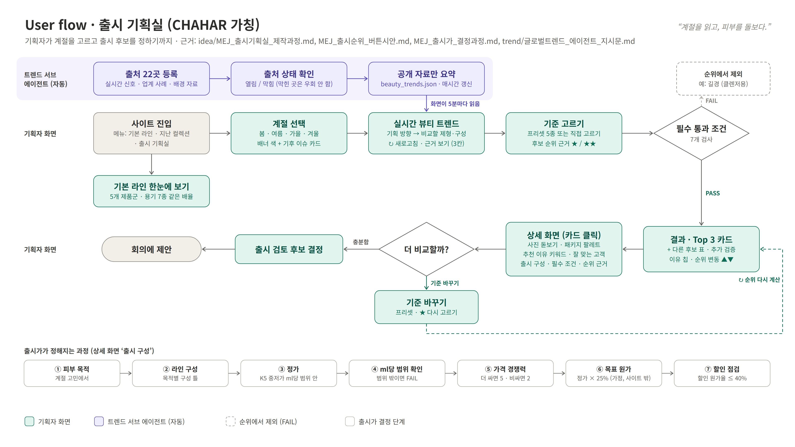

# 유저 플로우

> 이 문서는 HSJ가 AI(Claude Code)에게 준 **지시문**과 그에 따라 만든 **유저 플로우 이미지**를 순서대로 기록한 거예요.
> 지시문은 실제로 입력한 문장을 그대로 옮겼어요 (띄어쓰기·오타 포함, `@` 파일 첨부 표시는 파일 경로로 적음).
> 이미지에서 지운 **예외 처리 상자**와 **따로 보여 주는 목록 상자**의 내용은 [아래 4·5장](#4-예외-처리-이미지에서-뺀-상자)에 정리했어요.

## 📌 한 줄 요약
시나리오 명세의 유저 플로우(Mermaid)를 보기 쉬운 이미지로 바꾸고, 발표용 가로판을 만든 뒤, MEJ의 출시 기획실 문서 5개를 바탕으로 **출시 기획실 유저 플로우**를 새로 그렸어요. 마지막에 예외 처리·목록 상자를 이미지에서 빼고 이 문서로 옮겼어요.

## 🗂️ 결과물

| 파일 | 내용 | 비율 |
|---|---|---|
| [user_flow_launch_studio.png](user_flow_launch_studio.png) / [.svg](user_flow_launch_studio.svg) | **출시 기획실 유저 플로우 (최신)** | 16:9 (3840×2160) |
| [user_flow.png](user_flow.png) / [.svg](user_flow.svg) | 시나리오 명세 유저 플로우 (세로) | 960×1300 (PNG는 2배) |
| [user_flow_landscape.png](user_flow_landscape.png) / [.svg](user_flow_landscape.svg) | 시나리오 명세 유저 플로우 (발표용 가로) | 16:9 (3840×2160) |
| [시나리오.md](시나리오.md) 13장 | 같은 흐름의 Mermaid 텍스트판 | — |
| `presentation/2026-11-13_발표/2026-11-13_차하르·청향_발표자료_문구수정_유저플로우 추가.pptx` | 가로판을 17번 슬라이드에 넣은 발표 파일 | 16:9 |

---

## 1. 출시 기획실 유저 플로우 (최신)

### 1-1. 근거 문서

| 문서 | 유저 플로우에서 쓴 곳 |
|---|---|
| `idea/MEJ_출시기획실_제작과정.md` | 사이트 구성(메뉴, 계절 선택, 트렌드, 기준 고르기, 결과, 상세 화면, 기본 라인) |
| `idea/MEJ_출시순위_버튼시안.md` | 필수 통과 조건 7개, 후보 순위 근거 버튼(★/★★), 프리셋, 트렌드 갱신 규칙 |
| `idea/MEJ_출시가_결정과정.md` | 아래 띠의 "출시가가 정해지는 과정" ①~⑦ |
| `idea/trend/글로벌트렌드_에이전트_지시문.md` | 트렌드 서브 에이전트 줄 (출처 22곳 → 상태 확인 → 공개 자료만 요약) |
| `idea/브랜드명_CHAHAR(가칭).md` | 제목의 CHAHAR(가칭), 슬로건 "계절을 읽고, 피부를 돌보다." |

### 1-2. 흐름

**트렌드 서브 에이전트 (자동)**
1. 출처 22곳 등록 (실시간 신호 · 업계 사례 · 배경 자료)
2. 출처 상태 확인 (열림 / 막힘 — 막힌 곳은 우회하지 않음)
3. 공개 자료만 요약해 `beauty_trends.json`에 매시간 갱신
4. 화면이 5분마다 읽어 "실시간 뷰티 트렌드"에 보여 줌

**기획자 화면**
1. 사이트 진입 (메뉴: 기본 라인 · 지난 컬렉션 · 출시 기획실) → 갈래: 기본 라인 한눈에 보기 (5개 제품군 · 용기 7종 같은 배율)
2. 계절 선택 (봄·여름·가을·겨울, 배너 색 + 기후 이슈 카드)
3. 실시간 뷰티 트렌드 (기획 방향 → 비교할 제형·구성, ↻ 새로고침, 근거 보기 3칸)
4. 기준 고르기 (프리셋 5종 또는 직접 고르기, 후보 순위 근거 ★ / ★★)
5. 필수 통과 조건 7개 → **PASS**는 결과로, **FAIL**은 순위에서 제외 (예: 길경, 클렌저용)
6. 결과 · Top 3 카드 (+ 다른 후보 표 · 추가 검증, 이유 칩, 순위 변동 ▲▼)
7. 상세 화면 (사진 돋보기 · 패키지 팔레트, 추천 이유 키워드 · 잘 맞는 고객, 출시 구성 · 필수 조건 · 순위 근거)
8. 더 비교할까?
   - **기준 바꾸기** → 프리셋·★ 다시 고르기 → ↻ 순위 다시 계산 (결과로 돌아감)
   - **충분함** → 출시 검토 후보 결정 → 회의에 제안

**출시가가 정해지는 과정 (상세 화면 '출시 구성')**
① 피부 목적 → ② 라인 구성 → ③ 정가 (K5 중저가 ml당 범위 안) → ④ ml당 범위 확인 (범위 밖이면 FAIL) → ⑤ 가격 경쟁력 (더 싸면 5 · 비싸면 2) → ⑥ 목표 원가 (정가 × 25%, 가정, 사이트 밖) → ⑦ 할인 점검 (할인 원가율 ≤ 40%)

### 1-3. 확인 필요

- "회의에 제안"은 근거 문서 5개에는 없고, 기존 유저스토리("회의에 제안할 후보를 고르기 위해", `presentation/LJH_상품기획자_유저스토리_16x9.html`)에서 가져왔어요.
- 메뉴의 "지난 컬렉션"은 문서에 설명이 없어 메뉴 이름으로만 넣었어요.
- "다른 계절 보기" 갈래는 지시에 따라 이미지에서 지웠어요. 사이트에서 계절 탭을 다시 눌러 바꾸는 동작 자체는 `MEJ_출시순위_버튼시안.md`에 있어요.

---

## 2. 제작 과정 (지시문 → 결과)

### 1단계. 시나리오 명세의 유저 플로우 그리기 (11/13)

| 지시문 | 결과 |
|---|---|
| "user flow 그려줘." | 시나리오 12장 장면 1~9 흐름을 대화 화면용 그림으로 그리고, `시나리오.md` 13장에 Mermaid로 저장 |
| "시나리오.md 의 유저 플로우 머메이드 맵을 좀 더 보기 쉬운 이미지로 만들어줘." | `user_flow.svg`·`user_flow.png` (세로). 메인 흐름 / 예외 처리 두 칸, 장면 번호, 필수·나중 색 구분. `시나리오.md` 13장에 이미지 연결 |
| "커밋해줘" | `[HSJ] user flow 이미지(SVG·PNG) 추가하고 시나리오 13장에 연결` |
| "HSJ 브랜치 brand 폴더에 푸쉬해줘" → (선택) brand/spec 하위로 옮겨 푸시 | `spec/` → `brand/spec/`으로 이동, 이미지 부제의 경로 수정 후 HSJ에 push |

### 2단계. 발표용 가로판 (11/13)

| 지시문 | 결과 |
|---|---|
| "AxO/brand/spec/user_flow.png 가로 이미지로 변경해서 pptx 마지막 슬라이드에 넣어줘. 사이즈는 pptx 파일 사이즈에 맞게 만들어. 이미지 내용은 수정없이 그대로 유지해." (첨부: `2026-11-13_차하르·청향_발표자료_문구수정.pptx`) | 내용은 그대로 두고 배치만 가로(위 줄 →, 아래 줄 ←)로 바꾼 `user_flow_landscape.*` (3840×2160). 발표 파일 끝에 17번 슬라이드로 전체 크기 삽입 |
| "(첨부: …_유저플로우 추가.pptx) research 브랜치 presentation 폴더에 푸쉬해줘" → (선택) HSJ에 올리고 PR | `presentation/2026-11-13_발표/`에 넣어 HSJ에 push. GitHub 로그인이 안 되어 PR은 못 만듦 |
| "research브랜치에 직접올려줘" | HSJ 커밋을 research에 fast-forward로 push (리뷰 없이 반영) |

### 3단계. 출시 기획실 유저 플로우 (11/13)

| 지시문 | 결과 |
|---|---|
| "깃 풀 해줘" | research 최신본(팀원 커밋 23개)을 HSJ에 받음 |
| "AxO/idea/브랜드명_CHAHAR(가칭).md AxO/idea/MEJ_출시기획실_제작과정.md AxO/idea/MEJ_출시가_결정과정.md AxO/idea/MEJ_출시순위_버튼시안.md AxO/idea/trend/글로벌트렌드_에이전트_지시문.md 을 보고 유저 플로우 만들어줘." | `user_flow_launch_studio.*` (16:9). 트렌드 서브 에이전트 줄 + 기획자 화면 두 줄 + 예외 처리 줄 + 출시가 결정 과정 띠 |
| "유저플로우 더 비교할까? > 다른 계절 보기 화살표 삭제해" | "더 비교할까?" → "다른 계절 보기" 화살표와 "다른 계절" 라벨 삭제 |
| "다른 계절 보기 상자도 삭제해" | "다른 계절 보기" 상자와 계절 선택으로 돌아가던 점선 삭제 |
| "따로 보여주는 목록, 정보없음, 오늘 없음 상자 >> 유저플로우 이미지에서 삭제해. 유저플로우 제작 과정과 내 지시문을 정리해서 유저 플로우.md 파일을 만들고 예외처리 상자 내용과 따로 보여주는 목록 상자는 md 파일에 정리해놔" | 이미지에서 추가 검증 후보(목록)·정보 없음 2개·오늘 안 나옴 상자와 연결선, 아래 "예외 처리" 띠를 삭제. 범례도 정리. 이 문서 작성 |

### 만드는 방법

- 이미지는 SVG로 직접 그리고, Microsoft Edge(헤드리스)로 2배 해상도 PNG를 뽑았어요.
- 렌더링한 PNG를 열어 상자·글자·화살표가 겹치지 않는지 매번 확인했어요.
- 발표 파일은 원본 슬라이드를 건드리지 않고 마지막에 그림 슬라이드 1장만 추가했어요.

---

## 3. 이미지에서 뺀 것 한눈에 보기

| 상자 | 종류 | 원래 위치 (출시 기획실 유저 플로우) |
|---|---|---|
| 추가 검증 후보 | 따로 보여 주는 목록 | 필수 통과 조건 위, UNKNOWN 갈래 |
| 오늘 안 나옴 (트렌드) | 예외 처리 | 실시간 뷰티 트렌드 아래 |
| 정보 없음 (점수) | 예외 처리 | 결과 · Top 3 카드 아래 |
| 정보 없음 (가격·원가) | 예외 처리 | 상세 화면 아래 |
| 다른 계절 보기 | 기획자 화면 갈래 | 더 비교할까? 위 (앞 단계에서 삭제) |

- **남겨 둔 것:** "순위에서 제외 (FAIL)" 상자는 지우라는 목록에 없어서 이미지에 남겼어요.

---

## 4. 예외 처리 (이미지에서 뺀 상자)

| 유형 | 어디서 | 상황 | 화면 동작 | 근거 |
|---|---|---|---|---|
| 오늘 안 나옴 | 실시간 뷰티 트렌드 | 근거 자료가 아직 수집되지 않았거나 30일보다 오래됨 | **'예시 인사이트 · 수집 전'**으로 표시하고 실제 트렌드로 단정하지 않음 | MEJ_출시순위_버튼시안.md "실시간 뷰티 트렌드는?" |
| 오늘 안 나옴 | 실시간 뷰티 트렌드 | 150분 이상 갱신이 없음 | **'갱신 확인 필요'** 표시 | 같은 문서 |
| 오늘 안 나옴 | 트렌드 서브 에이전트 | 출처가 자동 접근 차단 (Google Trends, @cosme, 올리브영 판매 랭킹, McKinsey) | 다시 시도·우회하지 않고 **'확인 못 함'**으로 남김. 팀원이 브라우저로 직접 확인해 추가 | 글로벌트렌드_에이전트_지시문.md |
| 정보 없음 | 결과 · Top 3 카드 | 근거가 확인되지 않은 칸 (예: 오가피의 빈자리 공략 칸) | 0점이 아니라 **점수 범위(하한~상한)**와 **'확인 필요'**로 표시 | MEJ_출시순위_버튼시안.md 4장, MEJ_출시기획실_제작과정.md "지켜 온 규칙" |
| 정보 없음 | 상세 화면 · 출시 구성 | 클렌저는 가격 기준(K5) 조사 범위 밖 | 정가 없이 **'가격 기준 준비 중'** 표시 | MEJ_출시가_결정과정.md 3장 |
| 정보 없음 | 기준 고르기 | 원가 자료가 없음 | **💰 수익성** 버튼을 꺼 둠 (누를 수 없음). 목표 원가는 정가 × 25% 가정으로 사이트 밖에서만 계산 | MEJ_출시가_결정과정.md 1·3장 |
| 정보 없음 | 기준 고르기 | 완제품 시험·채널 자료가 없음 | **✨ 핵심 효능 · 📣 채널·고객 확보** 버튼 "자료 준비 중" (누를 수 없음) | MEJ_출시순위_버튼시안.md 4장 |
| 정보 없음 | 기준 고르기 · 📈 뜨는 원료 | 트렌드 파일(`trend.json`) 수집 전 (네이버 데이터랩 API 키 발급 전) | 해당 칸을 빈칸으로 둠 | MEJ_출시순위_버튼시안.md 4장 |

- 마지막 세 줄(✨·📣 버튼, 📈 뜨는 원료)은 원래 이미지 상자에는 없었고, 같은 문서에 있는 예외라서 함께 정리했어요.

---

## 5. 따로 보여 주는 목록 (이미지에서 뺀 상자)

### 추가 검증 후보

| 항목 | 내용 |
|---|---|
| 들어가는 후보 | 필수 통과 조건 중 하나라도 **UNKNOWN**(판단할 자료 부족)인 후보 |
| 화면 위치 | 결과 화면에서 Top 3 카드·다른 후보 표와 **따로** 표시. 순위에는 올리지 않음 |
| 예 | 병풀 — 공정서 약재가 아니라 "한방 원료 근거"가 UNKNOWN |
| 계절별 수 (시안 기준) | 봄 1 (병풀) · 여름 2 (병풀, 길경) · 가을 1 · 겨울 1 |
| 참고 | 길경은 클렌저용이라 "기초라인 적합"이 FAIL → 순위에서 제외 (여름 표에서는 추가 검증 수에 함께 셈) |
| 근거 | MEJ_출시순위_버튼시안.md 2·3장 |

### 이 문서에 정리한 이유

- 지시에 따라 유저 플로우 이미지는 **기획자가 실제로 지나가는 흐름**만 보이게 단순화했어요.
- 예외 처리와 따로 보여 주는 목록은 화면 규칙이라 이 문서에서 표로 관리해요.
