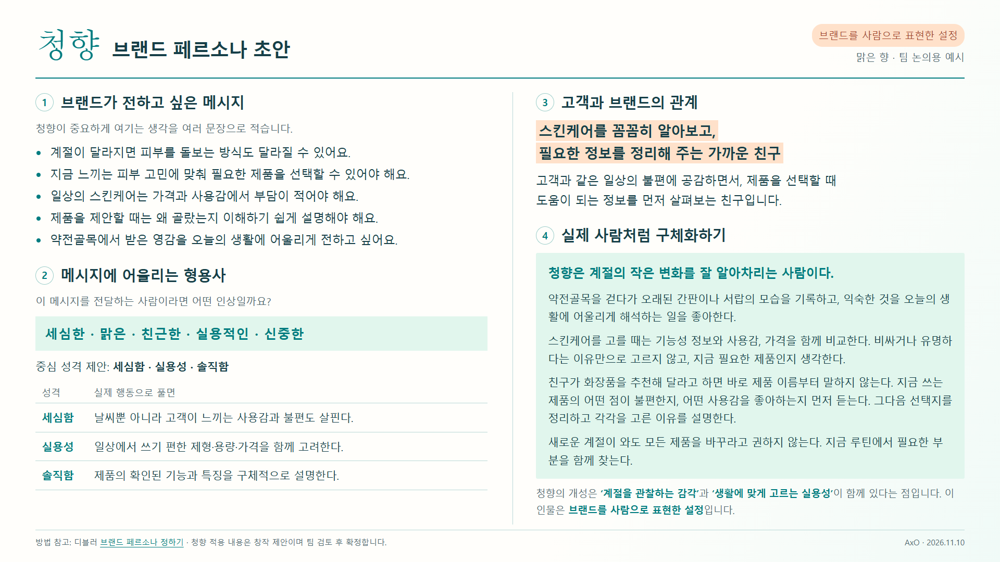
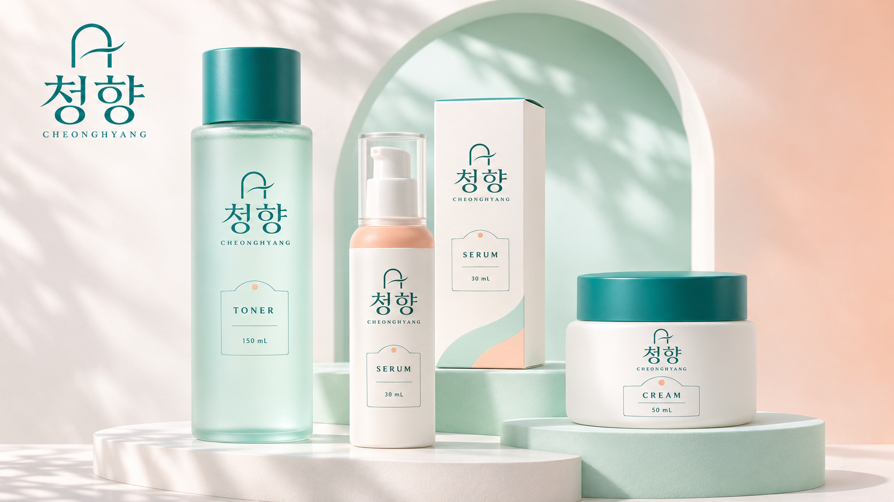
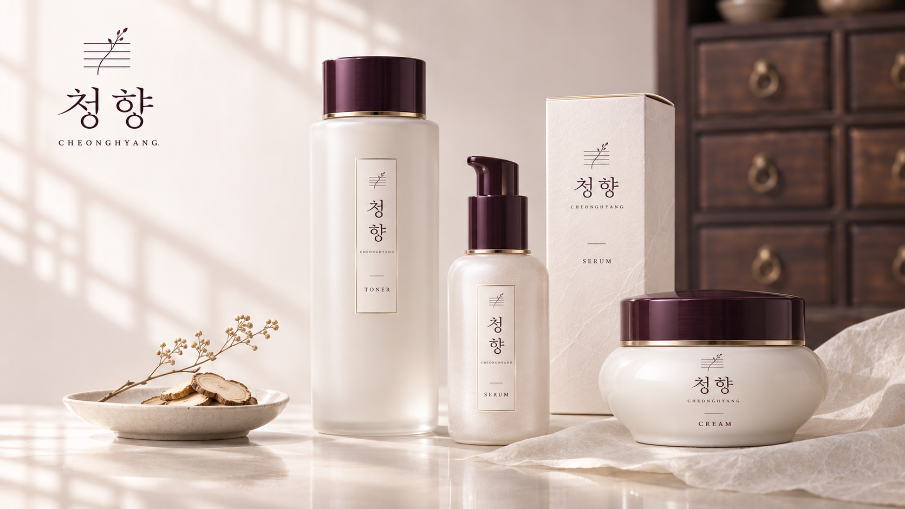
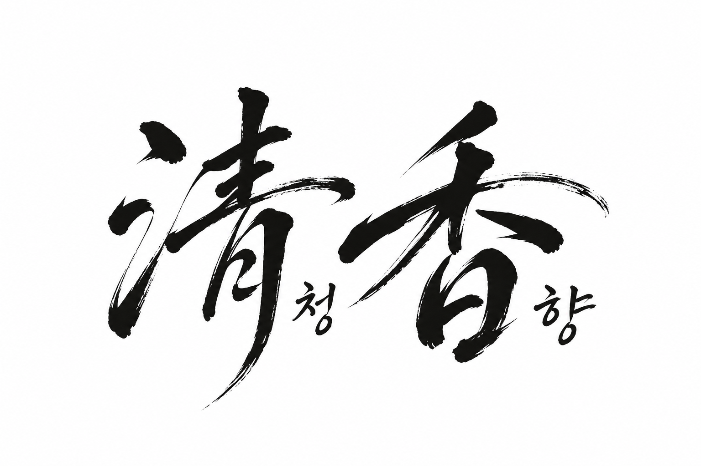
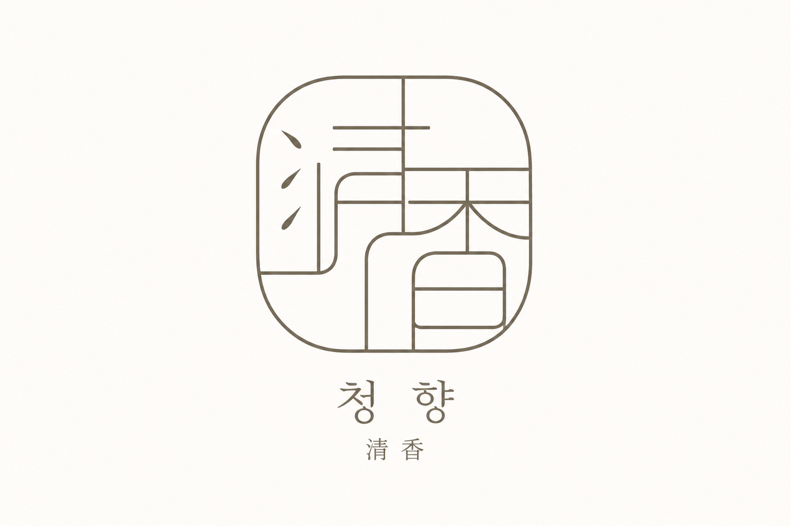
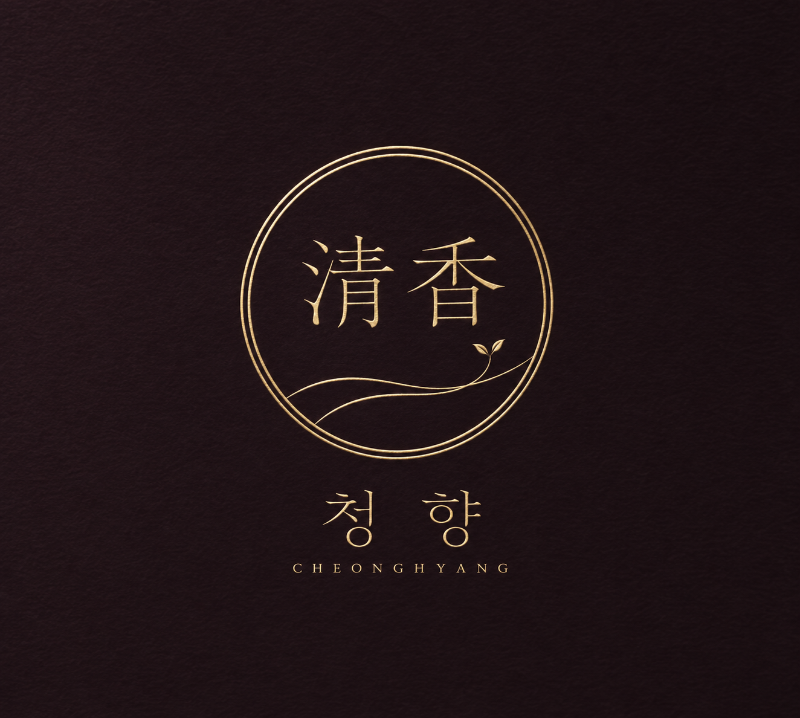
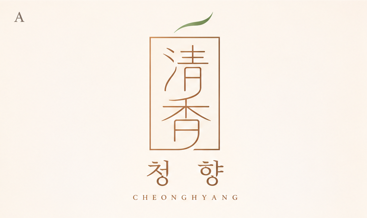
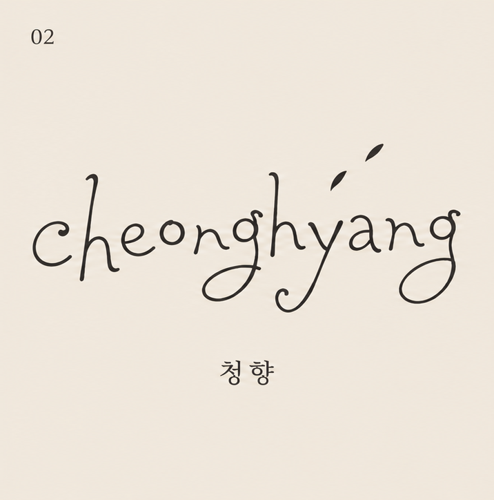

# 청향 · 오늘의 작업 모음

**MEJ · 2026-11-10 · 팀 논의용 초안**

브랜드 페르소나 / 고객 페르소나 / 패키지 / 한자·로마자 로고

- 오늘 만든 시안을 모두 모았습니다. 초기안과 수정안도 비교할 수 있습니다.
- 로마자 손글씨 후보 02는 사용자 선호안이며, 최종 확정안은 아닙니다.
- 이 파일의 구분선 한 개가 슬라이드 한 장입니다.

---

# 오늘의 방향과 남은 결정

| 구분 | 현재 기록 |
|---|---|
| 브랜드 | 청향, 맑은 향 / 淸香 / CHEONGHYANG |
| 제품 콘셉트 | 중저가 기능성 스킨케어. 계절별 주요 피부 고민과 가중치로 기초라인 후보 선정, 절기에 맞춰 출시 |
| 지역성 | 대구 약전골목의 이미지와 이야기 활용 |
| 제외한 조사 | 한방뷰티 산업을 선택한 근거를 추가로 찾는 일 |
| 한자형 배치 | **淸청香향**: 각 한자의 오른쪽 아래에 작은 독음 |
| 로마자형 | 별도 대안으로 탐색. 손글씨 02를 우선 후보로 선호 |
| 최종 채택 | 팀 논의 후 결정 |

출처: 현재 대화의 사용자 설명과 선택. 시장 검증 결과와 구분합니다.

---

# 브랜드 페르소나 · 원페이지



---

# 브랜드가 전하고 싶은 메시지

- [아이디어] 계절이 달라지면 피부를 돌보는 방식도 달라질 수 있어요.
- [아이디어] 지금 느끼는 피부 고민에 맞춰 필요한 제품을 선택할 수 있어야 해요.
- [아이디어] 일상의 스킨케어는 가격과 사용감에서 부담이 적어야 해요.
- [아이디어] 제품을 제안할 때는 왜 골랐는지 이해하기 쉽게 설명해야 해요.
- [아이디어] 약전골목에서 받은 영감을 오늘의 생활에 어울리게 전하고 싶어요.

방법 참고: [디블러 브랜드 페르소나 가이드](https://m.blog.naver.com/01063694566/223388247614). 2026-11-10 본문 확인. 방법 참고용 🔴 자료이며 청향 내용은 창작 제안입니다.

---

# 브랜드의 성격과 고객을 대하는 역할

**세심한 · 맑은 · 친근한 · 실용적인 · 신중한**

| 중심 성격 | 브랜드의 행동 |
|---|---|
| 세심함 | 날씨뿐 아니라 고객이 느끼는 사용감과 불편도 살핀다. |
| 실용성 | 일상에서 쓰기 편한 제형·용량·가격을 함께 고려한다. |
| 솔직함 | 제품의 확인된 기능과 특징을 구체적으로 설명한다. |

[아이디어] **스킨케어를 꼼꼼히 알아보고, 필요한 정보를 정리해 주는 가까운 친구.**

이는 브랜드의 성격과 역할이며 고객의 인물 프로필이 아닙니다.

---

# 브랜드를 실제 사람처럼 구체화하기

- 청향은 계절의 작은 변화를 잘 알아차리는 사람이다.
- 약전골목을 걷다가 오래된 간판이나 서랍의 모습을 기록하고, 익숙한 것을 오늘의 생활에 어울리게 해석하는 일을 좋아한다.
- 스킨케어를 고를 때는 기능성 정보와 사용감, 가격을 함께 비교한다. 비싸거나 유명하다는 이유만으로 고르지 않고, 지금 필요한 제품인지 생각한다.
- 친구가 화장품을 추천해 달라고 하면 바로 제품 이름부터 말하지 않는다. 지금 쓰는 제품의 어떤 점이 불편한지, 어떤 사용감을 좋아하는지 먼저 듣는다. 그다음 선택지를 정리하고 각각을 고른 이유를 설명한다.
- 새로운 계절이 와도 모든 제품을 바꾸라고 권하지 않는다. 지금 루틴에서 필요한 부분을 함께 찾는다.

청향의 개성은 **'계절을 관찰하는 감각'**과 **'생활에 맞게 고르는 실용성'**이 함께 있다는 점이에요. 이 인물은 브랜드를 사람으로 표현한 설정이에요.


[아이디어] 위 설정은 팀 검토 전 브랜드 의인화입니다.

---

# 고객 페르소나 · 네 가지 구매 장벽

기존 고객 초안에서 가져온 **가상 인물**입니다. 이름·직업·지역·예산·경험·대사는 실제 인터뷰가 아닙니다.

| 유형 | 가상 인물 | 고민 | 제안할 도움 |
|---|---|---|---|
| 향 | 이하은 | 향이 강하고 오래 남을까 걱정 | 향 강도와 사용감을 쉽게 설명 |
| 무게감 | 최유진 | 번들거리고 무거울까 걱정 | 제형·마무리감 비교 |
| 이미지 | 정다은 | 내 취향·나이와 어울리지 않는 이미지 | 현대적인 디자인과 일상 사용 장면 |
| 불신 | 강수빈 | 성분·원산지·함량 정보가 부족 | 확인 가능한 정보와 근거 제공 |

**확인 필요:** 기존 타깃은 2030인데 고객 원안은 19~29세 여성으로 좁혔습니다. 나이·성별·지역을 팀에서 다시 합의해야 합니다.

---

# 페르소나 1. 👃 향 거부형 · 이하은 (가상)

| 항목 | 내용 |
|---|---|
| 인적사항 | [아이디어] 24세 여성, 대학교 4학년(카페 아르바이트), 대구 북구에서 가족과 거주 |
| 피부 | [아이디어] 민감성. 향이 강하면 머리가 아픔. 고민은 붉어짐, 자극에 예민함 |
| 행동 | [아이디어] 한 달 2~3만 원, 인스타 릴스·틱톡에서 정보를 얻음. 엄마 한방 크림을 한 번 발라 봄 |
| 고객의 말 | [아이디어] "엄마 크림 한 번 발라 봤는데 한약 냄새가 하루 종일 났어요." |
| 페인포인트 | 얼굴에 바르면 약재 향이 너무 세고 오래 남는다. [원문 조사 주장·재확인 필요] 20대 향 만족도가 전 연령 중 가장 낮음 [2], "한방 냄새 싫으면 비추" 후기 [3] |
| 기회포인트 | [아이디어] 향 세기 고르기(거의 없게·은은하게·그대로), 얼굴용은 거의 무향. [원문 조사 주장·재확인 필요] 팀 K1 향 원칙과 같은 방향 [6] |

[아이디어] 인물 전체는 검증 전 가설. 오래된 설문과 한방의료 통계를 현재 화장품 수요로 일반화하지 않습니다.

---

# 페르소나 2. 🧴 무게감 거부형 · 최유진 (가상)

| 항목 | 내용 |
|---|---|
| 인적사항 | [아이디어] 28세 여성, IT 회사 마케터 4년 차, 대구 동구 신서동에서 혼자 거주 |
| 피부 | [아이디어] 지성. 오후면 T존이 번들거림. 고민은 번들거림, 넓어 보이는 모공 |
| 행동 | [아이디어] 한 달 4~6만 원, 유튜브 리뷰·올리브영 랭킹을 봄. 백화점 샘플로 한방 크림을 써 봄 |
| 고객의 말 | [아이디어] "샘플로 받은 한방 크림, 바르자마자 얼굴이 기름져서 못 쓰겠더라고요." |
| 페인포인트 | 한방 크림은 무겁고 번들거려 지성 피부에 안 맞는다. [원문 조사 주장·재확인 필요] 한방 제품 중 많이 산 것은 영양크림(22.6%) [2], "지성엔 무겁고 유분이 많다" 후기 [3] |
| 기회포인트 | [아이디어] 크림 말고 가벼운 토너·워터로 한방에 처음 들어오게 하기. [원문 조사 주장·재확인 필요] 아누아는 정제수 비율을 줄이고 어성초 추출물 위주로 만든 토너로 '순하다'는 평가를 받았다 [4] |

[아이디어] 인물 전체는 검증 전 가설. 오래된 설문과 한방의료 통계를 현재 화장품 수요로 일반화하지 않습니다.

---

# 페르소나 3. 👵 이미지 거부형 · 정다은 (가상)

| 항목 | 내용 |
|---|---|
| 인적사항 | [아이디어] 25세 여성, 디자인 회사 신입 디자이너, 서울 마포구 거주 · 대구는 여행으로 방문 |
| 피부 | [아이디어] 복합성. 건조한 계절에 당김. 고민은 칙칙한 안색 |
| 행동 | [아이디어] 한 달 4~5만 원, 인스타그램·성수 팝업 매장에서 정보를 얻음. 한방 화장품 경험 없음 |
| 고객의 말 | [아이디어] "한방 화장품은 엄마 화장대에 있는 거라, 제가 쓸 거라고 생각해 본 적이 없어요." |
| 페인포인트 | 한방 화장품은 '엄마 화장품'이라 내 나이와 안 어울린다. [원문 조사 주장·재확인 필요] 20대는 계속 살 의향이 50대 이상보다 낮았고, 20·30대는 단점으로 '사용 연령층이 높다'를 더 많이 꼽았다 [2] |
| 기회포인트 | [아이디어] 약재 하나를 '헤리티지'로 내세우고, 약전골목의 반전을 보여 주는 콘텐츠. [원문 조사 주장·재확인 필요] 비플레인은 녹두를 헤리티지로 내세워 차별화했다고 밝혔다 [5] |

[아이디어] 인물 전체는 검증 전 가설. 오래된 설문과 한방의료 통계를 현재 화장품 수요로 일반화하지 않습니다.

---

# 페르소나 4. ❓ 불신형 · 강수빈 (가상)

| 항목 | 내용 |
|---|---|
| 인적사항 | [아이디어] 29세 여성, 대학병원 간호사 6년 차, 대구 중구에서 혼자 거주 |
| 피부 | [아이디어] 건성. 교대 근무로 푸석함. 고민은 건조함, 생기 없음 |
| 행동 | [아이디어] 한 달 3~5만 원, 화장품 성분 앱으로 전성분을 확인함. 한의원에서 침을 맞아 봄 |
| 고객의 말 | [아이디어] "'한방 성분'이라는데 무슨 약재가 몇 % 들었는지, 어디서 왔는지 안 써 있어요." |
| 페인포인트 | 무슨 약재가 얼마나, 어디서 왔는지 알 수 없어 못 믿겠다. [원문 조사 주장·재확인 필요] 20대가 꼽은 개선 1순위는 '약재 안전성'(25.1%) [1] |
| 기회포인트 | [아이디어] 약재 원산지·함량(%)을 제품 앞면이나 QR로 공개, '약령시를 거친 약재' 이력 보여 주기 |

[아이디어] 인물 전체는 검증 전 가설. 오래된 설문과 한방의료 통계를 현재 화장품 수요로 일반화하지 않습니다.

---

# 세계관 구상 · 계절을 건너온 맑은 향

[아이디어] 대구 약전골목에서 시작해 과거의 감각과 오늘의 스킨케어를 연결하는 시간 여행.

- **약전골목:** 이야기와 시각적 영감의 출발점
- **타임슬립:** 과거의 감각과 현재의 지식을 연결하는 창작 장치
- **계절별 기초라인:** 지금의 피부 고민을 고려한 제품 제안
- **절기:** 새로운 이야기를 소개하는 출시 이정표
- **청향:** 시간을 연결하는 맑은 향이라는 상징

오늘 논의에서 나온 구상이며 확정된 역사·처방·성분·제품 효능이 아닙니다. 로고·캐릭터와 함께 추후 검토할 항목입니다.

---

# 초기 패키지 · 청록과 살구색



토너·세럼·크림 구성. 일반 스파 이미지에 가깝다는 의견으로 방향 수정.

출처: OpenAI 내장 image_gen. 팀 검토용 AI 디자인 시안.

---

# 한방 패키지 · 백자와 먹빛 자주색



약재 서랍 라벨·한지·백자에서 영감을 얻은 디자인. 배경 약재는 실제 배합 원료를 의미하지 않음.

출처: OpenAI 내장 image_gen. 팀 검토용 AI 디자인 시안.

---

# 한자 로고 · 캘리그래피



먼저 research 브랜치에 올렸던 초안. 각 한자 오른쪽 아래에 독음을 놓는 배치 참고.

출처: OpenAI 내장 image_gen. 팀 검토용 AI 디자인 시안.

---

# 대안 · 모노라인 인장형



둥근 사각형 안에 한자의 구조를 가는 선으로 엮은 대안.

출처: OpenAI 내장 image_gen. 팀 검토용 AI 디자인 시안.

---

# 대안 · 금박 원형



원형 엠블럼과 맑은 향의 곡선, 먹빛 자주색·샴페인 금박.

출처: OpenAI 내장 image_gen. 팀 검토용 AI 디자인 시안.

---

# 로고 후보 A · 세로 프레임



세로 사각 프레임 안의 淸香과 잎 하나. 후보표 A–D 중 A만 남김.

출처: OpenAI 내장 image_gen. 팀 검토용 AI 디자인 시안.

---

# 로마자 로고 · 02 손글씨



자유로운 펜 손글씨 cheonghyang. 사용자 선호안이며 최종 확정 전.

출처: OpenAI 내장 image_gen. 팀 검토용 AI 디자인 시안.

---

# 내일 함께 정할 것

- [ ] 브랜드 페르소나의 중심 성격과 행동에 동의하는가?
- [ ] 고객 4명은 유지·통합·수정 중 어느 방향인가? 2030과 19~29세의 범위 차이도 확인.
- [ ] 한자형과 로마자형 중 메인·보조를 어떻게 운영할까?
- [ ] 한자 배치는 淸청香향으로 유지할까?
- [ ] 로마자 손글씨 02를 우선 다듬을까?

| 날짜 | 검토자 | 결정·수정 내용 |
|---|---|---|
| 2026-11-11 |  |  |

---

# 출처와 사용 범위

- **아이디어·디자인·인물 설정:** 현재 사용자 대화와 AI 창작 제안. 🔴 참고용이며 소비자 사실의 증거가 아닙니다.
- **브랜드 작성 방법:** 디블러 블로그. 본문 확인 2026-11-10. 방법 참고용.
- **고객 조사:** 기존 팀 문서의 재인용. 이번 통합 과정에서 외부 원문을 재검증하지 않았습니다. 원 출처·쪽수·미확인 항목은 아래 원문에 보존했습니다.
- **생성 이미지:** OpenAI 내장 image_gen. ✅ 팀 디자인 검토용. 상표 유사성·한자 식별성·인쇄 가독성은 최종 채택 전 별도 확인.
- **사용자 참고 이미지:** 원 저작자·URL·이용 허락 확인 필요. 원본 자체는 저장·게시하지 않았습니다.
- **광고 표현:** 시안의 용기·원료·기능은 실물이나 시험 결과를 증명하지 않습니다. 실제 광고는 제품 자료와 K6 기준으로 별도 검토.

[브랜드 원문](https://github.com/k-1026/AxO/blob/0139dad95a417abd6ef92587c0f68bd6a99cf0eb/idea/%EC%B2%AD%ED%96%A5_%EB%B8%8C%EB%9E%9C%EB%93%9C%ED%8E%98%EB%A5%B4%EC%86%8C%EB%82%98_%EC%B4%88%EC%95%88.md) · [고객 원문과 출처표](https://github.com/k-1026/AxO/blob/0139dad95a417abd6ef92587c0f68bd6a99cf0eb/idea/%EC%B2%AD%ED%96%A5_%EA%B3%A0%EA%B0%9D%ED%8E%98%EB%A5%B4%EC%86%8C%EB%82%98_%EC%B4%88%EC%95%88.md) · [원페이지 HTML 원본](https://github.com/k-1026/AxO/blob/0139dad95a417abd6ef92587c0f68bd6a99cf0eb/idea/%EC%B2%AD%ED%96%A5_%EB%B8%8C%EB%9E%9C%EB%93%9C%ED%8E%98%EB%A5%B4%EC%86%8C%EB%82%98_%EC%B4%88%EC%95%88.html)

---

# 부록 · 원본과 출처 보존

## 원본 목록과 보존 위치

이미지는 고정된 Git 변경 이력에서 불러옵니다. 현재 폴더의 개별 시안을 지워도 이 문서의 이미지 주소는 유지됩니다. 이미지 표시에는 네트워크와 저장소 접근 권한이 필요합니다.

| 원본 | 보존본 |
|---|---|
| idea/청향_고객페르소나_초안.md | [원본 보기](https://github.com/k-1026/AxO/blob/0139dad95a417abd6ef92587c0f68bd6a99cf0eb/idea/%EC%B2%AD%ED%96%A5_%EA%B3%A0%EA%B0%9D%ED%8E%98%EB%A5%B4%EC%86%8C%EB%82%98_%EC%B4%88%EC%95%88.md) |
| idea/청향_브랜드페르소나_초안.html | [원본 보기](https://github.com/k-1026/AxO/blob/0139dad95a417abd6ef92587c0f68bd6a99cf0eb/idea/%EC%B2%AD%ED%96%A5_%EB%B8%8C%EB%9E%9C%EB%93%9C%ED%8E%98%EB%A5%B4%EC%86%8C%EB%82%98_%EC%B4%88%EC%95%88.html) |
| idea/청향_브랜드페르소나_초안.md | [원본 보기](https://github.com/k-1026/AxO/blob/0139dad95a417abd6ef92587c0f68bd6a99cf0eb/idea/%EC%B2%AD%ED%96%A5_%EB%B8%8C%EB%9E%9C%EB%93%9C%ED%8E%98%EB%A5%B4%EC%86%8C%EB%82%98_%EC%B4%88%EC%95%88.md) |
| idea/MEJ_로고초안_금박원형_v3_출처.txt | [원본 보기](https://github.com/k-1026/AxO/blob/0139dad95a417abd6ef92587c0f68bd6a99cf0eb/idea/MEJ_%EB%A1%9C%EA%B3%A0%EC%B4%88%EC%95%88_%EA%B8%88%EB%B0%95%EC%9B%90%ED%98%95_v3_%EC%B6%9C%EC%B2%98.txt) |
| idea/MEJ_로고초안_금박원형_v3.png | [원본 보기](https://github.com/k-1026/AxO/blob/0139dad95a417abd6ef92587c0f68bd6a99cf0eb/idea/MEJ_%EB%A1%9C%EA%B3%A0%EC%B4%88%EC%95%88_%EA%B8%88%EB%B0%95%EC%9B%90%ED%98%95_v3.png) |
| idea/MEJ_로고초안_인장형_v2_출처.txt | [원본 보기](https://github.com/k-1026/AxO/blob/0139dad95a417abd6ef92587c0f68bd6a99cf0eb/idea/MEJ_%EB%A1%9C%EA%B3%A0%EC%B4%88%EC%95%88_%EC%9D%B8%EC%9E%A5%ED%98%95_v2_%EC%B6%9C%EC%B2%98.txt) |
| idea/MEJ_로고초안_인장형_v2.png | [원본 보기](https://github.com/k-1026/AxO/blob/0139dad95a417abd6ef92587c0f68bd6a99cf0eb/idea/MEJ_%EB%A1%9C%EA%B3%A0%EC%B4%88%EC%95%88_%EC%9D%B8%EC%9E%A5%ED%98%95_v2.png) |
| idea/MEJ_로고초안_출처.txt | [원본 보기](https://github.com/k-1026/AxO/blob/0139dad95a417abd6ef92587c0f68bd6a99cf0eb/idea/MEJ_%EB%A1%9C%EA%B3%A0%EC%B4%88%EC%95%88_%EC%B6%9C%EC%B2%98.txt) |
| idea/MEJ_로고초안.png | [원본 보기](https://github.com/k-1026/AxO/blob/0139dad95a417abd6ef92587c0f68bd6a99cf0eb/idea/MEJ_%EB%A1%9C%EA%B3%A0%EC%B4%88%EC%95%88.png) |
| idea/MEJ_브랜드페르소나_원페이지_보존.png | [원본 보기](https://github.com/k-1026/AxO/blob/0139dad95a417abd6ef92587c0f68bd6a99cf0eb/idea/MEJ_%EB%B8%8C%EB%9E%9C%EB%93%9C%ED%8E%98%EB%A5%B4%EC%86%8C%EB%82%98_%EC%9B%90%ED%8E%98%EC%9D%B4%EC%A7%80_%EB%B3%B4%EC%A1%B4.png) |
| idea/MEJ_초기패키지_보존.png | [원본 보기](https://github.com/k-1026/AxO/blob/0139dad95a417abd6ef92587c0f68bd6a99cf0eb/idea/MEJ_%EC%B4%88%EA%B8%B0%ED%8C%A8%ED%82%A4%EC%A7%80_%EB%B3%B4%EC%A1%B4.png) |
| research/assets/청향_캘리그래피로고_v5_출처.txt | [원본 보기](https://github.com/k-1026/AxO/blob/0139dad95a417abd6ef92587c0f68bd6a99cf0eb/research/assets/%EC%B2%AD%ED%96%A5_%EC%BA%98%EB%A6%AC%EA%B7%B8%EB%9E%98%ED%94%BC%EB%A1%9C%EA%B3%A0_v5_%EC%B6%9C%EC%B2%98.txt) |
| research/assets/청향_캘리그래피로고_v5.png | [원본 보기](https://github.com/k-1026/AxO/blob/0139dad95a417abd6ef92587c0f68bd6a99cf0eb/research/assets/%EC%B2%AD%ED%96%A5_%EC%BA%98%EB%A6%AC%EA%B7%B8%EB%9E%98%ED%94%BC%EB%A1%9C%EA%B3%A0_v5.png) |
| research/assets/청향_한방브랜드_디자인_v2_출처.txt | [원본 보기](https://github.com/k-1026/AxO/blob/0139dad95a417abd6ef92587c0f68bd6a99cf0eb/research/assets/%EC%B2%AD%ED%96%A5_%ED%95%9C%EB%B0%A9%EB%B8%8C%EB%9E%9C%EB%93%9C_%EB%94%94%EC%9E%90%EC%9D%B8_v2_%EC%B6%9C%EC%B2%98.txt) |
| research/assets/청향_한방브랜드_디자인_v2.png | [원본 보기](https://github.com/k-1026/AxO/blob/0139dad95a417abd6ef92587c0f68bd6a99cf0eb/research/assets/%EC%B2%AD%ED%96%A5_%ED%95%9C%EB%B0%A9%EB%B8%8C%EB%9E%9C%EB%93%9C_%EB%94%94%EC%9E%90%EC%9D%B8_v2.png) |
| research/assets/청향_로고후보_A_세로프레임.png | MEJ_로고후보표_4종.png(커밋 0139dad)에서 A만 잘라 냄 · ✅ 팀 디자인 검토용 |
| research/assets/청향_로마자로고_02_손글씨.png | MEJ_로고후보표_로마자_3종.png(커밋 0139dad)에서 02만 잘라 냄 · ✅ 팀 디자인 검토용 |

### 이미지 생성 프롬프트·출처 기록

<details>
<summary>MEJ_로고초안_금박원형_v3_출처.txt</summary>

청향 금박 원형 로고 v3
작성·확인일: 2026-11-10
출처: OpenAI 내장 image_gen / 사용자 첨부 이미지의 조형 원리를 참고한 AI 생성
사용 가능 여부: ✅ 프로젝트 디자인 시안. 상표·유사성 검토 별도.
프롬프트 요약: 짙은 먹빛 자주색 바탕에 섬세한 샴페인 금박 이중 원형 엠블럼. 내부 淸香과 맑은 향의 흐름을 표현한 곡선 및 작은 새싹. 하단 청 향. 참조의 달·별·愛·상호·고유 구성을 복제하지 않고 스킨케어 정체성으로 재구성.
상태: 팀 검토 전 콘셉트. 로컬 저장만 수행.

</details>

<details>
<summary>MEJ_로고초안_인장형_v2_출처.txt</summary>

청향 인장형 로고 v2
작성·확인일: 2026-11-10
출처: OpenAI 내장 image_gen / 사용자 첨부 참고 이미지의 조형 원리를 참고한 AI 생성
사용 가능 여부: ✅ 프로젝트 디자인 시안. 상표·유사성 검토 별도.
프롬프트 요약: 둥근 사각형 안에 淸香의 구조를 얇은 선으로 엮은 독자적 모노그램. 아래에 작은 한글 청 향. 웜그레이 선과 백자색 바탕, 여백 중심. 참조 이미지의 고유 선·글자·상표는 복제하지 않는 방향.
상태: 검토 전 콘셉트. 현재 대화에서는 생성·로컬 저장만 수행.

</details>

<details>
<summary>MEJ_로고초안_출처.txt</summary>

청향 캘리그래피 로고 v5
작성·확인일: 2026-11-10
출처: OpenAI 내장 image_gen / 사용자 제공 이미지의 필획 분위기를 참고한 AI 생성
사용 가능 여부: ✅ 프로젝트 디자인 시안. AI 생성. 기존 브랜드와의 유사성·상표 검토는 별도.
프롬프트 요약: 淸청香향 순서의 독자적 한자·한글 캘리그래피. 각 한자 뒤 작은 한글 독음. 필획의 강약·먹의 질감·속도감·여백을 참고하되 참조 브랜드의 글자 형태·배치·도장 복제 금지. 백색 배경, 먹색 붓글씨, 추가 장식 없음.
상태: 팀 검토 전.

</details>


<details>
<summary>청향_캘리그래피로고_v5_출처.txt</summary>

청향 캘리그래피 로고 v5
작성·확인일: 2026-11-10
출처: OpenAI 내장 image_gen / 사용자 제공 이미지의 필획 분위기를 참고한 AI 생성
사용 가능 여부: ✅ 프로젝트 디자인 시안. AI 생성. 기존 브랜드와의 유사성·상표 검토는 별도.
프롬프트 요약: 淸청香향 순서의 독자적 한자·한글 캘리그래피. 각 한자 뒤 작은 한글 독음. 필획의 강약·먹의 질감·속도감·여백을 참고하되 참조 브랜드의 글자 형태·배치·도장 복제 금지. 백색 배경, 먹색 붓글씨, 추가 장식 없음.
상태: 팀 검토 전.

</details>

<details>
<summary>청향_한방브랜드_디자인_v2_출처.txt</summary>

청향 한방 브랜드 디자인 v2
작성·확인일: 2026-11-10
파일: 청향_한방브랜드_디자인_v2.png
출처: OpenAI 내장 image_gen 이미지 생성 도구 / 사용자 요청에 따른 AI 생성
사용 가능 여부: ✅ 프로젝트 시안으로 사용. AI 생성 이미지임을 표시. 실제 제품·원료 조달·기능성·제조 실적을 증명하는 사진이 아님.
상태: 브랜드 로고와 토너·세럼·크림의 디자인 콘셉트. 팀 검토 전.
프롬프트 요약: 브랜드명 청향 유지. 기존 민트·살구색 스파 스타일에서 고급 한국 한방 스킨케어로 재설계. 백자색 용기, 먹빛 자주색 캡, 가는 샴페인 금속선, 약재 서랍의 세로 이름표를 현대적으로 재해석한 라벨. 한지 질감·약장·소량의 말린 식물로 한방 분위기 표현. 밝은 자연광의 사실적인 제품 사진. 로고·TONER/SERUM/CREAM 유형 표기 외 성분·효능·인증 주장 제외.
주의: 배경의 약재는 시각적 소품이며 실제 배합 원료를 의미하지 않음. AI 생성 로고의 상표 및 유사성 검토는 별도 진행.

</details>


### 고객 페르소나 원문 전체

<details>
<summary>기존 원문의 가정·근거·출처·수정 기록 펼치기</summary>

```markdown
---
담당: MEJ
영역: 산업·시장
주제: 고객 페르소나 초안 (한방을 꺼리는 이유별 4명)
최종수정: 2026-11-10
상태: 조사중
---

# 고객 페르소나 초안: 한방을 꺼리는 이유별 4명

> ⚠️ 이 문서의 인물(이름·직업·사는 곳·지출·경험·대사)과 기회포인트는 **AI가 만든 초안(🔴)** 이에요. 팀 토론으로 고치고, 누가 무엇을 고쳤는지 아래 "팀 수정 기록"에 남겨 주세요.
> 시각 자료: `presentation/13_고객페르소나_유형별_카드.html`
> 짝이 되는 브랜드 페르소나: `idea/청향_브랜드페르소나_초안.md`

## 📌 한 줄 요약
'맑고 투명하고 건강한 피부'를 원하지만 한방 화장품은 아직 '내 것'이 아니라고 느끼는 만 19~29세 고객을, 꺼리는 이유(향·무게감·이미지·불신)별로 4명의 페르소나로 나눈 초안이다.

## 🔑 핵심 내용
- [사실] 20대의 한방의료 이용 경험은 31.1%로 전 연령 중 가장 낮고, 53.2%가 한방의료를 '잘 알지 못한다'고 답했다 [1]
- [사실] 그런데 20대가 앞으로 한방을 이용한다면 목적이 피부미용·다이어트라는 응답은 32.8%로 전체(14.6%)의 2배가 넘는다 [1]
- [사실] 2009년 설문에서 20대는 한방화장품의 향 만족도가 전 연령 중 가장 낮았고(3.02/5), 계속 살 의향도 20.5%로 50대 이상(53.1%)보다 낮았다 [2]
- [해석] 20대는 한방을 '몰라서, 그리고 향·사용감·이미지 때문에' 멀리하지만 미용 목적의 관심은 있다. 거부감을 풀면 기회가 될 수 있다
- [아이디어] 거부감의 종류(향·무게감·이미지·불신)마다 페르소나를 한 명씩 두고, 페인포인트와 기회포인트를 짝지어 정리한다

## 📚 상세 조사

### 공통 조건
| 항목 | 내용 | 근거 |
|---|---|---|
| 나이 | 만 19~29세 | [사실] 팀 핵심 타깃 2030 [6], 20대 한방 이용률 최저·미용 관심 높음 [1] |
| 원하는 피부 | 맑고 투명하고 건강해 보이는 피부 | [아이디어] 팀 논의 방향 |
| 한방에 대한 생각 | 좋다는 건 알지만 '내 화장품'은 아님 | [해석] [1][2] |
| 정보 얻는 곳 | 인터넷·SNS | [사실] 20대 정보 경로: 인터넷 22.3%, SNS 12.4% (전체 12.2%, 5.2%) [1] |
| 첫 구매 예산 | 토너 300ml 1만~2.7만 원, 앰플 50ml 0.7만~2.2만 원 | [사실] 팀 K5 중저가 ml당 정가로 계산 [7] |

### 페르소나 1. 👃 향 거부형 · 이하은 (가상)
| 항목 | 내용 |
|---|---|
| 인적사항 | [아이디어] 24세 여성, 대학교 4학년(카페 아르바이트), 대구 북구에서 가족과 거주 |
| 피부 | [아이디어] 민감성. 향이 강하면 머리가 아픔. 고민은 붉어짐, 자극에 예민함 |
| 행동 | [아이디어] 한 달 2~3만 원, 인스타 릴스·틱톡에서 정보를 얻음. 엄마 한방 크림을 한 번 발라 봄 |
| 고객의 말 | [아이디어] "엄마 크림 한 번 발라 봤는데 한약 냄새가 하루 종일 났어요." |
| 페인포인트 | 얼굴에 바르면 약재 향이 너무 세고 오래 남는다. [사실] 20대 향 만족도가 전 연령 중 가장 낮음 [2], "한방 냄새 싫으면 비추" 후기 [3] |
| 기회포인트 | [아이디어] 향 세기 고르기(거의 없게·은은하게·그대로), 얼굴용은 거의 무향. [사실] 팀 K1 향 원칙과 같은 방향 [6] |

### 페르소나 2. 🧴 무게감 거부형 · 최유진 (가상)
| 항목 | 내용 |
|---|---|
| 인적사항 | [아이디어] 28세 여성, IT 회사 마케터 4년 차, 대구 동구 신서동에서 혼자 거주 |
| 피부 | [아이디어] 지성. 오후면 T존이 번들거림. 고민은 번들거림, 넓어 보이는 모공 |
| 행동 | [아이디어] 한 달 4~6만 원, 유튜브 리뷰·올리브영 랭킹을 봄. 백화점 샘플로 한방 크림을 써 봄 |
| 고객의 말 | [아이디어] "샘플로 받은 한방 크림, 바르자마자 얼굴이 기름져서 못 쓰겠더라고요." |
| 페인포인트 | 한방 크림은 무겁고 번들거려 지성 피부에 안 맞는다. [사실] 한방 제품 중 많이 산 것은 영양크림(22.6%) [2], "지성엔 무겁고 유분이 많다" 후기 [3] |
| 기회포인트 | [아이디어] 크림 말고 가벼운 토너·워터로 한방에 처음 들어오게 하기. [사실] 아누아는 정제수 비율을 줄이고 어성초 추출물 위주로 만든 토너로 '순하다'는 평가를 받았다 [4] |

### 페르소나 3. 👵 이미지 거부형 · 정다은 (가상)
| 항목 | 내용 |
|---|---|
| 인적사항 | [아이디어] 25세 여성, 디자인 회사 신입 디자이너, 서울 마포구 거주 · 대구는 여행으로 방문 |
| 피부 | [아이디어] 복합성. 건조한 계절에 당김. 고민은 칙칙한 안색 |
| 행동 | [아이디어] 한 달 4~5만 원, 인스타그램·성수 팝업 매장에서 정보를 얻음. 한방 화장품 경험 없음 |
| 고객의 말 | [아이디어] "한방 화장품은 엄마 화장대에 있는 거라, 제가 쓸 거라고 생각해 본 적이 없어요." |
| 페인포인트 | 한방 화장품은 '엄마 화장품'이라 내 나이와 안 어울린다. [사실] 20대는 계속 살 의향이 50대 이상보다 낮았고, 20·30대는 단점으로 '사용 연령층이 높다'를 더 많이 꼽았다 [2] |
| 기회포인트 | [아이디어] 약재 하나를 '헤리티지'로 내세우고, 약전골목의 반전을 보여 주는 콘텐츠. [사실] 비플레인은 녹두를 헤리티지로 내세워 차별화했다고 밝혔다 [5] |

### 페르소나 4. ❓ 불신형 · 강수빈 (가상)
| 항목 | 내용 |
|---|---|
| 인적사항 | [아이디어] 29세 여성, 대학병원 간호사 6년 차, 대구 중구에서 혼자 거주 |
| 피부 | [아이디어] 건성. 교대 근무로 푸석함. 고민은 건조함, 생기 없음 |
| 행동 | [아이디어] 한 달 3~5만 원, 화장품 성분 앱으로 전성분을 확인함. 한의원에서 침을 맞아 봄 |
| 고객의 말 | [아이디어] "'한방 성분'이라는데 무슨 약재가 몇 % 들었는지, 어디서 왔는지 안 써 있어요." |
| 페인포인트 | 무슨 약재가 얼마나, 어디서 왔는지 알 수 없어 못 믿겠다. [사실] 20대가 꼽은 개선 1순위는 '약재 안전성'(25.1%) [1] |
| 기회포인트 | [아이디어] 약재 원산지·함량(%)을 제품 앞면이나 QR로 공개, '약령시를 거친 약재' 이력 보여 주기 |

### 팀 수정 기록
| 날짜 | 수정한 사람 | 바꾼 내용 |
|---|---|---|
|  |  |  |

## 🤖 우리 에이전트에 어떻게 쓸까?
- [ ] 세계관 / 키비주얼 / 캐릭터 소품 :
- [x] 페르소나 / 체질 캐릭터 / 제품 라인업 : K1 브랜드 정보의 '핵심 타깃'을 페르소나 4명으로 구체화
- [x] 캠페인 / 기획전 / 홍보 문구 : 유형별 기회포인트를 콘텐츠·문구 방향으로 사용 (K6 확인 후)
- [x] 피부타입 → 기초라인 추천 에이전트 : 고객이 꺼리는 이유(향·사용감)를 입력받아 향 세기·제형을 추천
- [ ] 약재 → 추천 라인·홍보 문구 에이전트 :
- [ ] 팝업 위치 추천 에이전트 :

## ⚠️ 광고 표현 체크
- [x] 금지어 확인 완료
- "맑고 투명한"은 피부 느낌을 묘사하는 정도로만 쓴다. "미백"은 기능성화장품 심사를 받은 제품에만 쓸 수 있다 (`research/LJH_K6_광고표현규칙.md`)
- "진정"은 맥락을 보고 조심해서 쓰고, "염증 완화", "트러블 치료"는 쓰지 않는다
- 페르소나 대사는 고객의 말이라 광고 문구로 그대로 옮기지 않는다

## 📌 다른 팀원에게
- To HSJ: K1 '핵심 타깃 20~30대'를 이 페르소나 4명으로 구체화할지 검토 부탁해요
- To LJH: 기회포인트 문구가 K6 광고 표현 규칙에 맞는지 확인 부탁해요

## ❓ 아직 모르는 것
- 4가지 이유 중 실제로 가장 큰 거부감이 무엇인지 (올리브영·화해 한방 제품 저평점 리뷰 키워드 분석 필요)
- 향·이미지 근거 [2]는 2009년 자료라 지금도 같은지 (최신 연령별 한방화장품 사용 통계 없음)
- 원산지·함량을 공개하면 실제로 믿음이 높아지는지 (설문 A/B 비교 필요)
- 성별(여성), 구매처(올리브영), 사는 곳(대구)은 가정이라 확인 필요
- 부모 세대의 '건강한 향' 반응을 선물 구매자 페르소나로 따로 둘지

## 🔗 출처

### 📄 자료 출처
| 번호 | 등급 | 종류 | 출처 | 교차확인 |
|---|---|---|---|---|
| [1] | 🟢 | 보고서 | 한국한의약진흥원 \| 2024년 한방의료이용 실태조사 기초보고서(일반국민) \| 2025 \| 부록 통계표 86~144쪽 \| https://nikom.or.kr/koms/board/index.do?menu_idx=19&manage_idx=142 \| 팀 문서 `research/한방화장품 시장조사_산업규모 및 약령시의 현재.md`에서 재인용, 원문 미확인 | 단독 출처 |
| [2] | 🟢 | 논문 | 서인숙·김애경·박영은 \| 여성 연령에 따른 한방화장품 사용실태와 구매 행동에 관한 연구 \| 대한피부미용학회지, 7(4), 137–145쪽 \| 2009 \| https://www.e-ajbc.org \| 팀 문서 `research/MEJ_기획데이터_조사정리.md`에서 재인용 (원문 확인일 2026-10-30) | 단독 출처, 17년 전 자료 → 경향으로만 사용 |
| [3] | 🔴 | 웹페이지 | 한방 오일 후기 \| bangot.kr \| 날짜 없음 \| https://bangot.kr/article/review/4/2775/ \| 팀 발표 자료 `05_고객인사이트_발표.html`에서 재인용 | 🟢🟡 출처 다시 찾기 필요 |
| [4] | 🟡 | 뉴스 기사 | 머니투데이 \| 미국인 홍조 고민 잡은 아누아...K허브, 어성초 신드롬 주역 \| 기자명 확인 필요 \| 2024-11-02 \| https://www.mt.co.kr/living/2024/11/02/2024102910381287224 \| 2026-11-10 (검색 결과 요약으로 확인, 본문 미확인) | 확인 필요 |
| [5] | 🟡 | 인터뷰 | 뉴스1 \| [K-뷰티 신드롬] 정윤진 비플레인 대표 "녹두 헤리티지로 차별화" \| 정윤진(모먼츠컴퍼니 대표) \| 게시일 확인 필요 \| https://www.news1.kr/industry/distribution/5891262 \| 2026-11-10 (검색 결과 요약으로 확인, 본문 미확인) | 확인 필요 |
| [6] | — | 팀 문서 | `research/HSJ_브랜드정보_K1.md` (핵심 타깃 20~30대, 향 원칙) | — |
| [7] | — | 팀 문서 | `research/HSJ_가격기준_K5.md` (중저가 ml당 정가: 토너 36~90원, 세럼·앰플 148~430원) | — |
| [8] | 🔴 | AI 답변 | Claude \| 페르소나 인물 설정·대사·기회포인트 초안 \| 2026-11-10 | 팀 토론으로 수정 필요 |

### 🖼️ 이미지 출처
| 파일명 (assets/) | 설명 | 출처 | 사용 가능 여부 |
|---|---|---|---|
|  |  |  |  |
```

</details>


<details>
<summary>추가로 통합된 최신 페르소나 원문 전체 보존</summary>

```markdown
---
담당: MEJ
영역: 산업·시장
주제: 청향 페르소나 초안 (브랜드 페르소나 + 한방을 꺼리는 이유별 고객 페르소나 4명)
최종수정: 2026-11-10
상태: 조사중
---

# 청향 페르소나 초안: 브랜드 페르소나 + 고객 페르소나

> 브랜드 페르소나와 고객 페르소나 MD 두 개를 이 파일 하나로 합쳤어요 (2026-11-10).
> ⚠️ 브랜드 페르소나의 청향 적용 내용은 팀 논의용 창작 제안이고, 고객 페르소나의 인물(이름·직업·사는 곳·지출·경험·대사)과 기회포인트는 **AI가 만든 초안(🔴)** 이에요. 팀 토론으로 고치고 "팀 수정 기록"에 남겨 주세요.
> 시각 자료: 브랜드 `idea/청향_브랜드페르소나_초안.html` · 고객 `presentation/13_고객페르소나_유형별_카드.html`

## 📌 한 줄 요약
청향을 '스킨케어를 꼼꼼히 알아보고 정리해 주는 가까운 친구'로 설정하고, 그 친구가 말을 걸 고객을 한방을 꺼리는 이유(향·무게감·이미지·불신)별로 4명의 페르소나로 나눈 초안이다.

## 🔑 핵심 내용
- [사실] 20대의 한방의료 이용 경험은 31.1%로 전 연령 중 가장 낮고, 53.2%가 한방의료를 '잘 알지 못한다'고 답했다 [1]
- [사실] 그런데 20대가 앞으로 한방을 이용한다면 목적이 피부미용·다이어트라는 응답은 32.8%로 전체(14.6%)의 2배가 넘는다 [1]
- [사실] 2009년 설문에서 20대는 한방화장품의 향 만족도가 전 연령 중 가장 낮았고(3.02/5), 계속 살 의향도 20.5%로 50대 이상(53.1%)보다 낮았다 [2]
- [해석] 20대는 한방을 '몰라서, 그리고 향·사용감·이미지 때문에' 멀리하지만 미용 목적의 관심은 있다. 거부감을 풀면 기회가 될 수 있다
- [아이디어] 거부감의 종류(향·무게감·이미지·불신)마다 페르소나를 한 명씩 두고, 페인포인트와 기회포인트를 짝지어 정리한다

## 📚 상세 조사

### A. 브랜드 페르소나 (청향)
#### 1. 브랜드가 전하고 싶은 메시지
청향이 중요하게 여기는 생각이에요.

- [아이디어] 계절이 달라지면 피부를 돌보는 방식도 달라질 수 있어요.
- [아이디어] 지금 느끼는 피부 고민에 맞춰 필요한 제품을 선택할 수 있어야 해요.
- [아이디어] 일상의 스킨케어는 가격과 사용감에서 부담이 적어야 해요.
- [아이디어] 제품을 제안할 때는 왜 골랐는지 이해하기 쉽게 설명해야 해요.
- [아이디어] 약전골목에서 받은 영감을 오늘의 생활에 어울리게 전하고 싶어요.

#### 2. 메시지에 어울리는 형용사
이 메시지를 전달하는 사람이라면 어떤 인상일까요?

**세심한 · 맑은 · 친근한 · 실용적인 · 신중한**

중심 성격 제안: **세심함 · 실용성 · 솔직함**

| 성격 | 실제 행동으로 풀면 |
|---|---|
| 세심함 | 날씨뿐 아니라 고객이 느끼는 사용감과 불편도 살핀다. |
| 실용성 | 일상에서 쓰기 편한 제형·용량·가격을 함께 고려한다. |
| 솔직함 | 제품의 확인된 기능과 특징을 구체적으로 설명한다. |

#### 3. 고객과 브랜드의 관계
**스킨케어를 꼼꼼히 알아보고, 필요한 정보를 정리해 주는 가까운 친구**

고객과 같은 일상의 불편에 공감하면서, 제품을 선택할 때 도움이 되는 정보를 먼저 살펴보는 친구예요.

#### 4. 실제 사람처럼 구체화하기
- 청향은 계절의 작은 변화를 잘 알아차리는 사람이다.
- 약전골목을 걷다가 오래된 간판이나 서랍의 모습을 기록하고, 익숙한 것을 오늘의 생활에 어울리게 해석하는 일을 좋아한다.
- 스킨케어를 고를 때는 기능성 정보와 사용감, 가격을 함께 비교한다. 비싸거나 유명하다는 이유만으로 고르지 않고, 지금 필요한 제품인지 생각한다.
- 친구가 화장품을 추천해 달라고 하면 바로 제품 이름부터 말하지 않는다. 지금 쓰는 제품의 어떤 점이 불편한지, 어떤 사용감을 좋아하는지 먼저 듣는다. 그다음 선택지를 정리하고 각각을 고른 이유를 설명한다.
- 새로운 계절이 와도 모든 제품을 바꾸라고 권하지 않는다. 지금 루틴에서 필요한 부분을 함께 찾는다.

청향의 개성은 **'계절을 관찰하는 감각'**과 **'생활에 맞게 고르는 실용성'**이 함께 있다는 점이에요. 이 인물은 브랜드를 사람으로 표현한 설정이에요. [9][10]

### B. 고객 페르소나 (한방을 꺼리는 이유별 4명)

#### 공통 조건
| 항목 | 내용 | 근거 |
|---|---|---|
| 나이 | 만 19~29세 | [사실] 팀 핵심 타깃 2030 [6], 20대 한방 이용률 최저·미용 관심 높음 [1] |
| 원하는 피부 | 맑고 투명하고 건강해 보이는 피부 | [아이디어] 팀 논의 방향 |
| 한방에 대한 생각 | 좋다는 건 알지만 '내 화장품'은 아님 | [해석] [1][2] |
| 정보 얻는 곳 | 인터넷·SNS | [사실] 20대 정보 경로: 인터넷 22.3%, SNS 12.4% (전체 12.2%, 5.2%) [1] |
| 첫 구매 예산 | 토너 300ml 1만~2.7만 원, 앰플 50ml 0.7만~2.2만 원 | [사실] 팀 K5 중저가 ml당 정가로 계산 [7] |

#### 페르소나 1. 👃 향 거부형 · 이하은 (가상)
| 항목 | 내용 |
|---|---|
| 인적사항 | [아이디어] 24세 여성, 대학교 4학년(카페 아르바이트), 대구 북구에서 가족과 거주 |
| 피부 | [아이디어] 민감성. 향이 강하면 머리가 아픔. 고민은 붉어짐, 자극에 예민함 |
| 행동 | [아이디어] 한 달 2~3만 원, 인스타 릴스·틱톡에서 정보를 얻음. 엄마 한방 크림을 한 번 발라 봄 |
| 고객의 말 | [아이디어] "엄마 크림 한 번 발라 봤는데 한약 냄새가 하루 종일 났어요." |
| 페인포인트 | 얼굴에 바르면 약재 향이 너무 세고 오래 남는다. [사실] 20대 향 만족도가 전 연령 중 가장 낮음 [2], "한방 냄새 싫으면 비추" 후기 [3] |
| 기회포인트 | [아이디어] 향 세기 고르기(거의 없게·은은하게·그대로), 얼굴용은 거의 무향. [사실] 팀 K1 향 원칙과 같은 방향 [6] |

#### 페르소나 2. 🧴 무게감 거부형 · 최유진 (가상)
| 항목 | 내용 |
|---|---|
| 인적사항 | [아이디어] 28세 여성, IT 회사 마케터 4년 차, 대구 동구 신서동에서 혼자 거주 |
| 피부 | [아이디어] 지성. 오후면 T존이 번들거림. 고민은 번들거림, 넓어 보이는 모공 |
| 행동 | [아이디어] 한 달 4~6만 원, 유튜브 리뷰·올리브영 랭킹을 봄. 백화점 샘플로 한방 크림을 써 봄 |
| 고객의 말 | [아이디어] "샘플로 받은 한방 크림, 바르자마자 얼굴이 기름져서 못 쓰겠더라고요." |
| 페인포인트 | 한방 크림은 무겁고 번들거려 지성 피부에 안 맞는다. [사실] 한방 제품 중 많이 산 것은 영양크림(22.6%) [2], "지성엔 무겁고 유분이 많다" 후기 [3] |
| 기회포인트 | [아이디어] 크림 말고 가벼운 토너·워터로 한방에 처음 들어오게 하기. [사실] 아누아는 정제수 비율을 줄이고 어성초 추출물 위주로 만든 토너로 '순하다'는 평가를 받았다 [4] |

#### 페르소나 3. 👵 이미지 거부형 · 정다은 (가상)
| 항목 | 내용 |
|---|---|
| 인적사항 | [아이디어] 25세 여성, 디자인 회사 신입 디자이너, 서울 마포구 거주 · 대구는 여행으로 방문 |
| 피부 | [아이디어] 복합성. 건조한 계절에 당김. 고민은 칙칙한 안색 |
| 행동 | [아이디어] 한 달 4~5만 원, 인스타그램·성수 팝업 매장에서 정보를 얻음. 한방 화장품 경험 없음 |
| 고객의 말 | [아이디어] "한방 화장품은 엄마 화장대에 있는 거라, 제가 쓸 거라고 생각해 본 적이 없어요." |
| 페인포인트 | 한방 화장품은 '엄마 화장품'이라 내 나이와 안 어울린다. [사실] 20대는 계속 살 의향이 50대 이상보다 낮았고, 20·30대는 단점으로 '사용 연령층이 높다'를 더 많이 꼽았다 [2] |
| 기회포인트 | [아이디어] 약재 하나를 '헤리티지'로 내세우고, 약전골목의 반전을 보여 주는 콘텐츠. [사실] 비플레인은 녹두를 헤리티지로 내세워 차별화했다고 밝혔다 [5] |

#### 페르소나 4. ❓ 불신형 · 강수빈 (가상)
| 항목 | 내용 |
|---|---|
| 인적사항 | [아이디어] 29세 여성, 대학병원 간호사 6년 차, 대구 중구에서 혼자 거주 |
| 피부 | [아이디어] 건성. 교대 근무로 푸석함. 고민은 건조함, 생기 없음 |
| 행동 | [아이디어] 한 달 3~5만 원, 화장품 성분 앱으로 전성분을 확인함. 한의원에서 침을 맞아 봄 |
| 고객의 말 | [아이디어] "'한방 성분'이라는데 무슨 약재가 몇 % 들었는지, 어디서 왔는지 안 써 있어요." |
| 페인포인트 | 무슨 약재가 얼마나, 어디서 왔는지 알 수 없어 못 믿겠다. [사실] 20대가 꼽은 개선 1순위는 '약재 안전성'(25.1%) [1] |
| 기회포인트 | [아이디어] 약재 원산지·함량(%)을 제품 앞면이나 QR로 공개, '약령시를 거친 약재' 이력 보여 주기 |

#### 팀 수정 기록
| 날짜 | 수정한 사람 | 바꾼 내용 |
|---|---|---|
|  |  |  |

## 🤖 우리 에이전트에 어떻게 쓸까?
- [ ] 세계관 / 키비주얼 / 캐릭터 소품 :
- [x] 페르소나 / 체질 캐릭터 / 제품 라인업 : 브랜드 말투(세심함·실용성·솔직함)와 K1 '핵심 타깃'을 고객 페르소나 4명으로 구체화
- [x] 캠페인 / 기획전 / 홍보 문구 : 유형별 기회포인트를 콘텐츠·문구 방향으로 사용 (K6 확인 후)
- [x] 피부타입 → 기초라인 추천 에이전트 : 고객이 꺼리는 이유(향·사용감)를 입력받아 향 세기·제형을 추천
- [ ] 약재 → 추천 라인·홍보 문구 에이전트 :
- [ ] 팝업 위치 추천 에이전트 :

## ⚠️ 광고 표현 체크
- [x] 금지어 확인 완료
- "맑고 투명한"은 피부 느낌을 묘사하는 정도로만 쓴다. "미백"은 기능성화장품 심사를 받은 제품에만 쓸 수 있다 (`research/LJH_K6_광고표현규칙.md`)
- "진정"은 맥락을 보고 조심해서 쓰고, "염증 완화", "트러블 치료"는 쓰지 않는다
- 페르소나 대사는 고객의 말이라 광고 문구로 그대로 옮기지 않는다
- 브랜드 페르소나의 "솔직함"은 확인된 기능·특징만 설명한다는 뜻으로, 효능을 과장하지 않는다

## 📌 다른 팀원에게
- To HSJ: K1 '핵심 타깃 20~30대'를 이 페르소나 4명으로 구체화할지 검토 부탁해요
- To LJH: 기회포인트 문구가 K6 광고 표현 규칙에 맞는지 확인 부탁해요

## ❓ 아직 모르는 것
- 브랜드명 '청향'은 팀 확정 전 (K1 브랜드명은 아직 미정)
- 브랜드 페르소나의 성격이 고객 페르소나 4명(향·무게감·이미지·불신)에게 각각 어떻게 말을 거는지 연결 필요
- 4가지 이유 중 실제로 가장 큰 거부감이 무엇인지 (올리브영·화해 한방 제품 저평점 리뷰 키워드 분석 필요)
- 향·이미지 근거 [2]는 2009년 자료라 지금도 같은지 (최신 연령별 한방화장품 사용 통계 없음)
- 원산지·함량을 공개하면 실제로 믿음이 높아지는지 (설문 A/B 비교 필요)
- 성별(여성), 구매처(올리브영), 사는 곳(대구)은 가정이라 확인 필요
- 부모 세대의 '건강한 향' 반응을 선물 구매자 페르소나로 따로 둘지

## 🔗 출처

### 📄 자료 출처
| 번호 | 등급 | 종류 | 출처 | 교차확인 |
|---|---|---|---|---|
| [1] | 🟢 | 보고서 | 한국한의약진흥원 \| 2024년 한방의료이용 실태조사 기초보고서(일반국민) \| 2025 \| 부록 통계표 86~144쪽 \| https://nikom.or.kr/koms/board/index.do?menu_idx=19&manage_idx=142 \| 팀 문서 `research/한방화장품 시장조사_산업규모 및 약령시의 현재.md`에서 재인용, 원문 미확인 | 단독 출처 |
| [2] | 🟢 | 논문 | 서인숙·김애경·박영은 \| 여성 연령에 따른 한방화장품 사용실태와 구매 행동에 관한 연구 \| 대한피부미용학회지, 7(4), 137–145쪽 \| 2009 \| https://www.e-ajbc.org \| 팀 문서 `research/MEJ_기획데이터_조사정리.md`에서 재인용 (원문 확인일 2026-10-30) | 단독 출처, 17년 전 자료 → 경향으로만 사용 |
| [3] | 🔴 | 웹페이지 | 한방 오일 후기 \| bangot.kr \| 날짜 없음 \| https://bangot.kr/article/review/4/2775/ \| 팀 발표 자료 `05_고객인사이트_발표.html`에서 재인용 | 🟢🟡 출처 다시 찾기 필요 |
| [4] | 🟡 | 뉴스 기사 | 머니투데이 \| 미국인 홍조 고민 잡은 아누아...K허브, 어성초 신드롬 주역 \| 기자명 확인 필요 \| 2024-11-02 \| https://www.mt.co.kr/living/2024/11/02/2024102910381287224 \| 2026-11-10 (검색 결과 요약으로 확인, 본문 미확인) | 확인 필요 |
| [5] | 🟡 | 인터뷰 | 뉴스1 \| [K-뷰티 신드롬] 정윤진 비플레인 대표 "녹두 헤리티지로 차별화" \| 정윤진(모먼츠컴퍼니 대표) \| 게시일 확인 필요 \| https://www.news1.kr/industry/distribution/5891262 \| 2026-11-10 (검색 결과 요약으로 확인, 본문 미확인) | 확인 필요 |
| [6] | — | 팀 문서 | `research/HSJ_브랜드정보_K1.md` (핵심 타깃 20~30대, 향 원칙) | — |
| [7] | — | 팀 문서 | `research/HSJ_가격기준_K5.md` (중저가 ml당 정가: 토너 36~90원, 세럼·앰플 148~430원) | — |
| [8] | 🔴 | AI 답변 | Claude \| 페르소나 인물 설정·대사·기회포인트 초안 \| 2026-11-10 | 팀 토론으로 수정 필요 |
| [9] | 🔴 | 블로그 | 디블러 \| 브랜드 페르소나 정하기 (방법 참고) \| 날짜 확인 필요 \| https://m.blog.naver.com/01063694566/223388247614 \| 확인일 확인 필요 | 방법 참고용 |
| [10] | — | 팀 자료 | `idea/청향_브랜드페르소나_초안.html` (2026-11-10 커밋 48b411f) | — |

### 🖼️ 이미지 출처
| 파일명 (assets/) | 설명 | 출처 | 사용 가능 여부 |
|---|---|---|---|
|  |  |  |  |
```

</details>
