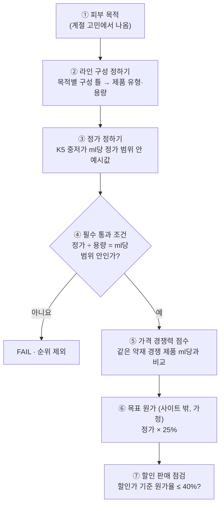

# 출시가는 이렇게 정해져요

> 근거 문서: `research/HSJ_가격기준_K5.md` (K5 가격 기준표), `research/MEJ_원가율_업계기준.md` (K7 원가율), 사이트 코드 `presentation/MEJ_출시순위_버튼시안_최신.html`

## 📌 한 줄 요약
우리 사이트는 **경쟁 가격(올리브영 중저가 ml당 정가)으로 정가를 정하고**, 원가는 실제 견적이 없어 **목표 원가법(정가 × 25%)으로 거꾸로 계산**만 해요. 고객 지불 의향 자료는 아직 없어요.

## 1. 가격 결정 3기준 중 우리가 쓰는 것

| 기준 | 우리 상태 | 근거 | 사이트에서 쓰는 곳 |
|---|---|---|---|
| **경쟁 (Competition)** | ✅ 주 기준 | K5: 올리브영 유형별 판매 상위 10개의 ml당 정가 | 필수 통과 조건 "중저가 가격", 순위 근거 "🏷️ 가격 경쟁력" |
| **원가 (Cost)** | ⚠️ 가정값만 | K7: 상장사 6곳 원가율 27.7~60.6% → 팀 임시 기준 25% | 사이트에는 없음 ("💰 수익성" 버튼 꺼짐) |
| **고객 가치 (Customer)** | ❌ 없음 | 지불 의향 조사 전 | 없음 |

→ 방법으로 보면 **경쟁 기준법 + 목표 원가법** 조합이에요.

## 2. 한눈에 보는 흐름

## 3. 단계별 설명

### ① 피부 목적 → ② 라인 구성
- 계절 기후 이슈에서 피부 목적이 나오고, 목적별 구성 틀이 1차 출시 제품을 정해요.
  - 예: 민감·장벽 → 토너 + 크림, 쿨링 → 토너 + 젤 크림 + 미스트
- 용량은 제품 유형마다 하나로 고정된 예시값이에요 (실제 출시 용량은 미정).

### ③ 정가 정하기 (경쟁 기준법)
- K5의 **중저가 ml당 정가** = 올리브영 판매 상위 10개의 ml당 정가 중 **중앙값 이하** 구간이에요.
- 그 범위 × 용량 = 정가 범위이고, 사이트 정가는 이 범위 안에서 고른 예시값이에요.

| 제품 | 용량 | 중저가 ml당 범위 | 정가 범위 (× 용량) | **사이트 정가** | ml당 | 범위 안 위치 |
|---|---|---|---|---|---|---|
| 토너 | 200ml | 36~90원 | 7,200~18,000원 | **15,000원** | 75원 | 위쪽 |
| 세럼 | 50ml | 148~430원 | 7,400~21,500원 | **19,000원** | 380원 | 위쪽 |
| 크림·젤 크림 | 50ml | 280~410원 | 14,000~20,500원 | **19,000원** | 380원 | 위쪽 |
| 리치 크림 | 50ml | 280~410원 | 14,000~20,500원 | **20,000원** | 400원 | 거의 상단 |
| 로션 | 200ml | 98~193원 | 19,600~38,600원 | **30,000원** | 150원 | 중간 |
| 미스트 | 100ml | 88~192원 | 8,800~19,200원 | **15,000원** | 150원 | 중간 |

- 클렌저는 K5 조사 범위에 없어서 정가 없이 "가격 기준 준비 중"으로 표시돼요.
- ⚠️ 범위 안에서 **어느 값을 고를지 규칙은 기록이 없어요.** 지금 값은 대부분 범위 위쪽이에요.

### ④ 필수 통과 조건 "중저가 가격"
- 계산: **ml당 = 정가 ÷ 용량**
- 범위 안이면 ✓ 통과, 밖이면 FAIL로 순위에서 빠져요.
- 지금 예시값은 모두 범위 안이라 전부 통과해요.

### ⑤ 순위 근거 "🏷️ 가격 경쟁력"
- 같은 약재 이름을 내세운 국내 경쟁 제품(K5 4장)의 ml당 정가와 우리 ml당 정가를 비교해요.

| 결과 | 점수 | 예시 |
|---|---|---|
| 경쟁 제품보다 우리가 쌈 | 5점 | 조선미녀 세럼 ml당 567원 > 우리 세럼 380원 |
| 경쟁 제품이 우리보다 쌈 | 2점 | 브링그린 토너 ml당 60원 < 우리 토너 75원 |
| 경쟁 제품 자료 없음 | 확인 필요 (점수 범위) | — |

### ⑥ 목표 원가 (목표 원가법, 사이트 밖)
- K7 기준: **목표 원가 = 정가 × 25%** ("이 가격에 팔려면 개당 원가를 이만큼 이하로")
- 실제 견적이 아니라서 "목표 원가(가정)"로만 말해요.

| 제품 | 정가 | 목표 원가 (× 25%) |
|---|---|---|
| 토너 200ml | 15,000원 | 3,750원 |
| 세럼 50ml | 19,000원 | 4,750원 |
| 크림 50ml | 19,000원 | 4,750원 |
| 리치 크림 50ml | 20,000원 | 5,000원 |
| 로션 200ml | 30,000원 | 7,500원 |
| 미스트 100ml | 15,000원 | 3,750원 |

### ⑦ 할인 판매 점검
- K5의 유형별 평균 할인율(29~34%)로 팔리면, 같은 원가로도 원가율이 올라가요.
- 계산: **할인가 = 정가 × (1 − 할인율)**, **할인 시 원가율 = 목표 원가 ÷ 할인가**

| 제품 | 평균 할인율 | 할인가 | 할인 시 원가율 | K7 상한 40% |
|---|---|---|---|---|
| 토너 | 32% | 10,200원 | 36.8% | 안 |
| 세럼 | 34% | 12,540원 | 37.9% | 안 |
| 크림 | 29% | 13,490원 | 35.2% | 안 |
| 로션 | 32% | 20,400원 | 36.8% | 안 |
| 미스트 | 34% | 9,900원 | 37.9% | 안 |

→ 평균 할인율로 팔려도 원가율이 40% 상한 아래라, 지금 정가와 25% 목표 원가는 **서로 맞는 조합**이에요.

## 4. 아직 비어 있는 것

| 빈 곳 | 영향 | 채우는 방법 |
|---|---|---|
| 정가를 범위 안 어디로 고를지 규칙 | 예시값을 설명하기 어려움 | 팀 합의 (예: 중앙값, 경쟁 제품보다 10% 낮게 등) |
| 고객 지불 의향 | "가격의 천장"을 모름 | 소비자 조사 자료, 페르소나 자료 |
| 유통 수수료율·부가세 10% | 회사가 실제로 받는 돈을 모름 | 공정거래위원회 판매수수료율 발표 등 |
| 실제 원가 | 수익성 버튼을 켤 수 없음 | 견적은 받지 않으므로 가정값 유지 |
| 클렌저 가격 범위 | 클렌저 정가 없음 | K5와 같은 방법으로 올리브영 조사 |
| 목표 원가율 25%·30%·40% 합의 | 기준값이 임시 | 팀 3명 합의 |
