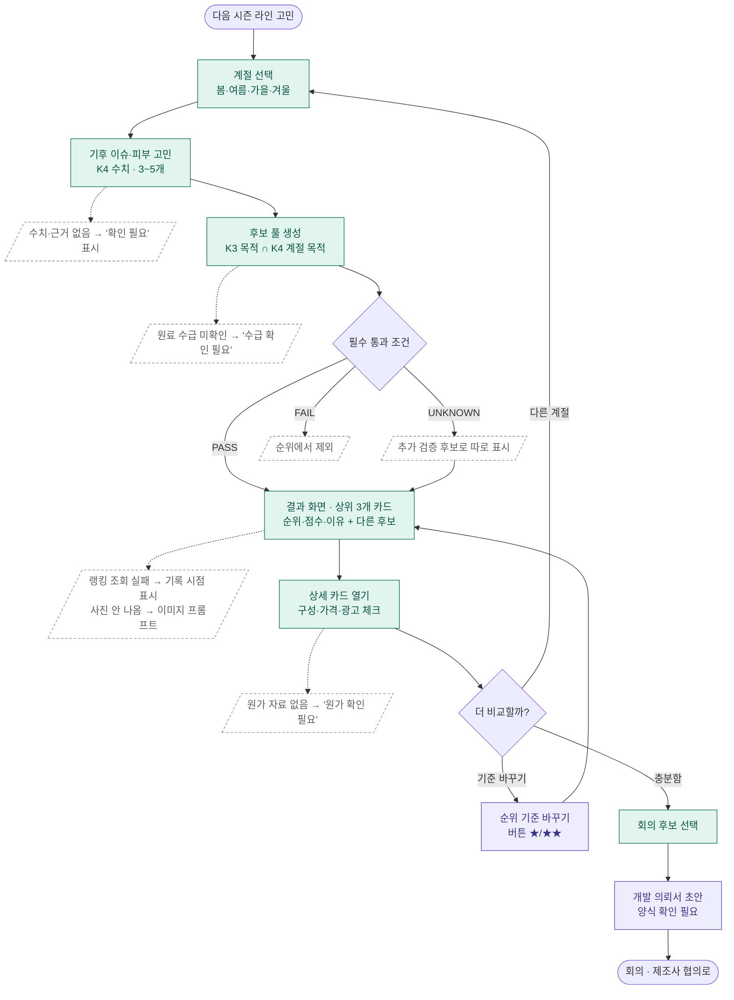

# 계절 제품 개발 아이디어 에이전트 · 시나리오 명세

> 이 문서는 저장소에 흩어진 기획·결정·지식 파일을 모아 **"누가, 언제, 무엇을 입력하고, 에이전트가 어떤 순서로 무엇을 보여 주는지"**를 시나리오 단위로 정리한 명세예요.
> 새 외부 조사는 하지 않았어요. 모든 내용은 아래 [근거 문서](#11-근거-문서)에서 왔고, 문서끼리 서로 다른 부분은 [10. 충돌·미정 사항](#10-충돌미정-사항)에 모았어요.
> 이 문서 전체는 **[아이디어] 기획 명세**예요. 사례로 든 숫자는 지식 파일(K1~K9)에 있는 값이거나, 문서마다 "예시"라고 적힌 값이에요.

---

## 0. 한눈에 보기

| 항목 | 내용 |
|---|---|
| 에이전트 | 계절 제품 개발 아이디어 에이전트 (이전 이름: 계절·절기 한방 뷰티 시즌 캠페인 에이전트 → 런칭 기획안 에이전트) |
| 사용자 | 우리 가상 한방 스킨케어 브랜드의 **상품기획팀 BM(브랜드 매니저)** |
| 사용 시점 | 다음 시즌 신제품을 정하기 전 (연 4회 가정) |
| 입력 | 4계절 중 하나 (봄 / 여름 / 가을 / 겨울) |
| 출력 | 계절별 라인 **후보 풀** 중 순위 **상위 3개 카드** + 나머지 후보 목록 + 추가 검증 후보 + 근거를 담은 **결과 화면(HTML, K9 템플릿)** ([D-09](decision_log.md)) |
| 타깃 고객 | 20~30대 ([D-10](decision_log.md)) |
| 가치 제안 | 작은 한방 브랜드 BM이 혼자서도, **쓸 수 있는 약재**와 **걸리지 않는 광고 표현**까지 확인된 계절 라인 후보를 받는다 |
| 실행 환경 | Claude 프로젝트 (지침 + 지식 파일 K1~K9 업로드) |

---

## 1. 배경: 왜 이 시나리오인가

### 1-1. 사용자가 막히는 곳

| 단계 | BM이 겪는 어려움 | 에이전트가 푸는 방식 | 판정 |
|---|---|---|---|
| 시장·트렌드 조사 | 다음 시즌 고객 니즈를 미리 정하기 어려움 | 기상청 평년값 기반 계절 → 피부 고민 표(K4) | 보조 |
| 상품 기획 | 기획안 하나에 오래 걸림. 다만 속도만으로는 경쟁 도구(콜마 AI 등)와 차별이 안 됨 | 속도 대신 "계절 근거 + 쓸 수 있는 약재"가 붙은 라인 후보 | 보조 |
| 원료·제형 | 약재의 전통 효능과 화장품 근거를 잇기 어렵고, 쓰면 안 되는 원료를 넣으면 판매가 멈춤 | 약재 후보표(K3): 향 세기·배합 제한·선점·고시 성분 | **핵심** |
| 원료 → 라인 | 원료를 어떤 제품(토너·세럼·크림…)으로 나눌지 정하기 어려움 | 목적별 라인 구성 틀(K2) | **핵심** |
| 원가·견적 | 견적 전에는 출시가를 정하기 어려움 | 중저가 ml당 정가(K5) + 목표 원가율(K7) | 보조 |
| 광고 표현 | 의약품 오인 광고 적발이 많음 (식약처 점검 83건 중 53건) | 광고 표현 셀프 체크(K6) | **핵심** |
| 기획서 작성 | 선택 이유를 설명하는 자료를 매번 다시 모음 | 기준별 점수 이유 + 근거 목록 (확장: 개발 의뢰서) | 확장 |

### 1-2. 사용자 페르소나 (요약)

| 항목 | 설정 | 근거 |
|---|---|---|
| 회사 | 직원 10명 미만 한방 스킨케어 브랜드, 대구 약령시 출발 | 생산실적 보고 업체의 약 88%가 10명 미만 (MEJ 페르소나 근거) |
| 팀 | BM 1~2명. 연구·규제·원가 담당이 따로 없음 | [해석] |
| 경력 | BM 4~5년 차 | 채용공고 경력 요건 범위 |
| 하는 일 | 조사 → 기획 → 원료·제형 → 원가·견적 → 용기 → 법규·출시. 생산은 ODM 위탁 | 워크넷·채용공고 |
| 바라는 것 | 출처가 달린 약재 정보, 광고 표현 체크, 시즌별 제품·컬러 아이디어 | HSJ 브랜드 정의 3부 |
| 성공 기준 | 기획 리서치 시간이 줄고, 회의에 바로 올릴 후보를 고를 수 있음 | HSJ 브랜드 정의, LJH 유저스토리 |

> 대표 페르소나는 **윤소라 32세**로 정했어요 ([D-06](decision_log.md)). 이름·나이·대사는 AI 초안이고, 나머지 속성은 출처가 있어요.

### 1-3. 유저스토리

> **우리 한방 스킨케어 브랜드의 상품기획자로서, 다음 계절에 맞는 제품 라인 후보를 비교하고 싶다. 출시 검토 회의에 제안할 후보를 고르기 위해.**

---

## 2. 범위

| 구분 | 포함 (이번 버전) | 제외 / 보류 |
|---|---|---|
| 입력 | 계절 1개 선택 | 타깃 피부 타입·목표 가격대·출시 시점·판매 지역 등 추가 조건 (HSJ 기회포인트의 확장안) |
| 추천 대상 | 기초 스킨케어 라인 (토너·세럼·크림·로션·미스트·클렌저 등) | 메이크업, 선케어 SPF 표시 제품(심사 필수) |
| 결과 | 라인 후보 풀과 순위(상위 3개 카드), 출시가, 디자인 방향, 광고 체크, 근거 | 최종 처방·실제 원가·납기 확정 (제조사 확인 영역) |
| 이미지 | 실사 제품 사진 (이미지 프롬프트 → 이미지 생성) | 실제 브랜드 로고·경쟁사 제품 모방 |
| 기타 | — | 절기 출시 타이밍·캠페인, 대구 약전골목 팝업 (2차 기능 후보로 보류) |

---

## 3. 등장 요소

### 3-1. 액터

| 액터 | 역할 |
|---|---|
| BM (주 사용자) | 계절을 고르고, 결과 화면을 보고, 회의에 올릴 후보를 고른다 |
| 에이전트 | 지식 파일만 근거로 단계 ①~⑦을 수행하고 결과 화면을 채운다 |
| 이미지 생성 도구 | 라인별 실사 제품 사진 생성 (A 반자동: 사람이 프롬프트를 붙여 넣음 / B 자동: 커넥터) |
| 팀 (운영자) | 지식 파일 갱신, 가중치 결정, 실행 검토표 작성 |
| 외부 사이트 (요구사항, 구현 전) | 올리브영·화해 랭킹·리뷰 — 실시간 조회 + 주간 기준 자료 |

### 3-2. 지식 파일

| # | 지식 파일 | 쓰는 단계 | 원문 | 상태 |
|---|---|---|---|---|
| K1 | 브랜드 정보 (이름, 타깃 2030, 제품명 규칙, 톤앤매너) | 라인 이름, 말투 | `research/HSJ_브랜드정보_K1.md`, `brand/HSJ_청향_브랜드정의.md`, `idea/브랜드명_CHAHAR(가칭).md` | 🟡 브랜드명 CHAHAR/차하르 (가칭 1순위, 상표 확인 필요) |
| K2 | 라인 구성 규칙 (13개 피부 목적, 기능성 여부, 구성 틀) | ② ③ | `research/HSJ_라인규칙_K2.md` | ✅ |
| K3 | 원료 후보표 (12종 + 예비 6종: 향 세기, 산지, 규제, 선점, 고시 성분) | ② ⑥ | `research/HSJ_원료후보_K3.md`, `research/LJH_K3_기능성고시성분_약재대조.md` | ✅ 1차 |
| K4 | 계절 기후·피부 이슈 표 | ① ⑥ | `research/HSJ_계절기후_K4.md` | 🟡 기후 수치 완료, 피부 고민 칸은 1차안 |
| K5 | 가격 기준표 (중저가 ml당 정가) | ④ ⑥ | `research/HSJ_가격기준_K5.md` | ✅ |
| K6 | 광고 표현 규칙 (식약처 지침 2025.8.14판) | ⑦ | `research/LJH_K6_광고표현규칙.md` | ✅ |
| K7 | 원가 자료 (목표 원가율 25% 임시, OEM 후보) | ④ | `research/MEJ_원가율_업계기준.md`, `research/MEJ_OEM_견적비교표.md` | 🟡 견적 없음 → 가정값 |
| K8 | 디자인 규칙 (브랜드 색, 약재별 색, 용기 모양·소재) | ⑤ | `idea/MEJ_K9_결과화면_버튼가중치_시안.md` 5장 원료 12종 패키지 팔레트(디자인 제안), `IMAGE/수정1/` 용기 기준 이미지·목표 용량 | 🟡 일부 제안 (확정 규칙 아님) |
| K9 | 결과 화면 템플릿 (라인 카드 → 상세 카드) | 출력 | `idea/LJH_K9_결과화면_시안.html`, `idea/MEJ_K9_결과화면_버튼가중치_시안.html` | 🟡 시안 2개 |

---

## 4. 메인 시나리오 (S1): 봄 시즌 라인 후보 받기

**상황:** 겨울이 끝나기 전, BM이 "봄 시즌 무슨 제품 낼까?"를 고민하며 에이전트를 연다.
**사전 조건:** Claude 프로젝트에 지침과 K1~K9가 올라가 있다.
**성공 결과:** BM이 상위 3개 라인 후보(와 나머지 후보 목록)를 순위·이유와 함께 비교하고, 회의에 올릴 후보를 고른다.

| # | 사용자 | 에이전트 처리 | 근거 | 화면에 보이는 것 |
|---|---|---|---|---|
| 1 | **[봄]** 선택 | 입력 확인. 계절 정의 = 3~5월 | K4 0장 | "봄 시즌 무슨 제품 낼까?" 헤더 |
| 2 | — | **① 계절 → 기후 이슈 → 피부 고민 후보 3~5개** 추출 | K4 1장 | 기후 이슈 표 (아래 예) |
| 3 | — | **② 후보 풀 생성**: K3 원료의 "맞는 목적"이 이 계절 피부 목적(K4)과 겹치면 라인 후보. 목적이 여러 개 겹치면 이어지는 기후 이슈가 가장 많은 목적 하나로 "{약재} {목적} 라인" | K3 1장, K4, MEJ K9 시안 2장 | (내부 처리) |
| 4 | — | **필수 통과 조건** 7개 검사 (기초라인 적합 · 한방 원료 근거 · 쓸 수 있는 원료 · 광고 표현 · 기능성 절차 · 중저가 가격 · 계절 고민 연결). FAIL은 제외, UNKNOWN은 추가 검증 후보로. 선점 '강함' 원료는 차별화 이유 필수 | MEJ K9 시안 3장, K3 | 추가 검증 후보 목록 (S3) |
| 5 | — | **③ 라인별 1차 출시 구성(●)과 2차 확장(○)** 결정 | K2 4장 | 상세 카드 "출시 구성" |
| 6 | — | **④ 출시가**: 시장 기준(용량 × 중저가 ml당 정가) vs 원가 기준(원가 ÷ 목표 원가율) 비교 | K5 1장, K7 | 제품별 용량·정가·ml당 정가 |
| 7 | — | **⑤ 디자인**: 라인 색(약재 색 → 목적으로 조정), 보조 색, 용기·소재, 라벨, 영어 실사 이미지 프롬프트 | K8, K1 | 라인 카드의 제품 사진 / 프롬프트 |
| 8 | — | **⑥ 가중치 점수 → 출시 순위** 1·2·3위. 기준마다 이유 한 줄 | [6장](#6-출시-순위-점수-규칙) | 순위 배지, 점수, 이유 |
| 9 | — | **⑦ 광고 표현 셀프 체크** (6문항) + 근거 목록 | K6 H표 | "광고 표현 체크 ✅", "근거 보기 ▾" |
| 10 | 결과 화면 확인 | K9 템플릿에 데이터만 채워 HTML 아티팩트로 출력 | K9 | **화면 1: 라인 카드** |
| 11 | 1위 카드 **[자세히 보기]** | — | K9 | **화면 2: 상세 카드** (추천 계절·피부 고민·목적·기능성 여부·대표 약재·출시 구성·디자인·점수·광고 체크·근거) |
| 12 | 후보 비교 후 회의용 후보 선택 | — | — | (에이전트 밖의 행동) |

### 4-1. 단계 ① 출력 예 — 봄 기후 이슈 (K4 값)

| 기후 이슈 | 핵심 수치 (전국 / 대구) | 피부 고민 | 피부 목적 |
|---|---|---|---|
| 건조한 공기 | 최소습도 30% 미만 41.9일★ / 46.1일 | 당김, 속건조, 각질 들뜸 | 보습, 민감·장벽 |
| 황사·미세먼지 | 황사 5.4일★, PM10 나쁨 이상 7.0일★ | 외부 자극으로 예민해짐 | 진정, 민감·장벽 |
| 큰 일교차 | 일교차 12.1℃★, 10℃ 이상 59.5일★ | 환절기 예민함 | 진정, 민감·장벽 |
| 자외선 증가 | 자외선지수 3월 4.3 → 5월 6.7 (포항) | 칙칙함, 톤 고민 | 미백(톤) |

★ = 네 계절 중 가장 큰 값. 피부 고민·목적 칸은 K4의 1차안(올리브영·화해 근거 확인 전)이에요.

### 4-2. 단계 ②~④ 출력 예 — 봄 라인 후보 (기획안의 형식 예시)

| 라인 (가칭) | 목적 / 기능성 | 대표 약재 | 1차 구성 | 출시가 (시장 기준) |
|---|---|---|---|---|
| 오미자 장벽 보습 라인 | 민감·장벽 / ❌ 일반 | 오미자(五味子) — 향 약, 경북 40.7% ✅, 스킨케어 선점 약함 | 토너 200ml + 세럼 50ml + 크림 50ml | 토너 약 15,000원 · 세럼 약 19,000원 · 크림 약 19,000원 |
| 작약 톤 라인 | 미백(톤) / ✅ 기능성 보고 필요 | 작약(芍藥) — 향 중, 경북 58.0% ✅, 선점 약함 | 토너 + 세럼 + 크림 | 세럼 약 21,000원 (ml당 420원) 등 |
| 감초 진정 라인 | 진정 / ❌ 일반 | 감초(甘草) — 향 약, 선점 보통 | 토너 200ml + 젤 크림 50ml | 토너 약 15,000원 · 크림 약 19,000원 |

- 원가 기준 출시가는 견적이 없어 **"원가 확인 필요"** (S4).
- 작약 톤 라인은 고시 미백 성분을 따로 배합해야 보고로 가능해요 (작약 자체는 고시 성분 아님. 고시 성분과 겹치는 약재는 감초 하나).

---

## 5. 대안·예외 시나리오

### S2. 다른 계절 비교 (겨울)

| 단계 | 내용 |
|---|---|
| 트리거 | BM이 같은 화면에서 **[겨울]**을 다시 고른다 |
| 처리 | K4 겨울 행으로 ①부터 다시 수행 |
| 기대 결과 | 다른 기후 이슈(저온·한파 / 건조 / 초미세먼지 PM2.5 나쁨 이상 11.0일★) → 다른 고민(거칠고 푸석함, 극건조, 외부 자극) → 다른 목적(보습·영양, 주름·탄력, 민감·장벽, 진정) → 다른 라인과 순위 |
| 확인 포인트 | 봄과 라인·순위가 달라지는가. 겨울 미세먼지(기존 팀 표에는 없던 이슈)가 반영되는가 |

### S3. 필수 조건을 통과하지 못한 후보 / 순위 후보가 적은 경우

| 단계 | 내용 |
|---|---|
| 트리거 | 후보 풀 중 필수 통과 조건이 FAIL 또는 UNKNOWN인 후보가 있음 (시안 예: 길경은 클렌저용이라 FAIL, 병풀은 공정서 약재가 아니라 UNKNOWN) |
| 처리 | FAIL은 순위에서 빼고, UNKNOWN은 "추가 검증 후보"로 따로 보여 준다. 순위 후보가 3개 미만이면 **억지로 채우지 않고** 있는 만큼만 카드로 보여 주며 이유를 한 줄 쓴다 (3개 미만 처리는 시안에 규칙이 없어 임시 규칙, D-09 확인 필요) |
| 화면 | No.1~3 제품 카드 + 다른 후보 목록 + 추가 검증 후보 |
| 시안 기준 수 | 봄 후보 8 · 순위 7 / 여름 6 · 4 / 가을 8 · 7 / 겨울 10 · 9 |
| 금지 | 근거 없는 후보 추가, UNKNOWN 후보를 순위에 올리기 |

### S4. 원가 자료가 없는 후보

| 단계 | 내용 |
|---|---|
| 트리거 | K7에 해당 제품의 원료·용기·제조 단가가 없음 (현재 모든 후보가 해당 — 실제 견적을 받지 않음) |
| 처리 | 시장 기준 출시가만 쓰고, 가격 옆에 **"원가 확인 필요"** 표시. 참고로 목표 원가 = 시장 기준 정가 × 25%(팀 임시 기준)를 보여 줄 수 있음 |
| 금지 | 중저가 범위 충족만으로 수익성까지 확인됐다고 말하기 |

### S5. 가중치를 바꿔 순위 다시 보기 (버튼 조합)

| 단계 | 내용 |
|---|---|
| 트리거 | BM이 순위 화면에서 "무엇을 중요하게 볼지" 버튼을 누른다 (MEJ 출시순위 버튼시안) |
| 처리 | **필수 통과 조건 (PASS가 아니면 순위에서 빠짐)**: 기초라인 적합 · 한방 원료 근거 · 쓸 수 있는 원료 · 광고 표현 · 기능성 절차 · 중저가 가격 · 계절 고민 연결 **매력 기준 버튼**: 1번 누름 ★, 2번 ★★, 3번 꺼짐. 🛒 계절 고민 크기 · 🎯 빈자리 · 🌿 순한 향 · 🏷️ 가격 경쟁력 · ⚡ 빠른 출시 · 🌸 제철 원료 · 🏮 우리 지역 이야기 · 📈 뜨는 원료 |
| 추천 조합 | 📋 체크리스트 기본 / ⚡ 이번 시즌 바로 / 🏮 우리다움 먼저 / 🎯 빈자리 공략 / 🛒 고민 해결 먼저 |
| 화면 | 순위 카드마다 고른 기준과 이유 칩, 순위 변동 ▲▼. 확인 안 된 칸은 점수를 비우고 점수 범위(빈칸 0점 ~ 5점)와 근거 확보 비중을 표시. 자료 없는 버튼(💰 수익성 · ✨ 핵심 효능 · 📣 채널·고객 확보)은 누를 수 없음 |
| 기대 결과 | 조합에 따라 1~3위가 바뀐다 (MEJ 11/13 시안의 봄 예: 체크리스트 기본 감초 > 오미자 > 작약 / 우리다움 먼저 작약 > 감초 > 어성초) |
| 상태 | 6기준을 기본값으로, 버튼은 [나중] 기능으로 병행 ([D-01](decision_log.md)). ★ 비중 값은 미정 |
| 근거 | `idea/MEJ_K9_결과화면_버튼가중치_시안.md`, `idea/MEJ_출시순위_버튼시안.md` (2026-11-13 수정본) |

### S6. 선점 '강함' 원료가 후보에 오를 때

| 단계 | 내용 |
|---|---|
| 트리거 | 쑥·어성초·인삼·병풀처럼 선점 강함 원료가 목적에 가장 잘 맞음 (예: 여름 진정·쿨링 → 어성초) |
| 처리 | 차별화 이유를 반드시 한 줄 쓴다 (예: 한방 브랜드 + 중저가). 이유가 없으면 후보에서 뺀다 |
| 점수 | 경쟁 우위 선점 점수 강함 = 1점 |

### S7. 기능성 라인이 후보에 오를 때

| 단계 | 내용 |
|---|---|
| 트리거 | 계절 고민이 미백(톤)·주름·장벽 등 기능성 목적과 이어짐 |
| 처리 | 기능성 라인은 꼭 넣지 않아도 되고, AI가 계절 고민에 맞춰 고른다. 넣으면 상세 카드에 ✅ 표시와 출시 전 필요한 것(고시 성분·함량이면 보고, 아니면 심사)을 적는다 |
| 주의 | 피부장벽 기능성은 고시 성분이 없어 **심사** 필요. 고시 성분과 겹치는 약재는 감초(유용성감초추출물 0.05%, 미백)뿐 → 다른 약재는 고시 성분을 따로 배합하고 약재는 이야기·향·출처로 쓴다 |
| 표현 | 기능성 보고 전에는 "맑아 보이는 피부톤", "탄력 있어 보이는"까지만. '흔적'은 미백 기능성 제품명에 명사로만 (K6 팀 결정 조건) |

### S8. 광고 표현 셀프 체크에 걸릴 때

| 단계 | 내용 |
|---|---|
| 트리거 | 라인 이름·설명에 6문항 중 하나라도 해당 (질병·의학적 효능 / 시술·전문가 / 일반 라인의 미백·주름 표현 / 실증 대상 표현에 "실증 필요" 없음 / 원료 설명에 약재 효능·처방·천연 / 최고·무자극) |
| 처리 | 해당 문장을 K2 "쓸 수 있는 말"로 고쳐 다시 체크. 고칠 수 없으면 후보 탈락 (최소 근거 "안전 문구") |
| 화면 | "광고 표현 체크 ✅" 또는 고친 내용 표시 |

### S9. 근거 자료가 없는 칸

| 단계 | 내용 |
|---|---|
| 트리거 | 수치·경쟁 제품·가격·원가 중 지식 파일에 없는 값이 필요함 |
| 처리 | **"자료 확인 필요"**로 표시하고 그 기준은 점수를 매기지 않는다. 지어내지 않는다 |
| 미정 | 일부 기준이 미채점일 때 총점·순위 표시 방식, 동점 처리 |

### S10. 외부 랭킹 실시간 조회 실패 (요구사항, 구현 전)

| 단계 | 내용 |
|---|---|
| 트리거 | 경쟁 우위·시장 필요도 계산 때 올리브영·화해 최신 랭킹 조회가 실패하거나 주간 갱신이 밀림 |
| 처리 | 마지막 주간 기록의 수집 시점을 표시하고 **"실시간 확인 불가"** 안내. 주간 갱신이 밀렸으면 **"업데이트 필요"**. 저장 자료를 실시간 자료처럼 보여 주지 않음 |
| 기록 | 조회 날짜·시간, 원문 URL, 카테고리, 검색어, 랭킹 범위 |
| 검색 흐름 (설계됨, 수집 전) | 트렌드 수집 에이전트가 매주 월요일 네이버 데이터랩 검색어 트렌드를 모아 `idea/trend/trend.json`으로 저장하고, 메인 에이전트는 이를 📈 뜨는 원료 점수로만 쓴다 (최근 4주 ÷ 그 전 12주). 자료가 없거나 오래되면 점수를 비운다. API 키 발급 전이라 아직 수집하지 않았다 (`idea/MEJ_트렌드수집에이전트_설계.md`) |

### S11. 실사 제품 이미지 만들기

| 단계 | 내용 |
|---|---|
| A 반자동 (지금 가능) | 에이전트가 화면에 영어 이미지 프롬프트를 쓴다 → BM이 이미지 생성 AI에 넣는다 → 결과 사진을 화면 이미지 칸에 넣는다 |
| B 자동 | 이미지 생성 커넥터로 에이전트가 사진까지 만든다 (팀 계정 사용 가능 여부 확인 필요) |
| 사진이 없을 때 | 사진 자리에 이미지 프롬프트를 보여 준다. 템플릿 배치는 바꾸지 않는다 |
| 규칙 | 실제 브랜드 로고·경쟁사 제품을 넣지 않는다. 라벨 글자는 화면에서 따로 얹을 수 있다 |
| 용기 기본 모양 | 토너 = 병, 세럼 = 스포이드 병, 크림 = 단지, 로션 = 펌프 병·튜브, 미스트 = 스프레이 병. 최신 기준 이미지는 `IMAGE/수정1/` (토너는 초안5, 나머지는 초안4에서 고름) |
| 목표 용량 | 토너 200mL · 세럼 50mL · 크림 50mL · 미스트 250mL · 펌프형 로션 80mL · 튜브형 로션 120mL (사용자 지정 디자인 목표, 실측·확정 출시 용량 아님) |
| 생성 도구 | 내장 이미지 생성 도구의 편집 기능 (팀 생성 기록). 2026-11-13 사용 한도 도달로 세럼·크림 이후 생성 실패 |

### S12. (확장) 개발 의뢰서로 내보내기

| 단계 | 내용 |
|---|---|
| 트리거 | BM이 고른 후보를 내부 승인·제조사 협의용으로 정리하고 싶음 |
| 처리 | 기획 조건, 후보 선정·제외 이유, 제품 구성, 출처, 추가 확인 사항을 일관된 양식으로 정리 |
| 상태 | HSJ 기회포인트의 확장 기능. 의뢰서 양식 확보 후 구체화 |

---

## 6. 출시 순위 점수 규칙

> 현재 저장소에는 가중치 안이 세 가지 있어요. 이 명세는 **가장 최근 작업안(HSJ 가중치기준, 11/12)**을 기본값으로 쓰고, 나머지는 [10장](#10-충돌미정-사항)에 남겨요.

| 평가 기준 | 가중치 | 무엇을 보나 | 채점 |
|---|---:|---|---|
| 시장 필요도 — 기후 이슈 | 10% | 계절 기후 지표와 라인 고민의 일치 | 1~5점, 구간 미정 |
| 시장 필요도 — 리뷰 고민 키워드 | 10% | 올리브영·화해 리뷰에서 해당 고민 언급 비율 | 1~5점, 구간 미정 |
| 시장 필요도 — 관련 제품 분포 | 10% | 랭킹 상위 N개 중 해당 목적 제품 비율 | 1~5점, 구간 미정 |
| 경쟁 우위 | 30% | 원료 선점 정도 (+ 랭킹) | 약함 5 · 보통 3 · 강함 1 (강함은 차별화 이유 필수) |
| 출시 가격 | 12% | 정가 ÷ 용량이 K5 중저가 범위 안인가 | 범위 안 = 최고점, 나머지 미정 |
| 향 부담 | 6% | 약재·제형 향 세기 | 약·거의 없음 우선, 나머지 미정 |
| 대구·경북 산지 | 15% | 대구·경북 생산 원료 조달 가능성 | 생산 통계 + 실제 원산지 증빙, 구간 미정 |
| 기능성 준비 | 7% | 일반 또는 고시 성분 보고로 가능한가 | 심사 필요·미확인 점수 미정 |
| **합계** | **100%** | | 가중점수 = (원점수 ÷ 5) × 가중치 |

- 시장 필요도 소계(30점)는 세 세부 항목의 합이고, 총점에 한 번만 더한다.
- 기준마다 **점수 이유 한 줄과 근거 자료**를 함께 보여 준다.
- 약령시에서 유통된다는 사실만으로 대구·경북 생산으로 판단하지 않는다. 지역 외 원료를 일괄 제외하지 않는다.

---

## 7. 공통 규칙 (모든 시나리오)

| # | 규칙 | 근거 |
|---|---|---|
| R1 | 수치·경쟁 제품·가격·원가는 지식 파일에 있는 것만 쓴다. 없으면 "자료 확인 필요" | 기획안 지침 |
| R2 | 약재는 K3 원료 후보표 안에서만 고른다 | K3 |
| R3 | 가격은 K5 중저가 범위가 기준. 벗어나면 이유를 쓴다. 할인가가 아니라 정가로 비교 | K5 |
| R4 | 질병·의학적 효능 표현, 기능성 심사·보고 없는 미백·주름 표현을 쓰지 않는다 | K6 |
| R5 | 라인 이름 = 브랜드명 + 대표 약재 + 피부 고민 + 제품 유형 | K1 |
| R6 | 연구 내용은 "연구에서 보고됨"까지만. 제품 효능 문구로 옮기지 않는다 | K3 |
| R7 | 약재 이름은 `한글(한자)`로 표기 | 팀 규칙 |
| R8 | 결과는 긴 글이 아니라 K9 템플릿을 채운 HTML 화면으로. 배치는 바꾸지 않는다 | 기획안 지침 |
| R9 | 최종 처방·원료 적용·단가·납기는 제조사·연구 담당자 확인 대상으로 남긴다 | HSJ 기회포인트 |
| R10 | 브랜드 말투: 헤드라인·패키지는 명사형, 본문은 해요체. 과장·비유 겹치기 금지 | 브랜드 정의 톤앤매너 |

---

## 8. 인수조건 (완료 판정)

실제 결과 화면을 보고 **예 / 아니오**로 판정해요.

| # | 조건 | 관련 시나리오 |
|---|---|---|
| AC1 | '겨울'을 선택하면 '겨울' 표시와 순위 상위 3개 라인 카드가 보인다 (순위 후보가 3개 미만이면 있는 만큼) | S1, S2 |
| AC2 | 라인 후보가 표시되면 후보마다 대표 원료·제품 구성·예상 가격이 보인다 | S1 |
| AC3 | 라인 후보가 표시되면 후보마다 출시 추천 순위와 추천 이유가 보인다 | S1 |
| AC4 | 원가 자료가 없는 후보가 있으면 해당 후보의 가격 옆에 '원가 확인 필요'가 보인다 | S4 |
| AC5 | 필수 조건이 UNKNOWN인 후보는 순위가 아니라 "추가 검증 후보"에 보인다 | S3 |
| AC6 | 선점 '강함' 원료를 고른 후보에는 차별화 이유가 보인다 | S6 |
| AC7 | 모든 라인 이름·설명이 K6 셀프 체크 6문항을 통과한다 | S8 |
| AC8 | 기준마다 점수 이유가 보이고, 근거가 없는 기준은 '자료 확인 필요'로 점수가 비어 있다 | S9 |
| AC9 | 사진이 없는 라인은 사진 자리에 이미지 프롬프트가 보인다 | S11 |

AC1~AC4는 LJH 유저스토리의 인수조건 그대로이고, AC5~AC9는 기획안 규칙에서 옮긴 추가 조건이에요.

### 실행 검토 (4계절 × 검토표)

- 4계절을 모두 입력하고 `research/LJH_실행검토_체크리스트.md`의 가격(P1~P4)·경쟁(C1~C2)·금지어(W1~W6) 항목을 ✅/❌로 채운다.
- 가중치를 여러 조합으로 돌려 순위가 크게 흔들리는지 확인한다 (비교 조합은 미정).

---

## 9. 발표 시연 시나리오

| 순서 | 말·행동 | 보여 줄 것 |
|---|---|---|
| 1 | "상품기획팀 BM이 다음 시즌 계절만 고르면, 라인 후보와 출시 순위가 나옵니다." | 시작 화면 |
| 2 | "봄 시즌 무슨 제품 낼까?" 상황에서 **[봄]** 선택 | 기후 이슈 → 피부 고민 표 (K4 수치) |
| 3 | 라인 카드와 순위 화면 → 1위 카드 열기 | 상세 카드. 가격이 "용량 × ml당 중저가 범위"로 계산된 근거 짚기 |
| 4 | (선택) 버튼 조합을 바꿔 1위가 바뀌는 것 보여 주기 | S5 |
| 5 | **[겨울]** 입력 | 다른 고민, 다른 라인·순위 비교 |

---

## 10. 충돌·미정 사항

> 2026-11-13 결정 내용은 [decision_log.md](decision_log.md)에 있어요 (가중치 D-01, 브랜드명 CHAHAR D-02, 입력 범위 D-03, 의뢰서 D-04, 산지 기준 D-05 제안안, 페르소나 D-06, 이미지 D-07, 미채점 환산 D-08, 후보 풀·상위 3개 D-09, 타깃 2030 유지 D-10). 아래 표는 결정 전 상태를 기록으로 남긴 거예요.

| # | 항목 | 문서별 내용 | 정할 것 |
|---|---|---|---|
| 1 | **가중치** | ① 기획안·워크플로우: 시장 필요도 40 / 경쟁 우위 30 / 성공 가능성 30 ② HSJ 가중치기준(11/12): 30(10+10+10) / 30 / 가격 12 / 향 6 / 대구·경북 산지 15 / 기능성 7 ③ MEJ 버튼시안(11/12): 최소 근거 칩 + BM이 고르는 ★ 버튼 조합 | 기본값과 버튼 조합을 함께 쓸지, 하나로 정할지 |
| 2 | **산지 가산 기준** | K3: 경북 생산 1위(✅)에만 가산 / HSJ 가중치기준: 대구·경북으로 확대, 15% / MEJ 버튼: 경북 생산 비율 구간 5·4·3·1 | 지역 범위와 점수 구간 |
| 3 | **브랜드명** | K1: 가칭 ONLEAF(후보 온리프·약결·허비트) / 브랜드 정의·MEJ 통합 슬라이드: 청향(淸香, 미확정, 상표 확인 필요) / IMAGE 시안: CHAHAR | 라인 이름(R5)과 라벨에 쓸 이름 |
| 4 | **입력 범위** | 기획안: 계절 하나만 / HSJ 기회포인트: 계절 + 타깃 피부 타입·주요 고민·목표 가격대·출시 시점·판매 지역 | 첫 버전은 계절만, 나머지는 확장으로 둘지 |
| 5 | **결과물** | 기획안: 라인 후보 2~3개 + 순위 화면 / HSJ 기회포인트: 약재 후보 3개 비교 → 라인 초안 1개 → 개발 의뢰서 | 의뢰서를 첫 버전에 넣을지 |
| 6 | **사용자 페르소나** | 브랜드 정의: 이하은 31세 BM 5년 차 / MEJ 페르소나 근거: 윤소라 32세 BM 4년 차 (이름·나이는 AI 초안) | 대표 페르소나 하나 |
| 7 | **K8 디자인 규칙** | 아직 없음. 브랜드 정의의 컬러 방향(오프화이트 베이스 + 작약 핑크·새순 그린 포인트)과 IMAGE 용기 시안만 있음 | 약재별 색, 용기·소재 기본값 |
| 8 | **K4 피부 고민 칸** | 기후 수치는 확인, 피부 고민·목적은 팀 문서 기반 1차안 | 올리브영·화해 리뷰로 확인 |
| 9 | **채점 구간** | 경쟁 우위 외 기준의 1~5점 구간 미정. 미채점 시 총점·동점 처리 미정 | 구간표 |
| 10 | **외부 랭킹 연동** | 실시간 조회 + 주간 갱신은 요구사항일 뿐 구현 전 | 연동 범위, 수집 방식, 갱신 요일 |
| 11 | **이미지 생성 방식** | A 반자동 / B 커넥터 자동 | 시연에 쓸 방식 |

---

## 11. 근거 문서

| 구분 | 파일 | 이 문서에서 쓴 곳 |
|---|---|---|
| 기획 | `idea/LJH_계절-제품개발-에이전트-기획안.md` | 0·4·5·7·9장 (흐름 ①~⑦, 화면, 지침 초안, 시연) |
| 기획 | `idea/런칭기획에이전트_워크플로우_역할분담.md` | 0·2·3장 (팀 결정 13개, 지식 파일 상태) |
| 기획 | `idea/HSJ_BM-에이전트-기회포인트.md`, `idea/HSJ_BM-페인포인트.html` | 1·5장 S12, 10장 #4·#5 |
| 기획 | `idea/HSJ_가중치기준.md` | 6장, 5장 S10 |
| 기획 | `idea/MEJ_출시순위_버튼시안.md` | 5장 S5 |
| 기획 | `idea/MEJ_기획자페르소나_근거.md` | 1장 (페르소나, 막힘 단계, 가치 제안) |
| 기획 | `idea/LJH_K9_결과화면_시안.html` | 3·4장 (화면 구성) |
| 발표 | `presentation/LJH_상품기획자_유저스토리_16x9.html` | 1-3, 8장 (유저스토리, AC1~AC4) |
| 브랜드 | `brand/HSJ_청향_브랜드정의.md`, `idea/MEJ_청향_오늘작업_통합슬라이드_2026-11-10.md` | 1-2장, 7장 R10, 10장 #3·#6·#7 |
| 지식 파일 | `research/HSJ_브랜드정보_K1.md` · `HSJ_라인규칙_K2.md` · `HSJ_원료후보_K3.md` · `LJH_K3_기능성고시성분_약재대조.md` · `HSJ_계절기후_K4.md` · `HSJ_가격기준_K5.md` · `LJH_K6_광고표현규칙.md` · `MEJ_원가율_업계기준.md` · `MEJ_OEM_견적비교표.md` | 3~8장 |
| 검토 | `research/LJH_실행검토_체크리스트.md` | 8장 |
| 이미지 | `IMAGE/수정1/CHAHAR_이미지생성_통합지시문.txt` (최신, 기존 수정지시서 대체), `IMAGE/초안1~5/` | 5장 S11, 장면 8 |
| 기획 (11/13 추가) | `idea/브랜드명_CHAHAR(가칭).md`, `idea/MEJ_K9_결과화면_버튼가중치_시안.md`, `idea/MEJ_트렌드수집에이전트_설계.md`, `idea/trend/keywords.json` | 3-2 K1·K8·K9, S5, S10, 장면 7 |

- 배경 자료(시장 근거, 고객 인사이트·여정지도, 대구 자산, 아모레퍼시픽 밸류체인, 11.09 실습)는 범위·보류 판단(2장)의 참고로만 썼어요. 특히 대구 약전골목 팝업·절기 캠페인 시나리오(실습 스토리보드, 대구자산)는 팀 결정에 따라 2차 기능으로 보류했어요.

---

## 12. As-is / To-be 장면과 유저스토리

> **상황:** 작은 뷰티 브랜드의 BM(여성) 1명이 다음 시즌 **기초 스킨케어 라인** 출시 아이디어를 고민한다.
> - 대표 페르소나: **윤소라 32세, BM 4년 차** ([D-06](decision_log.md)). 이름·나이는 AI 초안이에요.
> - As-is 장면에는 저장소 자료에 있는 막힘 근거만 썼어요. 작은 브랜드 BM이 실제로 단계마다 쓰는 시간·횟수는 자료가 없어 **확인 필요**예요 (BM 설문·인터뷰 전).
> - 표기: **[필수]** = 첫 버전에 꼭 들어갈 스토리 / **[나중]** = 2차 확장.
> - 인수조건은 "~할 때, 시스템에서는 ~한다", 예외조건은 **정보 없음 / 오늘 안 나옴 / 품절** 중 하나 이상으로 적었어요.

### 12-0. 장면 한눈에 보기

| # | 장면 | As-is (지금) | To-be (에이전트 사용 후) | 구분 |
|---|---|---|---|---|
| 1 | 시즌 피부 고민 정하기 | 계절만으로 어떤 고민을 우선할지 근거 없이 정함 | 계절을 고르면 기후 수치와 이어진 피부 고민 후보가 나옴 | 필수 |
| 2 | 약재(원료) 고르기 | 전통 효능과 화장품 근거·규제를 따로 찾아 비교 | 향·규제·선점·산지가 정리된 약재 후보가 나옴 | 필수 |
| 3 | 라인 구성 정하기 | 원료를 어떤 제품으로 나눌지 직접 정함 | 목적별 구성 틀로 1차 출시·2차 확장이 제안됨 | 필수 |
| 4 | 출시가 정하기 | 견적 전에는 가격을 정하기 어려움 | 용량 × 중저가 ml당 정가로 가격 범위가 나옴 | 필수 |
| 5 | 광고 표현 확인 | 법규를 BM이 직접 확인 | 라인 이름·설명을 6문항으로 자동 체크 | 필수 |
| 6 | 출시 순위 정해 회의에 올리기 | 후보 선택 이유를 자료마다 다시 모음 | 기준별 점수·이유가 붙은 순위가 나옴 | 필수 |
| 7 | 순위 기준 바꿔 보기 | 기준이 바뀌면 비교를 처음부터 다시 함 | 버튼으로 기준을 고르면 순위가 다시 계산됨 | 나중 |
| 8 | 실사 제품 이미지 보기 | 디자인 시안을 따로 만듦 | 라인 색·용기·이미지 프롬프트와 사진이 나옴 | 나중 |
| 9 | 개발 의뢰서 정리 | 승인·제조사 협의 자료를 매번 새로 씀 | 선정 이유·출처가 담긴 의뢰서 초안이 나옴 | 나중 |

---

### 장면 1. 시즌 피부 고민 정하기 **[필수]**

**As-is**
- BM은 "봄에 무슨 제품 낼까?"를 고민하지만, 계절이라는 조건만으로 당김·예민함·칙칙함 중 무엇을 먼저 볼지 정하기 어렵다 (BM 페인포인트 01, 업무 가설).
- 기후 자료(기상청·에어코리아)와 고객 리뷰를 따로 찾아 맞춰 봐야 한다. 걸리는 시간은 **확인 필요**.

**To-be**
- BM이 [봄]을 고르면, 에이전트가 K4 표에서 기후 이슈(건조, 황사·미세먼지, 큰 일교차, 자외선 증가)와 수치, 이어지는 피부 고민·피부 목적을 3~5개 보여 준다.

**유저스토리**
> 기초 스킨케어 라인을 기획하는 BM**으로서**, 고른 계절의 기후 이슈와 이어지는 피부 고민 후보를 한 번에 **보고 싶다**. 다음 시즌 라인이 어떤 고민을 다룰지 근거를 갖고 정**하기 위해**.

**인수조건**
1. BM이 계절 하나를 고를 **때**, 시스템에서는 그 계절의 기후 이슈와 피부 고민 후보를 3~5개 표로 보여 준다.
2. 기후 이슈를 보여 줄 **때**, 시스템에서는 이슈마다 K4의 수치(전국 / 대구)를 함께 보여 준다.
3. 피부 고민을 보여 줄 **때**, 시스템에서는 고민마다 이어지는 K2 피부 목적을 함께 보여 준다.

**예외조건**
- **정보 없음:** K4에 수치가 없는 이슈(예: 난방으로 인한 실내 건조)일 **때**, 시스템에서는 수치 칸을 "확인 필요"로 두고 수치를 지어내지 않는다.
- **정보 없음:** 피부 고민 칸이 리뷰 근거로 확인되지 않은 1차안일 **때**, 시스템에서는 "리뷰 근거 확인 필요"를 표시한다.

---

### 장면 2. 약재(원료) 고르기 **[필수]**

**As-is**
- 약재의 전통 효능과 화장품 연구가 섞여 있어 같은 기준으로 비교하기 어렵다 (BM 페인포인트 02, 업무 가설).
- 쓰면 안 되는 원료를 넣으면 판매가 멈출 수 있다. 2021~2025.6 안전기준 위반 41건 중 14건이 사용금지·제한 원료였다 (장업신문, MEJ 페르소나 근거 [24]).
- 대기업도 AI 도입 전 원료 연구 이력·적용 가능성 검토에 약 6일이 걸렸다고 밝혔다 (아모레퍼시픽 발표). 작은 브랜드 BM의 소요 시간은 **확인 필요**.

**To-be**
- 에이전트가 K3 후보표 안에서만 약재를 고른다. 필터 순서: 목적 키워드 → 향 세기 → 배합 제한 → 경쟁 선점. 약재마다 고른 이유를 한 줄 붙인다.

**유저스토리**
> 한방 원료로 라인을 기획하는 BM**으로서**, 피부 목적에 맞는 약재 후보를 향·규제·경쟁·산지 기준으로 비교해 **보고 싶다**. 쓸 수 있고 차별화되는 원료를 빨리 고르**기 위해**.

**인수조건**
1. 피부 목적이 정해질 **때**, 시스템에서는 K3 후보표에 있는 약재만 후보로 보여 준다.
2. 약재 후보를 보여 줄 **때**, 시스템에서는 향 세기·경북 산지 여부·경쟁 선점 정도와 고른 이유 한 줄을 함께 보여 준다.
3. 선점 '강함' 약재(쑥·어성초·인삼·병풀)를 고를 **때**, 시스템에서는 차별화 이유를 반드시 함께 보여 준다.
4. 약재 연구 내용을 설명할 **때**, 시스템에서는 "연구에서 보고됨"까지만 쓰고 제품 효능 문구로 옮기지 않는다.

**예외조건**
- **정보 없음:** 향 세기·경쟁 선점이 "미확인/확인 필요"인 약재(예: 병풀 향 세기, 오가피·길경 선점)일 **때**, 시스템에서는 그 칸을 "확인 필요"로 표시하고 그 기준의 점수를 매기지 않는다.
- **품절:** 약재의 실제 원료 수급·공급 가능 여부는 저장소 자료에 없으므로, 시스템에서는 모든 후보에 "공급사 수급 확인 필요"를 표시한다.
- **정보 없음:** 원료가 안전기준 별표에 이름으로 없을 **때**, 시스템에서는 "사용 가능"이라고 쓰지 않고 "공급사 성적서로 확인 필요"를 표시한다.

---

### 장면 3. 라인 구성 정하기 **[필수]**

**As-is**
- 원료를 정한 뒤 세럼·크림·클렌저 중 어디에 쓰고, 제품마다 역할과 제형을 어떻게 나눌지 직접 정해야 한다 (BM 페인포인트 03, 업무 가설).

**To-be**
- 에이전트가 K2 목적별 구성 틀로 1차 출시(●) 2~3개와 2차 확장(○) 후보를 제안한다. 라인 후보는 계절별 후보 풀에서 나오고, 순위 상위 3개가 카드로 보인다 (D-09).

**유저스토리**
> 신제품 라인업을 짜는 BM**으로서**, 라인마다 1차 출시 제품과 2차 확장 후보를 제안**받고 싶다**. 출시 범위를 정해 회의에서 바로 논의하**기 위해**.

**인수조건**
1. 라인 후보가 정해질 **때**, 시스템에서는 라인마다 1차 출시 제품의 유형·용량과 2차 확장 후보를 보여 준다.
2. 라인 후보를 만들 **때**, 시스템에서는 K3 원료의 맞는 목적과 그 계절 피부 목적이 겹치는 원료만 후보 풀에 넣는다.
3. 필수 통과 조건이 FAIL 또는 UNKNOWN일 **때**, 시스템에서는 그 후보를 순위에서 빼고 UNKNOWN은 "추가 검증 후보"로 보여 준다.

**예외조건**
- **정보 없음:** 목적의 구성 근거가 "구성 근거 없음"일 **때**, 시스템에서는 구성을 제안하되 "자료 확인 필요"를 표시한다.
- **정보 없음:** 목표 용량(토너 200mL · 세럼 50mL · 크림 50mL · 미스트 250mL · 펌프형 로션 80mL · 튜브형 로션 120mL)은 디자인 목표일 뿐 실측·확정 출시 용량이 아니므로, 시스템에서는 용량을 "목표 용량(확정 전)"으로 표시한다. 목표 용량이 없는 유형(클렌저 등)은 "용량 확인 필요"로 둔다.

---

### 장면 4. 출시가 정하기 **[필수]**

**As-is**
- 원가가 흔들려 출시가를 정하기 어렵다. 한 ODM이 일부 고객사 납품단가를 10% 이내 올렸다는 보도가 있다 (파이낸셜뉴스, MEJ 페르소나 근거 [15]).
- 단가는 ODM 견적을 받아야 알 수 있는데, 이 프로젝트는 견적을 받지 않는다 (MEJ OEM 견적비교표).

**To-be**
- 에이전트가 시장 기준(용량 × K5 중저가 ml당 정가)으로 제품별 정가와 ml당 정가를 제안하고, 원가 기준은 자료가 있을 때만 비교한다.

**유저스토리**
> 출시가를 제안해야 하는 BM**으로서**, 견적이 없어도 제품마다 중저가 범위 안의 예상 정가를 **보고 싶다**. 가격대가 시장에서 어디쯤인지 근거를 갖고 설명하**기 위해**.

**인수조건**
1. 1차 출시 제품이 정해질 **때**, 시스템에서는 제품마다 용량·정가·ml당 정가를 보여 준다.
2. 정가를 계산할 **때**, 시스템에서는 K5 유형별 중저가 ml당 정가(예: 토너 36~90원, 크림 280~410원)를 기준으로 쓴다.
3. 제안 가격이 중저가 범위를 벗어날 **때**, 시스템에서는 벗어난 이유를 한 줄 보여 준다.

**예외조건**
- **정보 없음:** 원가 자료(K7 견적)가 없을 **때**, 시스템에서는 가격 옆에 "원가 확인 필요"를 표시하고 수익성을 판단하지 않는다.
- **정보 없음:** 클렌저·마스크·패드·선케어처럼 K5 가격 조사 범위 밖의 유형일 **때**, 시스템에서는 가격 칸을 "확인 필요"로 둔다.

---

### 장면 5. 광고 표현 확인 **[필수]**

**As-is**
- 식약처가 2025년 온라인 화장품 판매 게시물 209건을 점검해 83건을 적발했고, 그중 53건(64%)이 의약품 오인 광고였다 (뉴시스·장업신문).
- BM이 법규·인증 확인을 직접 맡는다 (채용공고 주요업무).

**To-be**
- 에이전트가 라인 이름과 설명을 K6 셀프 체크 6문항으로 검사하고, 걸린 문장은 쓸 수 있는 말로 바꿔 제안한다.

**유저스토리**
> 라인 이름과 소개 문구를 정하는 BM**으로서**, 광고 규정에 걸리는 표현이 있는지 자동으로 확인**받고 싶다**. 출시 뒤 부당광고로 적발되는 일을 막**기 위해**.

**인수조건**
1. 라인 이름·설명을 만들 **때**, 시스템에서는 K6 6문항으로 검사하고 결과(✅ 또는 걸린 문장)를 보여 준다.
2. 일반 화장품 라인에 미백·주름 개선 같은 기능성 표현이 들어갈 **때**, 시스템에서는 그 표현을 K2의 "쓸 수 있는 말"로 바꿔 제안한다.
3. 실증이 필요한 표현(수치·기간·비교 등)이 들어갈 **때**, 시스템에서는 "실증 필요"를 표시한다.

**예외조건**
- **정보 없음:** 문구가 K6 표에 없어 위반 여부를 판단할 수 없을 **때**, 시스템에서는 "광고 표현 확인 필요"를 표시하고 통과로 처리하지 않는다.
- **정보 없음:** 브랜드명이 가칭(CHAHAR/차하르)이고 상표 확인 전일 **때**, 시스템에서는 라인 이름 옆에 "(가칭)"을 표시한다.

---

### 장면 6. 출시 순위 정해 회의에 올리기 **[필수]**

**As-is**
- 내부 승인과 제조사 협의를 위해 계절 적합성·근거·차별성을 여러 자료에서 다시 모아야 한다 (BM 페인포인트 06, 업무 가설).
- 기획안 하나에 1~3개월이 걸렸다는 보도가 있다 (이데일리·장업신문, 콜마 라우드랩스 기사). 작은 한방 브랜드 BM 기준 기간은 **확인 필요**.

**To-be**
- 에이전트가 가중치 기준(시장 필요도·경쟁 우위·출시 가격·향 부담·대구·경북 산지·기능성 준비)으로 점수를 매겨 후보 풀 전체 순위와 상위 3개 카드, 기준별 이유를 보여 준다.

**유저스토리**
> 출시 검토 회의를 준비하는 BM**으로서**, 라인 후보를 점수와 이유가 붙은 순위로 비교**하고 싶다**. 회의에 제안할 후보를 고르고 선택 이유를 설명하**기 위해**.

**인수조건**
1. 라인 후보가 모두 만들어질 **때**, 시스템에서는 후보마다 출시 추천 순위와 총점을 보여 준다.
2. 순위를 보여 줄 **때**, 시스템에서는 기준마다 점수 이유 한 줄과 근거 지식 파일을 함께 보여 준다.
3. 1위 카드를 누를 **때**, 시스템에서는 계절·고민·목적·기능성 여부·대표 약재·출시 구성·가격·점수가 담긴 상세 카드를 연다.

**예외조건**
- **정보 없음:** 어떤 기준의 근거 자료가 없을 **때**, 시스템에서는 그 칸을 "자료 확인 필요"로 두고 점수를 매기지 않는다. 미채점 기준이 있을 때 총점·동점 처리 방식은 **확인 필요**(팀 미정).
- **오늘 안 나옴:** 올리브영·화해 최신 랭킹 조회가 실패하거나 트렌드 스냅샷(`idea/trend/trend.json`)이 비었거나 오래됐을 **때**, 시스템에서는 마지막 수집 시점과 "실시간 확인 불가"를 표시하고 해당 점수를 비운다 (랭킹 연동은 구현 전, 트렌드 수집은 API 키 발급 전).
- **정보 없음:** 가중치 비중이 팀에서 확정되지 않았으므로, 시스템에서는 순위 화면에 "가중치 임시값"을 표시한다.

---

### 장면 7. 순위 기준 바꿔 보기 **[나중]**

**As-is**
- 무엇을 중요하게 볼지(빠른 출시, 지역 원료, 가격 등)가 바뀌면 후보 비교를 처음부터 다시 해야 한다. 실제로 얼마나 자주 바뀌는지는 **확인 필요**.

**To-be**
- BM이 매력 기준 버튼(🛒 계절 고민 크기, 🎯 빈자리, ⚡ 빠른 출시, 🏮 우리 지역 이야기 등)을 ★/★★로 고르면, 필수 통과 조건을 PASS한 후보만 다시 순위를 매긴다 (MEJ K9 버튼 가중치 시안, 2026-11-13).

**유저스토리**
> 시즌 전략을 바꿔 가며 검토하는 BM**으로서**, 중요하게 볼 기준을 버튼으로 골라 순위를 다시 **보고 싶다**. 전략에 따라 1위가 어떻게 달라지는지 회의에서 보여 주**기 위해**.

**인수조건**
1. BM이 버튼을 한 번·두 번 누를 **때**, 시스템에서는 그 기준에 ★(비중 1)·★★(비중 2)를 주고 순위를 다시 계산한다.
2. 순위가 다시 나올 **때**, 시스템에서는 카드마다 고른 버튼과 ★를 칩으로, 약한 기준을 빨간 "약함" 칩으로 보여 준다.
3. 후보가 필수 통과 조건(기초라인 적합·한방 원료 근거·쓸 수 있는 원료·광고 표현·기능성 절차·중저가 가격·계절 고민 연결) 중 하나라도 PASS가 아닐 **때**, 시스템에서는 그 후보를 순위에 올리지 않는다.

**예외조건**
- **정보 없음:** 자료가 준비되지 않은 버튼(💰 수익성, ✨ 핵심 효능, 📣 채널·고객 확보)일 **때**, 시스템에서는 버튼을 "자료 준비 중"으로 보여 주고 누를 수 없게 한다.
- **정보 없음:** 후보의 칸이 확인되지 않았을 **때**(예: 오가피의 빈자리 칸), 시스템에서는 점수를 비우고 점수 범위와 "확인 필요"를 표시한다.
- **오늘 안 나옴:** 📈 뜨는 원료의 트렌드 자료가 아직 수집되지 않았을 **때**, 시스템에서는 그 칸을 빈칸으로 둔다.
- **오늘 안 나옴:** 기능성 보고 기간 때문에 시즌 안에 낼 수 없는 후보일 **때**, 시스템에서는 "다음 시즌으로 미룸"을 표시한다. 실제 보고 소요 기간은 **확인 필요**.

---

### 장면 8. 실사 제품 이미지 보기 **[나중]**

**As-is**
- 라인 색·용기 시안을 따로 만들어야 한다. 이 팀도 이미지 생성 도구로 용기 시안을 초안1~5까지 만들고 `IMAGE/수정1/`에 기준 이미지 7장을 골랐다.
- 목표 용량을 지정한 뒤 토너 200mL 수정본만 생성됐고, 세럼·크림 이후는 생성 도구 사용 한도(2026-11-13)로 만들지 못했다 (`IMAGE/수정1/CHAHAR_이미지생성_통합지시문.txt`, `IMAGE/초안5/생성기록_및_대기요청문.json`).
- 디자인 규칙(K8)은 확정되지 않았다. 원료 12종 패키지 팔레트는 디자인 제안으로만 있다 (`idea/MEJ_K9_결과화면_버튼가중치_시안.md`).

**To-be**
- 에이전트가 라인 색·보조 색·용기 모양·소재·라벨을 정하고 영어 이미지 프롬프트를 쓴다. 사진이 생성되면 라인 카드에 넣는다.

**유저스토리**
> 라인 콘셉트를 회의에서 보여 줘야 하는 BM**으로서**, 라인마다 구성 제품이 함께 놓인 실사 제품 이미지를 **보고 싶다**. 글로만 된 기획보다 라인 차이를 한눈에 전달하**기 위해**.

**인수조건**
1. 라인 후보가 정해질 **때**, 시스템에서는 라인마다 라인 색·보조 색(HEX)·용기 모양·소재와 이미지 프롬프트를 보여 준다.
2. 생성된 사진이 있을 **때**, 시스템에서는 K9 템플릿의 사진 자리에 넣고 배치는 바꾸지 않는다.
3. 이미지 프롬프트를 쓸 **때**, 시스템에서는 실제 브랜드 로고·경쟁사 제품을 넣지 않는다.

**예외조건**
- **오늘 안 나옴:** 이미지 생성 한도 등으로 사진이 만들어지지 않을 **때**, 시스템에서는 사진 자리에 이미지 프롬프트를 보여 준다.
- **정보 없음:** K8 디자인 규칙이 확정되지 않았을 **때**, 시스템에서는 원료별 팔레트 제안값을 쓰되 "디자인 제안(K8 확정 전)"으로 표시한다. 팔레트에 없는 원료(예비 후보 6종 등)는 색을 "확인 필요"로 둔다.
- **품절:** 실제 용기 재고·조달 가능 여부는 자료에 없으므로, 시스템에서는 용기 칸에 "용기 조달 확인 필요"를 표시한다 (용기 부족 보도는 있으나 우리 용기 기준 자료는 없음).

---

### 장면 9. 개발 의뢰서 정리 **[나중]**

**As-is**
- 내부 승인·제조사 협의용 자료를 매번 새로 쓴다 (BM 페인포인트 06, 업무 가설). 작성 횟수·시간은 **확인 필요**.
- 제조 검토 단계에서 향·색·제형·단가·수급 문제가 뒤늦게 나오면 기획을 다시 바꿔야 한다 (BM 페인포인트 05, 업무 가설).

**To-be**
- 에이전트가 고른 후보의 기획 조건, 선정·제외 이유, 제품 구성, 출처, 제조사 확인 사항을 한 문서로 정리한다.

**유저스토리**
> 제조사와 협의를 시작하려는 BM**으로서**, 고른 라인 후보를 출처가 연결된 개발 의뢰서 초안으로 **받고 싶다**. 승인과 제조사 협의 자료를 반복해서 만드는 시간을 줄이**기 위해**.

**인수조건**
1. BM이 후보 하나를 고를 **때**, 시스템에서는 콘셉트·제품 구성·선정 이유·출처·추가 확인 사항을 담은 의뢰서 초안을 만든다.
2. 의뢰서에 제형·처방 방향을 쓸 **때**, 시스템에서는 "제조사·연구 담당자 검토 필요"를 표시하고 최종 처방으로 확정하지 않는다.

**예외조건**
- **정보 없음:** 개발 의뢰서 양식이 아직 확보되지 않았으므로, 시스템에서는 "의뢰서 양식 확인 필요"를 표시한다.
- **정보 없음:** OEM 단가·최소 주문 수량·납기가 없을 **때**, 시스템에서는 해당 칸을 "제조사 견적 확인 필요"로 둔다.
- **품절:** 원료·용기 수급이 확인되지 않았을 **때**, 시스템에서는 "수급 확인 필요"를 표시하고 대체 원료 후보 칸을 남긴다 (대체 후보는 자료 확보 시 채움).

---

### 12-10. 장면별 근거

| 장면 | As-is 근거 | To-be 근거 |
|---|---|---|
| 1 | `idea/HSJ_BM-페인포인트.html` 01 | `research/HSJ_계절기후_K4.md`, `research/HSJ_라인규칙_K2.md` |
| 2 | `idea/HSJ_BM-페인포인트.html` 02, `idea/MEJ_기획자페르소나_근거.md` [6][7][24] | `research/HSJ_원료후보_K3.md` |
| 3 | `idea/HSJ_BM-페인포인트.html` 03 | `research/HSJ_라인규칙_K2.md` 4장, 기획안 ②③ |
| 4 | `idea/MEJ_기획자페르소나_근거.md` [15], `research/MEJ_OEM_견적비교표.md` | `research/HSJ_가격기준_K5.md`, `research/MEJ_원가율_업계기준.md` |
| 5 | `idea/MEJ_기획자페르소나_근거.md` [5][12][23] | `research/LJH_K6_광고표현규칙.md`, `research/LJH_실행검토_체크리스트.md` |
| 6 | `idea/HSJ_BM-페인포인트.html` 06, `idea/MEJ_기획자페르소나_근거.md` [8][22] | `idea/HSJ_가중치기준.md`, `idea/LJH_K9_결과화면_시안.html` |
| 7 | 자료 없음 (확인 필요) | `idea/MEJ_K9_결과화면_버튼가중치_시안.md`, `idea/MEJ_출시순위_버튼시안.md` |
| 8 | `IMAGE/수정1/CHAHAR_이미지생성_통합지시문.txt`, `IMAGE/초안5/생성기록_및_대기요청문.json` | 기획안 ⑤ "실사 이미지 만드는 방법", MEJ K9 시안 5장 팔레트 |
| 9 | `idea/HSJ_BM-페인포인트.html` 05·06 | `idea/HSJ_BM-에이전트-기회포인트.md` 3장 |

- As-is의 "업무 가설"은 실제 BM 인터뷰 전 가설이에요. 빈도·심각도는 BM 설문·인터뷰로 **확인 필요**예요.

---

## 13. User flow

12장의 장면 1~9를 BM이 화면에서 움직이는 순서로 그렸어요. 초록 = [필수], 보라 = [나중], 점선 = 예외 처리.

| 흐름 구간 | 해당 장면 |
|---|---|
| 계절 선택 → 기후 이슈·피부 고민 | 장면 1 |
| 후보 풀 생성 → 필수 통과 조건 판단 | 장면 2·3 |
| 라인 카드 → 상세 카드 | 장면 4·5·6 |
| 순위 기준 바꾸기 | 장면 7 [나중] |
| 사진·이미지 프롬프트 | 장면 8 [나중] (라인 카드 안에서 표시) |
| 개발 의뢰서 초안 | 장면 9 [나중] |
