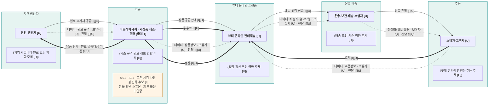

# 밸류체인 v1 — 원페이지·출처 목록 대조본

## 📌 한 줄 요약

[해석][I] [원페이지]와 [출처 목록]에 대조한 결과를 반영한 v1이다. ‘지역 생산자 → 가공 → 뷰티 온라인 플랫폼 → 주문 → 물류·배송’은 사용자가 정한 분석 단계이며, 원페이지에 이 순서의 실제 거래가 모두 확인된 것은 아니다. 구체 거래·담당·데이터 보유자 미확인 상태는 `[U]`로 유지한다. 항목별 검증은 [analysis.md의 검증 절](analysis.md#검증)에 기록했다.

## 🔑 핵심 내용

- [사실] 아모레퍼시픽의 화장품·생활용품 제조·판매와 온라인 등 복수 판매경로는 원페이지에 기재돼 있다. [원페이지] 1·2칸, [출처 1]
- [해석][I] 지역 원료 공급·플랫폼 중개·배송 위탁·정산·데이터 인계는 조사할 구조 가설이며 확인된 실제 계약을 뜻하지 않는다. [원페이지] 2·7·8칸
- [해석] M01은 한율 리뷰에 기록된 사용감 차이를 검토할 후보로, 기업 제조 불량의 증거가 아니다. 한방 브랜드(설화수·한율) 리뷰 기준, 소표본. [리뷰 출처 1][리뷰 출처 2]

## 📚 상세 조사

### 네 층과 범례

| 표현 층 | 표시 | 확인 범위 |
|---|---|---|
| 단계·이해관계자 | 다섯 subgraph, 굵은 수행자, 괄호 영향 주체 | 사용자 지정 단계와 기업 개괄 사실. 구체 주체는 대부분 [U] |
| 상품 | `-->` | 공급·배송의 구조 가설 [I][U] |
| 돈 | `==>`, 결제·정산·수수료·납품 단가 | 계약·실제 송금·차감 방식 미확인. 금액·수수료율 미사용 |
| 데이터 | `-.->`, 데이터 이름·보유자 | 데이터 이름은 제안 [I], 실제 보유자·전달은 [U] |

마커는 네 흐름 층과 별도의 주석이다. M01은 ‘가공’ 그룹에 놓았으나 수행자·공급망 참여자로 세지 않는다. 기존 기능 단계 ‘② 운영·제작’과 ‘가공’의 대응은 분석 해석이다. 데이터 화살표를 마커 연결선으로 사용하지 않았다.

### Mermaid

### 단계별 근거와 수정 판단

| 단계 | 원페이지 근거 칸·원출처 | 유지한 내용 | 남은 해석·미확인 |
|---|---|---|---|
| 지역 생산자 | 3칸 자연 원료 이야기, 7칸 팀 접점, 출처 13·16 | 사용자 지정 단계·유형 노드 | 기업의 지역 생산자·조달 계약은 [U]. 팀 기획을 기업 공급 사실로 사용하지 않음 |
| 가공 | 1칸 제조·판매, 2칸 자체 생산·연구개발, 출처 1 | 아모레퍼시픽 실명·화장품 제조·판매 | ‘가공’으로 분류한 것은 [I]. 지역 원료 투입·위탁 생산은 [U] |
| 뷰티 온라인 플랫폼 | 2칸 온라인 채널, 4칸 이커머스 확대 계획, 출처 1·5 | 뷰티 온라인 채널 유형 | 계약 상대·중개/매입·플랫폼 재고 보유는 [U] |
| 주문 | 2칸 제품·상품 판매 중심, 출처 9 | 구매 주체 유형 | 고객명·주문·결제·정산 시스템과 대금 수취 주체는 [U] |
| 물류·배송 | 2·6칸 해외법인·수출·판매경로, 5칸 운반비, 출처 1·2·3·9 | 배송 수행자 유형 | 판매법인은 배송사가 아님. 배송 위탁·상품 경유·데이터 전달은 [U] |

돈 화살표는 중개 판매를 가정한 개념 관계다. 실제 수수료가 정산액에서 공제된다면 별도 송금으로 중복 계산하지 않는다. ‘납품 단가’는 금액이 아니라 원료 납품대금의 결정 기준이다. 직접 판매·매입 판매·직배송 등 다른 경로도 가능하며 이 자료만으로 판정하지 않는다. [해석][I][원페이지] 2·5·6칸

### 마커와 우선 검토 기회 1개

| 마커·신호 | 근거 문장·출처 | AI 기회 | 점수·사분면 | 상태 |
|---|---|---|---|---|
| M01→S01 | [해석] 한율 토너의 긍정적인 사용 반응과 건조함·따가움 등의 불편 반응이 자료에 함께 기록됨. [리뷰 출처 1] 60·62행, [리뷰 출처 2] 78·81행 | O01 [아이디어] VOC 분류·조건별 비교 보조 | 기대효과 2/5, 실현 준비도 2/5, III사분면 | 소표본의 고객 체감 탐색 후보. 제조 불량 미입증. 우선 검토는 AI 제안이며 팀 채택 미확인 |

점수·사분면은 [signals.md](signals.md)의 임시 정의를 사용한다. 각 축 3점 이상을 높음으로 두며 III은 저효과·저준비를 뜻한다. 소표본 요약만 있고 원문 정형화·권한·평가셋·정량 효과가 없어 2/5·2/5로 기록한 주관 평가다. 회사의 실제 개선 효과나 수업 metrics 결과로 표시하지 않는다.

## 🤖 우리 에이전트에 어떻게 쓸까?

- [아이디어] 기획 기능과 실제 발주·배송·정산 업무의 경계를 확인하는 참고도로 쓴다. O01은 별도 검토 후보이며 기존 BM용 제품기획 기능에 자동으로 추가하지 않는다.

## ⚠️ 광고 표현 체크

- 제품 효능·광고 문구를 제안하지 않았다. 소비자 반응을 제품의 의학적 효능·안전성·제조 결함 판단으로 바꾸지 않는다.

## 📌 다른 팀원에게

- 기존 v0는 비교 대상으로 보존했다. v1은 원페이지·sources.md와의 문서 대조 후 버전이며, 실제 거래 검증·팀의 신규 기회 채택 완료를 뜻하지 않는다. 항목별 불일치와 판단은 [검증 절](analysis.md#검증)을 따른다.

## ❓ 아직 모르는 것

- 지역 공급자·원산지·가공·플랫폼·물류 계약, 수수료 공제·정산 방식.
- 데이터 보유자·전달·피드백·접근 권한과 실제 운영 로그.
- 리뷰 조건·버전·독립 표본 수·원인, O01 평가셋·효과와 팀 채택 여부.

## 🔗 출처

| 번호 | 구분 | 근거·한계 |
|---|---|---|
| [출처 1] | 🟡 B, 기업 공시 | 아모레퍼시픽 사업보고서 사업의 내용, 제조·판매·판매경로. 개별 거래 계약 근거는 아님 |
| [출처 2] | 🟡 B, 기업 공시 | 같은 보고서 계열회사. 출처 1과 독립 보고서 아님 |
| [출처 3] | 🟡 B, 기업 IR | 해외 유통·플랫폼 개괄 설명 |
| [출처 5] | 🟡 B, 기업 발표 | 올리브영 선출시·이커머스 확대 계획 |
| [출처 9] | 🟡 B, 기업 공시 | 수익·비용 항목. 개별 거래 차감액 아님 |
| [출처 13] | 🟡 B, 기업 소개 | 한율 자연 원료 이야기. 실제 공급 계약 아님 |
| [출처 16] | 팀 내부 기획 | 팀의 지역 자산 방향. 기업 외부 사실 근거 아님 |
| [리뷰 출처 1] | 팀 내부 수집·요약 | 04 고객인사이트, 기록 2026-10-29 |
| [리뷰 출처 2] | 팀 내부 종합 | 05 고객인사이트, 종합 2026-10-30. 04와 중복되므로 독립 교차검증 아님 |

기업 번호·자료 제목·원문 URL·날짜·저장 파일은 [출처 목록]과 대조했다. 로컬 파일 열람일은 2026-11-06, 기존 기업 원문 확인일은 2026-11-05이며 이번 기업 웹 원문 재검증은 미실시다. 보고서 쪽수는 확인 필요. 리뷰 원출처는 🔴 C 후기·커뮤니티로, 객관적 기업 품질 사실의 근거가 아니라 반응이 기록됐다는 해석 자료로만 사용한다.

[원페이지]: ../Lifestyle실습/company/아모레퍼시픽/onepager.md
[출처 목록]: ../Lifestyle실습/company/아모레퍼시픽/sources.md
[출처 1]: ../Lifestyle실습/company/아모레퍼시픽/sources/01_dart_사업의내용.md
[출처 2]: ../Lifestyle실습/company/아모레퍼시픽/sources/02_dart_계열회사.md
[출처 3]: ../Lifestyle실습/company/아모레퍼시픽/sources/03_ir_실적자료.md
[출처 5]: ../Lifestyle실습/company/아모레퍼시픽/sources/05_pr_2026-11-04-2.md
[출처 9]: ../Lifestyle실습/company/아모레퍼시픽/sources/09_dart_재무.md
[출처 13]: ../Lifestyle실습/company/아모레퍼시픽/sources/13_brand_한율.md
[출처 16]: ../Lifestyle실습/company/아모레퍼시픽/sources/16_local_context.md
[리뷰 출처 1]: ../research/04_고객인사이트_자료조사.md
[리뷰 출처 2]: ../research/05_고객인사이트_종합.md
