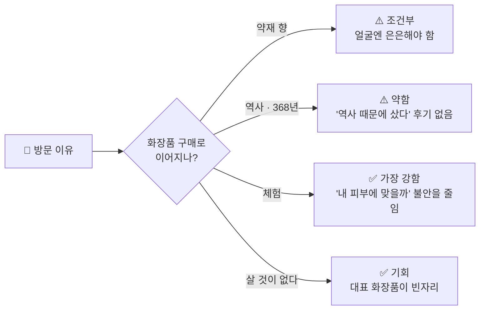

# 🌿 중간보고 · 대구 약전골목 × 한방 뷰티

> **2026-10-30 팀 중간보고** · 고객 인사이트 파트 (MEJ)
> 상세 자료: [01 산업·시장](01_산업시장_자료조사.md) · [02 역사·공간](02_역사공간_자료조사.md) · [03 사람·원료](03_사람원료_자료조사.md) · [04 고객 인사이트](04_고객인사이트_자료조사.md)

---

## 📌 한 장 요약

| | |
|---|---|
| **핵심 질문** | 고객은 왜 한방화장품을 고르거나 망설이고, 약전골목의 무엇이 선택 이유가 될까? |
| **가장 큰 쟁점** | 사람들이 약전골목에 **가고 싶은 이유**가 **얼굴에 바를 화장품을 살 이유**로 이어지는가? |
| **지금까지 답** | 역사만으로는 약하다. **향과 체험**이 가장 강한 연결고리다. 그런데 그 향마저 **옅어지고 있다**는 현장 반응이 나왔다. |
| **다음 할 일** | 인스타그램·X 반응 수집 (로그인 필요), 현장에서 향과 판매 품목 확인 |

---

## 1. 팀 조사 현황

| 파트 | 문서 | 핵심 결과 | 상태 |
|---|---|---|---|
| 🏭 산업·시장 | 01 | 광고 금지 표현 정리, 경쟁 브랜드 4곳(설화수·수려한·한율·조선미녀), 로컬 IP 사례(대전 꿈돌이·제주 감귤), 대구·경북 인프라 | ✅ 1차 완료 |
| 🏛️ 역사·공간 | 02 | 1658년 개설, 368년 동안 끊기지 않은 유일한 약령시, 심약관·령바람 이야기, **약령시 대표 제품은 빈자리** | ✅ 1차 완료 |
| 🌱 사람·원료 | 03 | 사상체질 4종, 약재 8종(효능·산지·향), 인물 5명 조사 예정 | 🔄 진행 중 |
| 💬 고객 인사이트 | 04 + 이 문서 | 구매 장벽, 골목의 실제 가치, 추천의 조건, Agent 선택질문 12개, **유튜브 댓글 반응** | 🔄 SNS 수집 남음 |

---

## 2. 이번 쟁점: ‘가고 싶은 이유’는 ‘얼굴에 바를 이유’가 되는가

| 방문 이유 | 화장품 구매로 이어지나? | 판단 |
|---|---|---|
| **약재 향이 좋다** | 거리 향은 좋지만, 얼굴에 바르는 향은 은은해야 한다는 요구와 부딪친다. | 🟠 조건부 |
| **역사 · 368년** | 신뢰의 배경은 되지만, ‘역사 때문에 샀다’는 화장품 후기는 없다. | 🟠 약함 |
| **체험** | 직접 맡고 만들어 본 경험이 ‘내 피부에 맞을까’라는 불안을 줄인다. | 🟢 가장 강함 |
| **살 것이 없다** | 약령시를 대표하는 화장품이 아직 없다. | 🟢 기회 |

> [!IMPORTANT]
> **인사이트** · 골목의 가치는 역사보다 **오감과 체험**에서 나온다.
> → “골목에서 맡은 그 향을, **내 피부에 맞는 세기로** 가져간다.”

---

## 3. 🔥 새로 찾은 현장 반응 (유튜브 댓글)

인스타그램과 X는 로그인을 해야 검색할 수 있어서, 이번에는 **로그인 없이 볼 수 있는 유튜브 댓글**을 먼저 모았다.

### 3-1. KBS뉴스 「130억 들였는데 ‘텅텅’…대구 약령시 현재 상황」

📺 [영상 링크](https://www.youtube.com/watch?v=bfrRqZDBN9U) · 조회수 3.8만 · **댓글 211개** · 2024.01

| 반응 유형 | 대표 댓글 (요약) | 👍 |
|---|---|---|
| 🧓 **세대 단절** | 젊은 사람들은 한방에 관심이 없다, 세대가 바뀌는 자연스러운 현상 | **94** |
| 🧓 세대 단절 | 젊은 사람이 약령골목을 찾지 않으면 사라진다 | 41 |
| 💸 **가격** | 한약이 너무 비싸다, 보약 한 재에 60만~120만 원 | 23 |
| 🇨🇳 **원산지 불신** | 요즘 중국산 가짜 약재를 조심해야 한다 | 22 |
| 🇨🇳 원산지 불신 | 레토르트 파우치로 비싸게 팔면서 성분·함량 설명이 없다 | 3 |
| 👃 **향이 사라짐** | 90년대엔 골목에 약 냄새가 진동했는데, 요즘엔 거의 나지 않는다 | 1 |
| 👃 향이 사라짐 | 예전엔 한약 냄새라도 나서 다녔는데, 이젠 그냥 시내 가는 길 | 1 |
| 📍 **장소 성격** | 데이트 장소로도, 가족끼리 가기에도 애매하다 | 2 |
| ☕ **반론** | 몇 년 전보다 핫플 식당·카페·술집이 많이 생겨서 유동인구는 늘었다 | 2 |

### 3-2. 대구TV 「대구 약령시 투어 | 대구싸람 제이슨 EP.03」

📺 [영상 링크](https://www.youtube.com/watch?v=Er52uxMUbXo) · 조회수 4.2만 · 댓글 498개 · 대구시 공식 채널

> [!WARNING]
> 댓글 이벤트를 했던 영상이라 칭찬 댓글이 많다. **분위기보다 ‘어떤 장면을 기억하는지’만** 참고한다.

| 기억하는 장면 | 댓글 요약 | 우리에게 주는 힌트 |
|---|---|---|
| 🧪 **체질 분석기** | 결과가 예상과 정반대로 나와서 당황하는 장면이 재밌었다 | 체질 테스트는 **재미 콘텐츠**로 통한다 |
| 👃 **도착하자마자 맡은 향** | 향긋한 한약 냄새에 힐링 | 향 = 골목의 첫인상 |
| 🙇 **한약방 선생님께 인사** | 모자를 벗고 인사하는 장면이 인상 깊었다 | **상인과의 만남**이 기억에 남는다 (04 문서에서 못 찾은 요소) |
| 🎁 **부모님께 한약 선물** | 부모님께 한약을 사 드리는 장면 | **선물 수요** (Agent 질문 12번 근거 보강) |
| 🌑 **이미지 반전** | 약 냄새 나고 어두운 곳인 줄 알았는데 활기차고 재밌다 | 선입견을 깨는 콘텐츠가 효과 있다 |
| 🚶 **스쳐 지나가던 곳** | 평소엔 그냥 지나가기만 했지 제대로 둘러볼 생각은 못 했다 | 대구 사람에게도 **목적지가 아니다** |
| 🇰🇷 **케데헌 한약방** | 케데헌 한약방 투어가 성지가 됐듯 박물관도 붐비면 좋겠다 | ⬇️ 3-3 참고 |

### 3-3. 비교: 서울 약령시는 ‘케데헌’ 효과를 보고 있다

- 애니메이션 『케이팝 데몬 헌터스』에 한약방 장면이 나온 뒤, **서울약령시(경동시장) 서울한방진흥센터**가 주목받았다. ([서울신문](https://m.go.seoul.co.kr/news/2025/10/20/20251020033001))
- 외국인 사이에서 한의원 체험이 ‘서울 필수코스’로 떠올랐다는 보도도 있다. ([한국경제 사설](https://www.hankyung.com/article/2025090436081))
- 대구 약령시는 **‘가장 오래된 약령시’라는 이야기는 있지만, 이런 화제의 연결고리가 없다.**

### 3-4. 그 밖에 눈에 띈 점

| 관찰 | 근거 |
|---|---|
| 조회수 124만의 대구 여행 브이로그도 떡볶이 골목, 미도다방, 곱창 골목은 다루지만 **약전골목은 제목에 없다.** | [유튜브 검색 결과](https://www.youtube.com/results?search_query=%EC%95%BD%EC%A0%84%EA%B3%A8%EB%AA%A9+%EB%B8%8C%EC%9D%B4%EB%A1%9C%EA%B7%B8) |
| ‘약령시’ 영상은 대부분 지자체·방송국 채널이 올렸다. 개인이 올린 영상은 칼국수 맛집 브이로그 정도다. | 같은 검색 결과 |
| KBS대구의 축제 브이로그(2026년 5월)는 조회수 224회, **댓글 0개**다. | [영상](https://www.youtube.com/watch?v=FU5ibrw_zYs) |

> [!IMPORTANT]
> **새 인사이트 3가지**
> 1. **향은 우리의 핵심 자산인데, 그 향이 옅어지고 있다.** 골목만 믿을 게 아니라, 향을 **제품과 체험으로 다시 만들어야** 한다.
> 2. **‘중국산·가짜·성분 표시 없음’ 불신은 화장품에도 그대로 옮겨 온다.** 원료 이력(어느 점포, 어느 산지)을 보여 주는 것이 차별점이 된다.
> 3. **젊은 층에게 약전골목은 목적지가 아니다.** 체질 테스트처럼 **재미있는 입구**와, 부모님 선물처럼 **사야 할 이유**가 필요하다.

---

## 4. 한방화장품 구매 장벽 (요약)

| 장벽 | 실제 반응 | 출처 |
|---|---|---|
| 👃 향 | 보습은 좋지만 한방 냄새를 싫어하면 비추. 금방 날아간다더니 꽤 셌다. | [한방 오일 후기](https://bangot.kr/article/review/4/2775/) |
| 🧴 무게감 | 지성 피부에겐 무겁고 유분이 많다. | 설화수 자음생크림 블로그 후기 |
| 💸 가격 · 진품 | 50ml 27만 원. 가품이 많으니 조심하라. | [글로우픽](https://www.glowpick.com/casts/1313) |
| 👵 이미지 | ‘엄마 화장품’ 이미지를 벗으려고 대형 브랜드가 리브랜딩했다. | [매일일보](http://www.m-i.kr/news/articleView.html?idxno=1232268) |
| ❓ 신뢰 | 한방 성분 0.001%만 넣어도 ‘한방화장품’이라고 할 수 있다. | [얼루어](https://www.allurekorea.com/2016/03/24/%ED%95%9C%EB%B0%A9-%ED%99%94%EC%9E%A5%ED%92%88%EC%9D%98-%EC%A7%84%EC%8B%A4/) |

> [!NOTE]
> **한방 제품 후기에서 칭찬받는 이유는 한방이 아니라 사용감이었다.** 설화수 윤조에센스·한율 어린쑥 후기는 은은한 향, 가벼운 사용감, 흡수를 말한다.
> ‘한방이라서 샀다’는 후기는 찾지 못했다. 한방이 **관심을 끄는지**는 아직 근거가 없어서, SNS 조사로 확인해야 한다.
> *(04 문서 1-1의 조선미녀 예시와 MZ 설문 해석은 근거가 약해 이렇게 고쳐 보고한다.)*

---

## 5. 🤖 Agent 선택질문 (초안 12개 중 대표 6개)

| # | 고객이 실제로 한 말 | Agent 질문 | 선택지 |
|---|---|---|---|
| 1 | 보습은 필요한데 아침 화장이 뜬다 | 아침 화장 전에 쓸 제품인가요? | 아침 화장 전 · 밤에만 · 둘 다 |
| 2 | 한방 냄새 싫다, 생각보다 셌다 | 약재 향은 어느 정도가 좋으세요? | 거의 없게 · 은은하게 · 약재 향 그대로 |
| 3 | 수분은 유지가 안 되고, 유분은 무겁다 | 바르고 난 느낌은 어떤 쪽이 좋으세요? | 산뜻하게 · 촉촉하게 · 쫀쫀하게 |
| 6 | 써 봤는데 실패한 제품이 있다 | 안 맞았던 제품은 어떤 점이 별로였나요? | 무거움 · 건조함 · 향 · 따가움 |
| 9 | 비싸면 실패가 무섭다 | 처음엔 어떻게 써 보고 싶으세요? | 샘플 먼저 · 소용량 · 본품 |
| 12 | 🆕 부모님께 한약을 사 드린다 (유튜브) | 누가 쓸 건가요? | 나 · 부모님 · 친구 선물 |

🆕 **유튜브 반응으로 추가할 후보**

| 고객이 실제로 한 말 | Agent 질문 | 선택지 |
|---|---|---|
| 중국산·가짜 약재가 걱정된다 | 원료에서 가장 궁금한 건 무엇인가요? | 산지 · 사용한 점포 · 전성분 |
| 체질 분석 결과가 재밌었다 | 재미로 보는 체질 테스트로 향을 골라 볼까요? | 해 볼래요 · 바로 고를래요 |

> [!CAUTION]
> 질병명(아토피·여드름), 치료·개선·진단 표현은 의약품 오인 광고가 된다. 체질 테스트는 **사용감·향 추천**에만 쓴다. (01 문서 1단계)

---

## 6. 📋 다음 수집 계획: 인스타그램 · X

이 채널은 로그인을 해야 볼 수 있다. 팀원이 직접 보고 **아래 표 형식 그대로** 채우면 3장에 합칠 수 있다.

| 채널 | 검색어 | 볼 것 |
|---|---|---|
| 📸 인스타그램 | `#약전골목` `#대구약령시` `#약령시` `#한방화장품` `#한방스킨케어` | 사진에 무엇을 찍었나 (간판·약재·족욕·카페), 캡션의 감정 단어 |
| 🐦 X | `약전골목`, `약령시`, `한방 화장품 냄새`, `한약 냄새 화장품`, `설화수 엄마` | 짧은 불만·농담 (향·이미지·가격) |
| 🗺️ 구글 지도 | 대구약령시 · 한의약박물관 · 한방의료체험타운 | 별점이 낮은 리뷰의 이유, 상인 응대 |

**수집 양식 (복사해서 쓰기)**

| 채널 | 링크 | 원문 요약 (한 줄) | 반응 유형 | 좋아요·조회 |
|---|---|---|---|---|
| 인스타 | | | 향 / 체험 / 가격 / 이미지 / 불신 / 선물 / 기타 | |
| X | | | | |

### ✅ 확인 필요 목록

- [ ] 지금 골목에서 약재 향이 실제로 얼마나 나는지 (현장 방문)
- [ ] 상인과 나눈 대화를 기억하는 후기 (유튜브에서 1건 찾음, 더 필요)
- [ ] 골목 안에서 파는 한방 화장품·비누가 있는지 (현장)
- [ ] 한방의료체험타운이 1년 넘게 방치됐다는 보도의 현재 상태 (KBS 2024.01)
- [ ] 박물관 입장료 무료 / 1,000원 (자료가 엇갈림)
- [ ] 2030의 한방화장품 인식 정량 조사

---

유튜브 댓글은 2026-10-29에 공개된 댓글 상위 40개를 확인했다. 좋아요 수는 확인 시점 기준이다. 표본이 작으므로 결론이 아니라 가설로 본다.
